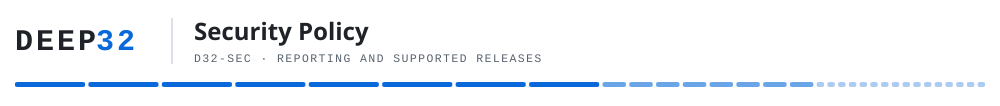

<div align="center">

<picture>
  <source media="(prefers-color-scheme: dark)" srcset="../docs/figures/head-security-dark.svg">
  <source media="(prefers-color-scheme: light)" srcset="../docs/figures/head-security-light.svg">
  
</picture>
<br>

</div>

How to report a security problem in Deep32, and which release gets the fix.

<sub>Applies to 0.1.0-alpha.3 · [1 Supported releases](#1-supported-releases) · [2 Reporting](#2-reporting-a-vulnerability) · [3 Scope](#3-scope) · [4 Security design](#4-security-design) · [5 Known limitations](#5-known-limitations) · [6 After a report](#6-what-happens-after-a-report) · [7 What to expect](#7-what-you-can-and-cannot-expect) · [8 Third-party components](#8-third-party-components) · [9 Maintainer accounts](#9-maintainer-accounts)</sub>

## 1. Supported releases

| Release | Status | Fixes |
|---|---|---|
| 0.1.0-alpha.3 | Current | Yes |
| 0.1.0-alpha.2 | Superseded | No: upgrade to the current release |
| 0.1.0-alpha.1 | Images withdrawn | No: upgrade to the current release |

Fixes go into the current release only. [Upgrading](../docs/UPGRADING.md) says how to move each part of an install to a
new release and what each part keeps.

## 2. Reporting a vulnerability

Please report privately, in either of two ways:

- Use **Report a vulnerability** on the repository's **Security** tab (GitHub private vulnerability reporting).
- Email [jacummings@acm.org](mailto:jacummings@acm.org), encrypted to the release key:

  ```text
  B205 B406 5486 27AA BF52  50D8 A078 C5F2 5D02 5DD6
  ```

Include the release, the part affected (Workstation, Forge, headend, release tools), what you did, what happened, and
the output of `bash install/deep32-setup.sh check` with any tokens removed. Please do not open a public issue for a vulnerability.

I'll confirm I got the report within 7 days and keep you posted while I work on a fix. Unless you'd rather not, I'll
credit you in the release notes. Section [6](#6-what-happens-after-a-report) says what happens after that.

## 3. Scope

In scope: everything in this repository and the signed images built from it, including the gateway, the engine,
pairing and publication, the installers, `deep32-get` and the release signatures.

Out of scope: Tailscale, Docker, NVIDIA's drivers and container toolkit, the language model providers, and the
documents in the corpus. Report problems in those to their owners. A document that tries to instruct the agent is
expected, since Deep32 treats retrieved text as untrusted. A way around that is in scope.

## 4. Security design

[Security considerations](../README.md#10-security-considerations) in the README describe the design, the design
document's [section 14](https://hellobpdu.github.io/deep32/tr/d32-tr-1.html#name-security-considerations) goes
through it threat by threat, and the [network contract](../docs/contracts/C8-network.md) specifies ports, tokens and
pairing in detail. The [assurance case](../docs/ASSURANCE-CASE.md) argues claim by claim why the design meets its security
requirements, and the [security review of November 2026](../docs/SECURITY-REVIEW-2026-11.md) records what I checked and
found.

## 5. Known limitations

These are known and accepted in this release. Reports that show one of them is worse than described are in scope.

- The language model provider sees each question, the passages the agent reads and the agent's reasoning.
- HTTPS certificates for Tailscale Serve put machine names in the public Certificate Transparency logs.
- Documents can carry text written to steer a model. Ingest review and the gateway's instructions reduce the risk;
  they don't remove it.
- On Linux and macOS, the Ask relay ends an agent by ending its process group, so a process that left the group could
  outlive cancellation. The agents run with their built-in tools off and start no tool processes. On Windows a job object
  ends every descendant.
- Whoever holds the release signing key can sign a release. The key is held by the author alone.
- Ask has no password of its own. Every account in the Workstation's `_d32users` group can use Ask, including the
  desktop user the installer creates, and each question counts against the plan of the agent signed in on the paired
  PC. The protection is on the link: the Workstation and the relay talk D32U/1 inside TLS 1.3, each side pins the
  other's certificate at pairing after you confirm ten words at the Workstation's console, and the link stays inside
  your Tailscale network on TCP port 7452. Add an account to `_d32users` only if that person may ask on your plan.

## 6. What happens after a report

1. **Received.** A report from the Security tab opens a draft security advisory that only you and the project's
   maintainers can see. For a report by email, I open the draft advisory myself and, if you have a GitHub account and
   want to, add you to it.
2. **Acknowledged** within 7 days.
3. **Triaged.** I reproduce the problem, check it against the scope in section 3 and rate its severity as low,
   moderate, high or critical, the scale GitHub advisories use. I tell you what I found. If I conclude it isn't a
   vulnerability in Deep32, I explain why, and you're free to open a public issue or take it to the component's owner.
4. **Fixed in private.** I work on the fix in the advisory's private fork, with a test that fails without the fix.
   If you'd like to check the fix before it's released, I'll share it with you there.
5. **Released.** A fix to the parts that change between releases (the setup scripts, the machine inventory and the
   agent adapters, as [CONTRIBUTING.md](CONTRIBUTING.md#43-what-changes-only-with-a-release) lists) arrives as a signed
   commit on `main`. A fix to code on the images arrives as new signed images in a new release. My target is a released
   fix within 60 days of the report for anything rated moderate or higher.
6. **Disclosed.** When the fix is out, I publish the advisory, ask GitHub for a CVE ID if the problem affects a
   release, and list the fix in the [release notes](../CHANGELOG.md). Please don't publish details yourself before the
   fix is released or 90 days have passed since your report, whichever comes first. If a fix needs longer, I'll tell
   you why and ask for more time; that's your decision.
7. **Credited.** The advisory and the release notes name you as the reporter, by name or handle as you choose, unless
   you ask me not to.

## 7. What you can and cannot expect

Deep32 is alpha software, and I maintain it alone. This is what its design protects and what it leaves to you.

**What the design protects:**

- **The images you download.** Every image and release file is covered by a checksum list signed with the release
  key, and `deep32-get` checks the signer's fingerprint before it uses any hash in the list, so a mirror can't swap an
  image without the check failing ([README section 11](../README.md#11-release-and-verification)).
- **Your credentials.** No image or file in this repository holds a secret key, token or password. Each machine makes
  its own, and a token leaves the machine that checks it only inside an authenticated pairing
  ([INSTALL.md section 11](../INSTALL.md#11-what-is-never-stored)).
- **Access between the parts.** Services listen on loopback and are reachable only from inside your tailnet, through
  the routes the installers set up: HTTPS for the services, TLS 1.3 for pairing and the Ask link. Tailscale Funnel is
  refused, so nothing is published to the public internet. Being in the tailnet isn't enough to use a service: two
  parts pair first with a short one-time code (ten words for the Ask link), and each service then checks the
  credential made for that pairing ([README section 10](../README.md#10-security-considerations)).
- **The Workstation.** Its firewall denies by default and lets it reach only your network's DHCP and DNS servers,
  Tailscale, time servers and Let's Encrypt (for the gateway's HTTPS certificate). System files can't be changed while
  it runs, and it is administered at its console. The one exception is the optional maintenance SSH, which is off
  unless you give the installer an Ed25519 public key; with a key, it accepts only that key, for root, from the tailnet
  address of the machine the Workstation is paired with. Features that would contact anything else, such as the web
  switch, ship off ([Optional features](../docs/OPTIONAL-FEATURES.md#4-network-egress)).
- **Ask sessions.** An agent started by the Ask relay can use the eleven Deep32 tools and nothing else
  ([agent adapters section 5](../adapters/README.md#5-the-ask-relay)).

**What it doesn't protect:**

- **Your questions from the model provider.** The provider sees each question, the queries the agent writes and the
  passages the tools return.
- **Your PC from an agent you connect directly.** An agent connected with Connect keeps its own tools and permissions,
  and a document that steers it can make it use them. A [separate agent profile](../adapters/README.md#3-use-a-separate-profile)
  with fewer permissions limits what it can do.
- **Credentials from an administrator of the machine.** Tokens and keys on the Workstation and the Forge are files that
  only the service that uses them can read, but they aren't encrypted. Root on the Workstation, an administrator or a
  member of the `docker` group on the Forge, or anyone with a copy of an unencrypted disk can read them. The guided
  install offers disk encryption; in a VM it is off unless you choose it
  ([DR-57](../docs/DECISIONS.md#dr-57-guided-install-defaults)).
- **Your tailnet.** Deep32 relies on your Tailscale account to decide which machines are in your tailnet. Someone who
  controls that account can add a machine, although the machine still has to pair before it can use a service.
- **Up-to-date third-party software on the images.** Each image's packages are fixed when it is built. The Workstation
  has no route to package mirrors and doesn't fetch OpenBSD's errata, so updated OpenBSD and container packages reach
  your install only in a new Deep32 release.

## 8. Third-party components

- **Listed.** [`notices/DEPENDENCIES.tsv`](../notices/DEPENDENCIES.tsv) lists the third-party components of the source
  with their version, origin and a note on how their license applies. The Python lock files pin exact versions with
  hashes, for example `adapters/relay/requirements.lock` and `src/workstation/pyrag/locks/`. Model files and container
  images in the GPU pack are pinned by digest, and each release image has a software bill of materials (SPDX 2.3).
- **Updated** by moving a pin or a lock file to the new version. The Ask relay's packages can change with a commit on
  `main`; components on the images change when the images are rebuilt for a release (section 7).
- **Watched.** OSV-Scanner checks every pinned Python package against the [OSV database](https://osv.dev) on each push
  and pull request and once a week ([`.github/workflows/osv-scanner.yml`](workflows/osv-scanner.yml)), and
  Dependabot proposes weekly updates to the GitHub Actions the workflows use
  ([`.github/dependabot.yml`](dependabot.yml)).
- **Triaged.** For each release I check every advisory OSV-Scanner reports in a pinned package against how Deep32 uses
  that package, and publish the result as an OpenVEX document in [`docs/security/`](../docs/security/README.md). For
  0.1.0-alpha.2 none of the 74 advisories affects Deep32, and the document gives the reason for each one.

## 9. Maintainer accounts

Anyone who can change this repository or read its private vulnerability reports, which means me and any co-maintainer
listed in [GOVERNANCE.md](GOVERNANCE.md#roles), must use two-factor authentication on their GitHub account with a
passkey, a security key or an authenticator app. A text-message code alone doesn't meet this. I give write access
only to an account that does. The release signing key isn't stored on GitHub.

---

<p align="center"><sub><a href="../README.md">Overview</a> · <a href="../INSTALL.md">Installation</a> · <a href="../docs/HARDWARE.md">Hardware</a> · <a href="../docs/OPTIONAL-FEATURES.md">Optional features</a> · <a href="../docs/tr/README.md">Design</a> · <a href="../docs/DECISIONS.md">Decision record</a> · <a href="../docs/contracts/README.md">Contracts</a> · <a href="../adapters/README.md">Agent adapters</a> · <b>Security</b> · <a href="../CHANGELOG.md">Release notes</a></sub></p>
