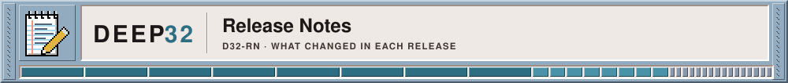

<picture>
  <source media="(prefers-color-scheme: dark)" srcset="docs/figures/head-changelog-dark.svg">
  <source media="(prefers-color-scheme: light)" srcset="docs/figures/head-changelog-light.svg">
  
</picture>
 

Releases, newest first. Versions follow [Semantic Versioning](https://semver.org), and each release is signed and
archived on Zenodo under [10.5281/zenodo.24272647](https://doi.org/10.5281/zenodo.24272647).

## 0.1.0-alpha.2 · 20 November 2026

The first release whose Workstation installs from its image and joins your own tailnet, and whose parts pair with each
other there by short code. Each machine also has a one-command setup script, which I haven't yet run from start to
finish; INSTALL gives every step by hand as well.

**Added**

- Three ways to give the Workstation disc 2. Besides an optical drive (or a VM's virtual CD), a USB stick of 32 GB or
  more with the disc 2 image written to it (balenaEtcher or `dd`), or over the network: in First Start, **Get Disc 2
  over the Network** downloads it from a PC on your tailnet, which sends it with the setup wizard's **Send disc 2** and
  a one-time code, or from the release mirror. The download resumes after a stop, shows its progress, waits on the
  empty system update slot and is deleted after the import. The import itself is unchanged: the signature first, then
  every file against the signed manifest.
- A setup wizard for bash and PowerShell (`install/deep32-wizard.sh`, `install\deep32-wizard.ps1`) that drives the
  setup scripts through the whole install with numbered steps, live progress and every error code explained. Its VM
  guide (`--vm-guide`) walks through the Workstation VM on Proxmox VE (boot-tested), Hyper-V, KVM, VMware Workstation,
  ESXi, VirtualBox or bare metal (all but Proxmox VE not boot-tested yet) and checks each step it can see. `--demo` shows
  it without changing anything.
- Installing with an agent: in a clone, Claude Code's `/deep32-install` or Codex's `$deep32-install` walks you through
  the wizard on each machine and stops at every step that needs you ([AGENTS.md](AGENTS.md)).
- A project site at https://hellobpdu.github.io/deep32/ with a step-by-step general setup and an advanced install guide.
- Ask lets you choose the model and the strength for each conversation. A Claude Code relay offers the models Claude
  Code lists for its profile (default, opus, fable, sonnet and haiku with Claude Code 2.1.326) and the effort levels
  low, medium, high, xhigh and max, with default first; a Codex relay offers its one checked model and effort. An
  answer has no time limit of its own; it runs until the agent is done, within the relay session's one hour. The
  limit was 170 seconds, and a researched question at xhigh ran past it. The relay answers one question at a time
  ([adapters/README.md section 5](adapters/README.md#5-the-ask-relay)).
- Ask's agent follows the same research skill that Connect installs, inlined because it can't open files. Before,
  it had a short summary of that skill, and its answers were much thinner than the same question through Connect.
- The research skill has a map of the ENARSI 300-410 and CCIE Enterprise Infrastructure exam topics: each topic
  with its RFCs, Cisco documents and where to look. The agent searches it first to find the governing documents.
  The topic titles are Cisco's published exam topics; the mappings are mine.
- `install/deep32-setup.sh`: one command per machine that checks it, fixes what it safely can, downloads and installs
  its part, and stops only for a sign-in, the installer's plan and the pairing code. AGENTS.md tells Claude Code or
  Codex how to run it for you.
- `install/deep32-setup.ps1`, the same one command for Windows: a Forge on Docker Desktop, a Workstation on Hyper-V,
  or a headend. Both setup scripts check the card's memory and the host's Python before they download anything.
- The Forge installs from the signed disc 3 images. `deep32-get` joins the shared core, your card's embedder and the
  ingestion image into one verified copy, and the installer checks the host before it writes anything: the host
  recipe, the driver and memory floors, the ports, the free space against a signed storage budget, and your tailnet.
- `install/forge-host-python.sh`: checks the Forge host's Python for the pairing helper and installs it where the
  distribution allows.
- Pairing by short code between the parts, and publication of each part's services on your tailnet with routes Deep32
  owns and removes cleanly.
- Configurable service ports, with a check that refuses to take a port or route another service already uses.
- Isolated agent profiles, for a PC that already has Claude Code or Codex configured for other work.
- The Ask relay for Windows, Linux and macOS: questions typed in the Workstation's Ask window are answered by the agent
  on your PC, which can only search the corpus while it does. Pairing and the link work, and on a Linux headend a
  question sent to the relay completes with Claude Code 2.1, tool call and answer included. See the known issues for
  Ask from the Workstation.
- A software bill of materials (SPDX 2.3) for every image.
- The design document [D32-TR-1](docs/tr/README.md) and the [Decision Record](docs/DECISIONS.md).
- The script that builds the Workstation's install medium, `src/workstation/ship/tools/mkimage-ship.sh`, is now part of
  the published source.
- [CONTRIBUTING.md](CONTRIBUTING.md), with a Developer Certificate of Origin sign-off on every commit; a code of conduct
  based on the Contributor Covenant 2.1; and [GOVERNANCE.md](GOVERNANCE.md), with the project's roles, how decisions
  are made and how changes are reviewed.
- Continuous integration on GitHub. The Tests workflow fails on any new Ruff or Bandit finding and runs every test
  suite on Windows with Python 3.12. The Coverage workflow, and `make coverage` on a clone, measure statement and
  branch coverage of the Python. [docs/BUILDING.md](docs/BUILDING.md) says how to build and test locally.
- The existing test suites for the engine, the gateway, the GPU pack kit, the disc 3 pin resolver and `exact_local`,
  now published under `tests/`. With them the suites cover 54.0% of the statements and 46.0% of the branches in the
  487 Python files under `src/`, `adapters/` and `install/`, tests excluded (measured 19 November 2026 on Windows with
  coverage.py 7.17.3, branch coverage on).
- Fuzz targets for the Workstation's C parsers: 17 libFuzzer targets built with AddressSanitizer and
  UndefinedBehaviorSanitizer, run in CI on every push and pull request and for longer once a week
  ([tests/fuzz](tests/fuzz/README.md)).
- `REUSE.toml`, which records the copyright holder and license of every file in the REUSE 3.3 format.
- The [roadmap](docs/ROADMAP.md) through November 2027, and a guide to [upgrading](docs/UPGRADING.md) an install to a
  new release.

**Changed**

- Pairing on the PC shows what you type. At the relay's prompt each of the ten words appears as you type it and is
  checked when you press Space or Enter; a slip is asked for again, and a different pairing word stops the attempt with
  nothing stored. Connect's one-time code stays hidden but shows a dot for each character.
- The Workstation reads disc 2 once, in two parts, and search works long before the Library is in. The import checks
  the signature first. Then it copies and checks only what search needs, the knowledge base and the corpus records
  (about 1.5 GB of the 19.6 GB disc), installs the knowledge base and switches it on by itself: search, Ask,
  publication and pairing work from then on, about 8 minutes after sign-in on my lab VM. The
  Library (the encyclopedia, the Cisco papers, the RFC shelf) follows in the same run in the background, at a lower
  priority, and switches on when all of it has checked out. Each file is checked against the signed manifest
  (size and SHA-256) as it is copied, nothing is used before its own part has checked out, and a stop resumes
  where it stopped. If the Library part fails, the knowledge base stays in use and the Import Report says so
  (`IMPORT_KB_ONLY`). Until now the import read the whole disc twice and nothing worked until all of it was in,
  about 2.5 hours on my lab VM; a complete import now takes about 2 hours there, most of it the Library.
- On Windows without Hyper-V, `install\deep32-setup.ps1 workstation` writes the raw-image VM kit for VirtualBox or
  VMware instead of stopping.
- The GPU pack is one Linux Docker form on every host. On Windows it runs through Docker Desktop or in an Ubuntu 24.04
  WSL 2 distro.
- The GPU pack is a shared core plus one small add-on for your card's generation and an ingestion add-on with the PDF
  converter and index builder. A Forge needs all three, about 37.1 GB: the 18.6 GB core, a 3.1 to 3.3 GB embedder
  and the 15.3 GB ingestion image.
- A Forge needs at least 10.5 GB of graphics memory, an 11 GB card or larger. Smaller cards come back once reranking
  and the converter are measured on them.
- Images download whole from permanent mirrors listed in a signed index; `deep32-get` falls through the mirrors and
  resumes interrupted downloads.
- The Forge installer now accepts three host setups under a dated owner waiver, ahead of their full install runs:
  Ubuntu 24.04 with Docker Engine, on the host itself or in WSL 2, for journeys J2 and J4, and Windows 11 with Docker
  Desktop for journey J1. When a host matches a waived setup, the installer prints a note that says so and names
  the signed file that lists what wasn't run. Every other host check is unchanged.
- The Windows setup is matched by version floors: Windows 11 build 26100 or later in the Home, Pro, Enterprise or
  Education edition, and Docker Desktop 4.99.0 or later with Docker Engine 29.0.0 or later on the WSL 2 backend.
  Windows 10 and Windows Server are refused.
- The GPU pack's storage budgets are declared upper bounds, computed from the image sizes and labeled as declared in
  the installer's plan. I plan to replace them with measured budgets in a signed revision. A Forge with the core, one
  embedder and the ingestion image declares about 244 to 247 GB when its data folder and Docker's storage share one
  Linux filesystem or one Windows volume. The installer checks that budget again after it has joined the downloaded
  images, about 37 GB, so that disk needs about 281 to 284 GB free when the install starts.
- Deep32's code is now under the Apache License 2.0, with a NOTICE file whose attribution goes with every copy and
  every changed version ([DR-110](docs/DECISIONS.md#dr-110-apache-20-with-a-notice-file-for-code)). The two parts that
  use MuPDF, which is AGPL, stay under AGPL-3.0-or-later: the Forge's PDF converter and the Workstation Library's
  renderer, `e26-render`. Documentation stays under CC BY 4.0.
- Every image carries the license texts. The Workstation has LICENSE, NOTICE, the AGPL text and the third-party
  notices in `/usr/local/share/doc/d32`. The content image's `/code` folder holds a README, LICENSE, NOTICE and the
  AGPL text in place of the alpha.1 source archive. The GPU pack ships LICENSE and NOTICE
  with every copy of Deep32's code, and MinerU's license with the converter.
- The PDF converter uses MinerU 4.0.7, which is under the MinerU Open Source License: Apache-2.0 with additional
  terms. If you and your affiliates together have more than 100 million monthly active users or more than USD 20
  million in total monthly revenue, commercial use needs a separate commercial license from the MinerU team, and an
  online service for third parties built on MinerU must say that it uses MinerU. The license text is in
  `src/gpu-pack/licenses/`.
- The content image is rebuilt as 0.1.0-alpha.2 with the same corpus and search index. Deep32's own documents in it
  are labeled Apache-2.0 and CC BY 4.0, and it stays about 19.6 GB. I built it twice from the same staged files and
  the two images were byte-identical. Its software bill of materials lists every file on it.
- Cisco documentation is labeled with its copyright and its source in the content image's corpus and Library records
  and third-party notices, and with its copyright on the Workstation's Cisco papers page. This replaces the alpha.1
  wording about permission and personal use.

**Fixed**

- The guided install's last status line tells you to turn the machine off and remove the install medium. It said the
  machine powers off, but on the Proxmox virtual machines I tested the installer halts and the machine stays on.
- The Ask guide on the Workstation (`/usr/local/share/doc/d32/ASK.txt`) describes this release's Ask: the relay on the
  paired PC picks the engine and offers the models and strengths, `/engine` only sets the label, and the `work` link
  pairs at the text console by comparing ten words.
- The Workstation image now includes the Tailscale package. Without it, the alpha.1 Workstation could not join a
  tailnet.
- At first start the Workstation shows the Tailscale sign-in address on the text console, on the serial port and in
  the First Start window. Tailscale's status output ends without a newline, and the first-start check never saw
  the state Tailscale reported, so no address appeared and disc 2 was never imported by itself.
- After you sign in, the Workstation finds disc 2 in a CD drive and imports it by itself. In a fresh install on a lab
  VM on 19 November 2026, the import started 15 seconds after the Workstation joined the tailnet.
- The Workstation imports all of disc 2. On alpha.1 the import could not finish: its scripts were not executable, the
  image had no release key to check disc 2's signature, and the importer failed on its own read-only disc mount. The
  importer also miscounted the corpus pack, which carries a file of its own named `MANIFEST.tsv`. An alpha.2
  Workstation accepts the unchanged alpha.1 content image.
- The First Start, Import Report and Pairing entries in the desktop's Application Manager open their windows. They
  were installed without the execute permission CDE needs to run an entry.
- The Ask link service no longer prints `d32chat(failed)` at boot before an Ask relay is paired.
- The Ask relay starts after a turn that ended while Claude Code was writing one of its built-in plugin records.
  That left an empty lock folder in the relay's own profile, and the relay took it for a customised profile and
  refused to start (`native-profile-customised`).
- First Start's hint for a switched-off link gives the command with the full path that `doas` accepts:
  `doas /usr/local/d32/sbin/d32-link enable`.
- The Forge's model servers start on an offline host. The alpha.1 GPU pack shipped both model caches without the
  pointer files the loaders look up, so neither the embedding model nor the reranker could load without internet
  access.
- PDF conversion on the Forge works. The alpha.1 converter image lacked the graphics libraries and the Accelerate
  package that MinerU loads, and the installed model folder lacked the empty folder the converter mounts for its lock
  files, so a job stopped before the first page. On 19 November 2026 the alpha.2 ingestion image converted a one-page
  PDF with `--tier standard` on an RTX 2080 Ti in about 2 minutes 22 seconds, with Docker Engine 29.1.3 in an Ubuntu
  24.04 WSL 2 distro. I haven't yet run a conversion with the default `--tier advanced`, in Docker Desktop on Windows,
  or in a full Forge install with pairing.
- Guided install: the root SSH key question no longer fails with `printf: not found`; the root disk question no longer
  offers the install medium as its default; the keyboard question accepts Enter for the default.
- The guided install stops when it finishes. Before, it restarted into the installer. It now halts at
  `Please press any key to reboot.`; turn the machine off there and remove disc 1 before you start it.
- The Workstation's firewall allows the Ask link on the relay's port, 7452.
- The published source now builds the Deep32 Library: a generated document-type table the build needs was missing.
- The files the Workstation image installs from the published `distrib/site` and `ship/site` folders match the
  published source byte for byte, except three. The image's `/etc/rc.local` comes from a build overlay outside the
  published source and doesn't run `d32-publish resume` at boot. From the code, publication survives a restart without
  it, but I haven't tested that yet. The firewall table `/etc/d32/pf/relay_hub` differs in a comment, and on the image
  `/etc/d32/pf/ts_infra` holds the address list that the published copy leaves empty.
- A paired Forge now serves meaning search and reranking. Before, the Workstation couldn't read the Forge's token,
  pairing never opened the firewall to the Forge, and the model check only accepted the exact numbers of one graphics
  card; it now allows the small differences between card generations. The firewall also let no pairing connection
  reach the Forge.
- The Workstation publishes its gateway over HTTPS. Its resolver no longer fails every lookup behind routers that strip
  DNSSEC records, it can reach Let's Encrypt for the certificate, and publication checks the gateway in a way that
  works on OpenBSD.
- Pairing with the Ask relay sets up the Workstation's Ask link: its address, firewall entry, identity and gateway
  token. The relay's Linux service unit loads, and Connect waits a few seconds for the gateway to load a new
  credential instead of failing right after pairing.
- The Ask relay accepts the `rate_limit_event` that Claude Code now reports while it answers. A question used to stop
  with `native-output-failed` right after the agent's first tool call.
- The Ask relay names a signed-out agent. When the agent's sign-in is missing or refused, at start or during a
  question, the relay reports `agent-sign-in-required`; before, it passed Claude Code's "Failed to authenticate" line
  on as the answer. The relay's install check also answers with the server details Claude Code requires, so its live
  self-test can start.
- The Ask relay's service keeps running after you remove and reinstall the relay, or restart it soon after a
  Workstation link closed. The install now starts the service only after it has written everything, and the relay
  waits up to 90 seconds for its port while a just-closed link still holds it. Before, systemd gave up after three
  quick failures, and on Windows the relay stayed down until the next sign-in.
- Ask questions reach the relay. Ask sent an engine name with each new conversation, and the Workstation's chat broker
  refuses that, so every question ended in `Error 1 PROTOCOL`. The relay on the paired PC picks the engine, and
  `--engine` and `/engine` now only set the label in Ask's header. When you don't name a link, Ask uses the
  Workstation's own, `work`; it asked for `home`, which alpha.2 doesn't configure. The Ask window opens straight to the
  question box. Before, it waited at a password prompt that this release's broker doesn't support.
- `deep32 doctor --role headend` loads and runs on Python 3.12 and 3.13. Before, it stopped at an import error on any
  Python older than 3.14.

**Security**

- This release fixes no publicly known vulnerability.
- I checked every advisory OSV-Scanner reports for a package Deep32 pins, 74 advisories in 11 package versions,
  against how Deep32 uses that package. None affects Deep32 as built. The result is an OpenVEX document in
  [docs/security](docs/security/README.md), and the OSV-Scanner workflow applies it on every push and pull request to
  the main branch and once a week. Its exceptions expire on 19 February 2027, so a finding that is still there by then
  shows again. The check doesn't cover the Debian packages inside the GPU pack's images, native libraries inside
  Python wheels or the Workstation's OpenBSD packages; section 4 of that page says more.
- CodeQL analyzes the Python and C code on every push and pull request to the main branch and once a week, OpenSSF
  Scorecard checks the repository's practices once a week, and Dependabot keeps the actions the workflows use up to
  date.
- The [assurance case](docs/ASSURANCE-CASE.md) argues claim by claim why the design meets its security requirements,
  and the record of the [security review of November 2026](docs/SECURITY-REVIEW-2026-11.md) says what I checked and
  found.

**Known issues**

- The guided installer prints a status line between asking a question and asking it again. A key typed in that
  moment can be lost, and in my lab runs the installer twice stopped reading keys after it. If it stops responding,
  restart the VM: the installer starts over. Answer each question once it is the last line on the screen.
- The disc 2 import copies the Library, most of the disc, into the Library partition before it installs it, and
  needs that much plus 5% free there. The guided install sizes that partition from the disk, so the Workstation now
  needs a disk of 200 GB or more. On a smaller disk the knowledge base still goes into use, and the Library stops
  with IMPORT_SPACE before any of it is copied. The VM commands that `deep32-get --prepare-vm` writes still make a
  160 GB disk; change that to 200 GB before you run them. 0.1.0-alpha.3 stages the copy where there is more room and
  fixes the commands.
- The GPU pack's rebuilt images are stored uncompressed, so a Forge downloads about 37 GB instead of about 26.5 GB,
  and because the installer's space check reserves room for unpacking at a factor set for compressed archives, a Forge
  on one disk needs about 281 to 284 GB free at the start. The contents are the same. 0.1.0-alpha.3 stores the images
  compressed again and corrects that factor.
- The installer checks free space twice, before it joins the images and again after it has written the joined copy.
  The second check still asks for the whole budget, including room for the joined copy that is already on disk, so
  the joined copy, about 37 GB, has to be free on top of the budget when the install starts. INSTALL section 5 has the
  figures. I'll correct the second check in 0.1.0-alpha.3.
- The Ask window has no password of its own in this release. In it the relay on the paired PC picks the engine, so the
  window can't switch the engine for each conversation or sign in to Codex. [SECURITY.md section 5](SECURITY.md#5-known-limitations)
  says who can use Ask. The per-window password returns with a later Workstation release.
- Stop the Ask relay service before pairing (`systemctl --user stop 'deep32-relay-<id>'` on Linux), then start it
  again afterwards. Publish the gateway before pairing the relay. Unpublishing it stops Ask until you publish again.
  To pair a different relay, remove the old one first (`/usr/local/d32/sbin/d32-chatctl unpair work`).
- If the Forge's five-minute pairing window closes before you pair, its services keep running but it records itself
  as stopped; start it again to open a new window.
- `deep32 doctor` and `deep32 selftest` are on the images but don't work yet: doctor doesn't read the install record,
  so it always reports the installation check as failed, and selftest has no signed reference values. Both are
  planned for alpha.3. `deep32-setup.sh` checks an install meanwhile.
- The Forge's pairing helper runs on the host's `/usr/bin/python3`, so a host whose system Python is missing, broken or
  older than 3.10 can't pair. Unraid is one. `install/forge-host-python.sh` checks a host and installs Python where
  the distribution allows it.
- Revoking a paired Workstation on the Forge leaves the Forge unable to restart. Until alpha.3, revoke by reinstalling
  the Forge into a new data folder.
- The Workstation offers only machines whose Tailscale name starts with `deep32-` and that are in its own tailnet, for
  both the Forge and the Ask relay. INSTALL and the Agent Adapters page say so.
- The Forge's images load only into Docker's classic image store, and Docker Engine 29 and Docker Desktop default to
  containerd. The installer and the setup scripts stop with how to switch; INSTALL section 5 has the details.
- At boot the Workstation lists `kiwix_serve(failed)` among its services until disc 2 is imported. The encyclopedia
  server has no library to serve before then; the import starts it.
- The Forge install on Linux, in WSL 2 and on Docker Desktop ships under the owner waiver above, before its full
  end-to-end acceptance run, and with declared storage budgets. Its parts were each checked on an RTX 2080 Ti;
  INSTALL section 5 lists what.
- The fuzz targets found five low-severity defects in the Library's JSON, WAVE and RFC text readers. Their fixes are
  planned for alpha.3; section 5 of the [fuzzing page](tests/fuzz/README.md#5-findings) describes each one.
- The repository doesn't pass the REUSE check yet. `REUSE.toml` records every file's license, but the REUSE format
  expects the license texts in `LICENSES/`. Moving them from `licenses/` changes the Workstation image build, so it is
  planned for alpha.3.
- Deep32 has one maintainer, and I review every change myself. From alpha.3 on, changes reach the main branch through
  pull requests, and once a co-maintainer joins, at least half of the changes in each release are reviewed by someone
  other than their author ([GOVERNANCE.md](GOVERNANCE.md#reviews)).
- The archive item's collection is Community Texts; it should be Community Data. Downloads aren't affected.

**Removed**

- The separate WSL 2 form of the GPU pack. Windows hosts run the same Linux Docker form as every other host.
- Split image parts on the GitHub release.

## 0.1.0-alpha.1 · 16 November 2026 · images withdrawn

First public release, with the source under AGPL-3.0 and three signed images. The images downloaded and verified, but
the install did not yet join the Workstation, the GPU pack and the agent end to end, so I withdrew them on
17 November 2026. The source stays archived at [10.5281/zenodo.24272648](https://doi.org/10.5281/zenodo.24272648).

---

<a href="README.md">Overview</a> · <a href="INSTALL.md">Installation</a> · <a href="docs/HARDWARE.md">Hardware</a> · <a href="docs/OPTIONAL-FEATURES.md">Optional features</a> · <a href="docs/tr/README.md">Design</a> · <a href="docs/DECISIONS.md">Decision record</a> · <a href="docs/contracts/README.md">Contracts</a> · <a href="adapters/README.md">Agent adapters</a> · <a href="SECURITY.md">Security</a> · <b>Release notes</b>

