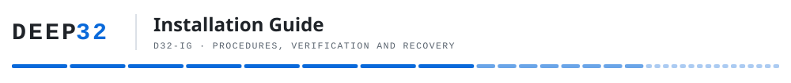
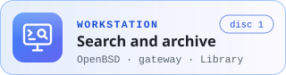

<div align="center">

<picture>
  <source media="(prefers-color-scheme: dark)" srcset="docs/figures/head-install-dark.svg">
  <source media="(prefers-color-scheme: light)" srcset="docs/figures/head-install-light.svg">
  
</picture>
<br>

</div>

How to install Deep32 0.1.0-alpha.3, from checking your machines to a first question your agent answers from the
corpus. Plan on an afternoon, most of it downloading.

<sub>Applies to 0.1.0-alpha.3 · [1 Layout](#1-choose-a-layout) · [2 Check](#2-check-your-machines) · [3 Source](#3-get-and-verify-the-source) · [4 Download](#4-download-the-images) · [5 Forge](#5-install-the-forge) · [6 Workstation](#6-install-the-workstation) · [7 Tailscale](#7-tailscale) · [8 Pair](#8-pair-the-parts) · [9 Verify](#9-verify) · [10 Afterwards](#10-afterwards) · [11 Never stored](#11-what-is-never-stored)</sub>


**Quick start.** On each machine, clone the repository and run one command. It works out whether the machine
should be the Forge, the Workstation's host or the headend, checks it, fixes what it safely can with your consent,
downloads and verifies the images, and installs. It stops only for a Tailscale sign-in, the installer's plan and the
pairing code:

```sh
git clone https://github.com/hellobpdu/deep32.git && cd deep32
bash install/deep32-setup.sh
```

On Windows, from PowerShell (elevated for a Forge):

```powershell
git clone https://github.com/hellobpdu/deep32.git; cd deep32
powershell -NoProfile -ExecutionPolicy Bypass -File install\deep32-setup.ps1
```

`check` as the first argument only checks; it changes nothing. If Claude Code or Codex runs on the machine, open it
in the clone and ask it to set up Deep32: [AGENTS.md](AGENTS.md) tells it to run the same script and pass you only the steps that need
you. The sections below do the same by hand and explain each step. I haven't yet run the setup scripts from start
to finish on a clean machine, so the sections below are the tested path.

## 1. Choose a layout

A deployment has three parts: the Workstation (an OpenBSD VM or machine with the index), the Forge (the NVIDIA host
that runs the search models) and the headend (the PC where Claude Code or Codex runs). They can share machines. Pick
the layout, or journey, that matches what you have:

| Journey | Machines | Workstation | Forge | In 0.1.0-alpha.3 |
|---|---|---|---|---|
| J1 | Two Windows PCs | Hyper-V VM on the first | Docker Desktop on the second | Not yet run end to end |
| J2 | A Windows PC and a Linux NVIDIA host | Hyper-V VM on the Windows PC | Docker on the Linux host | The Linux Forge is tested; the Hyper-V Workstation isn't yet |
| J3 | One Linux NVIDIA host, no desktop | None: engine and gateway run in Docker | Docker on the same host | Not in this release: its image isn't among the downloads |
| J4 | One Linux NVIDIA host | KVM VM on the same host | Docker on the same host | The tested parts: a KVM Workstation and a Docker Forge on Linux |

What I have run is a Workstation in a KVM virtual machine (on Proxmox) with a Forge on a separate Linux host. The
other rows put the same parts in different places.

The headend can be any of these machines or another PC. [docs/HARDWARE.md](docs/HARDWARE.md) has sizes, supported
cards and hypervisor settings.

## 2. Check your machines

The inventory reports what a machine can run and changes nothing. Run it on each machine with the role it will play:

```sh
bash install/deep32-inventory.sh --journey J4 --role all --check-prereqs
```

```powershell
powershell -NoProfile -ExecutionPolicy Bypass -File install\deep32-inventory.ps1 -Journey J1 -Role workstation-host -CheckPrereqs
```

Roles are `workstation-host`, `gpu-host`, `all` and `agent`. The report ends with a verdict for that role and, for a
GPU host, the card class you'll pass to `deep32-get` in section [4](#4-download-the-images). Anything missing is
listed with what to install.

## 3. Get and verify the source

Clone the repository at the release tag and check the tag's signature:

```sh
git clone --branch v0.1.0-alpha.3 https://github.com/hellobpdu/deep32.git
cd deep32
gpg --import install/release-key.asc
git verify-tag v0.1.0-alpha.3
```

The signing key's fingerprint must be `B205 B406 5486 27AA BF52  50D8 A078 C5F2 5D02 5DD6`, as printed in the
README. Use the scripts from this verified clone for every step below.

## 4. Download the images

`deep32-get` downloads an image, checks it against the release's signed metadata, and keeps it only if every check
passes. It tries the Internet Archive first and then each mirror in the signed list, and it resumes an interrupted
download from the last verified 64 MiB chunk.

| Image | Needed for | Command |
|---|---|---|
| Disc 1, Workstation | J1, J2, J4 | `bash src/release-tools/deep32-get.sh disc1` |
| Disc 2, content | Every journey | `bash src/release-tools/deep32-get.sh disc2` |
| Disc 3, Forge GPU pack | Forge installs | `bash src/release-tools/deep32-get.sh disc3 --gpu-class CLASS`, with `--ingestion` for the PDF converter and index builder |

On Windows use `src\release-tools\deep32-get.ps1` with the same arguments. Files go to `./deep32-downloads` unless you
give `--to DIR`.

For disc 3, use the class for the compute capability reported by
`nvidia-smi --query-gpu=compute_cap --format=csv,noheader`.

| Compute capability | Disc 3 class |
|---|---|
| 7.5 | `turing` |
| 8.0 | `ampere80` |
| 8.6 or 8.7 | `ampere86` |
| 8.9 | `ada` |
| 9.0 | `hopper` |
| 10.0 | `blackwell100` |
| 12.0 | `blackwell120` |

For disc 3 you get the shared core (18.6 GB) and your card's embedder (3.1 to 3.3 GB), and with `--ingestion` the
ingestion image (15.3 GB), which carries the PDF converter and the index builder: 21.7 to 21.9 GB without it, about
37.1 GB with it. You need ingestion only to convert PDFs or build indexes of your own. On Windows, `deep32-get.ps1`
still downloads all three. Disc 1 is 1.9 GB and disc 2 is 19.6 GB; disc 2 is the content image of 0.1.0-alpha.2,
unchanged.

If every mirror fails, `deep32-get` prints the image's torrent address from the signed metadata. Download it with
any torrent client, then check it with `--from DIR`, which verifies files you already have without downloading.

> [!NOTE]
> You don't have to trust `deep32-get`. The release metadata is signed with the key from section 3, and the README's
> [section 11](README.md#11-release-and-verification) shows how to check an image by hand with `gpgv` and SHA-256.

<a id="5-install-planned"></a>

## 5. Install the Forge

<picture>
  <source media="(prefers-color-scheme: dark)" srcset="docs/figures/part-forge-dark.svg">
  <source media="(prefers-color-scheme: light)" srcset="docs/figures/part-forge-light.svg">
  
</picture>

The Forge is the NVIDIA machine that runs the two search models: one turns text into vectors for meaning search, the
other reranks the best candidates. It runs as Docker containers behind one authenticated door, on a Linux host, in an
Ubuntu 24.04 WSL 2 distro on Windows, or in Docker Desktop on Windows.

> [!IMPORTANT]
> Check these first. Each one decides whether the install or the pairing works later.
>
> - **The host.** In 0.1.0-alpha.3 the installer accepts Ubuntu 24.04 on amd64 with Docker Engine, on the host itself
>   or as a WSL 2 distro, for journeys J2 and J4, and Windows 11 build 26100 or later (Home, Pro, Enterprise or
>   Education) with Docker Desktop 4.99.0 or later and Docker Engine 29.0.0 or later on the WSL 2 backend, for J1.
>   It stops on any other system, Windows 10 and Windows Server included.
> - **Free space.** About 244 to 247 GB free when you start for a Forge with ingestion, if the data folder and
>   Docker's storage share one filesystem or volume. **Disk space** below has the figures for other layouts.
> - **The card.** Compute capability 7.5 or newer and at least 10.5 GB of graphics memory, so an 11 GB card or larger
>   ([docs/HARDWARE.md](docs/HARDWARE.md#5-graphics-card)).
> - **Its Tailscale machine name starts with `deep32-`**, for example `deep32-forge`. The Workstation only offers
>   machines named that way. Rename it on the admin console's Machines page or with
>   `sudo tailscale set --hostname deep32-forge`.
> - **It is in the same tailnet as the Workstation.** A machine shared in from someone else's tailnet is never
>   offered for pairing.
> - **Docker's image store.** On Linux and in WSL 2, Docker Engine can keep its default containerd image store, with
>   the system's containerd running (the installer checks that it is), or use the classic store (`overlay2`). If you
>   moved containerd's `root` in `/etc/containerd/config.toml`, the space check measures the wrong filesystem. Docker
>   Desktop still needs the classic store: turn off **Use containerd for pulling and storing images** under Settings,
>   General. Images and containers you keep in the other store stay hidden until you switch back, so the installer
>   never changes this for you.
> - **Python.** The installer needs Python 3.12 or newer, and from 0.1.0-alpha.3 the pairing helper runs on that same
>   Python, so the host's own `/usr/bin/python3` doesn't matter any more.
> - **One Docker engine per WSL VM.** Every WSL 2 distro shares one network stack. If another Docker engine runs in
>   another distro and sets its `FORWARD` policy to `DROP`, traffic between the Forge's containers is dropped and the
>   door reports unhealthy. Run one engine, or add `DOCKER-USER` accept rules for the Forge's bridges.

**The short way.** One command checks all of that, downloads and verifies the images, installs the Forge,
checks its door and shows the pairing code:

```sh
bash install/deep32-setup.sh forge
```

```powershell
# from an elevated PowerShell, with Docker Desktop running
powershell -NoProfile -ExecutionPolicy Bypass -File install\deep32-setup.ps1 forge
```

**By hand.**

1. Put the images from section [4](#4-download-the-images) in one folder with the five signed files of the same
   release: `SHA256SUMS`, `SHA256SUMS.sig`, `MIRRORS.json`, `CAPABILITIES.json` and `FORGE-PREREQUISITES.json`. If you
   downloaded with `deep32-get`, they are already in `./deep32-downloads`, the signed files in its
   `.deep32-v0.1.0-alpha.3/revision-*` snapshot.
2. Run the installer. On Linux:

   ```sh
   sudo bash src/release-tools/deep32-get.sh disc3 --gpu-class CLASS --install --journey J2 --data-root /opt/deep32 --from ./deep32-downloads
   ```

   In WSL, keep your `PATH`: WSL puts `nvidia-smi` in `/usr/lib/wsl/lib`, which `sudo` drops, and without it the
   GPU checks fail with exit 10:

   ```sh
   sudo env "PATH=$PATH" bash src/release-tools/deep32-get.sh disc3 --gpu-class CLASS --install --journey J2 --data-root /opt/deep32 --from ./deep32-downloads
   ```

   On Windows, from an elevated PowerShell with Docker Desktop running:

   ```powershell
   powershell -NoProfile -ExecutionPolicy Bypass -File src\release-tools\deep32-get.ps1 disc3 --gpu-class CLASS --install --journey J1 --data-root C:\Deep32 --from .\deep32-downloads
   ```

3. The installer checks the host before it changes anything: the host recipe and the driver and memory floors in
   `FORGE-PREREQUISITES.json`, that the Forge's ports are free (or already this Forge's), and the free space against
   the signed storage budget. It asks you to confirm the tailnet the Forge will publish on, and to agree that its name
   goes into the public Certificate Transparency logs. Then it shows its plan, with the folders, the ports and the size
   and SHA-256 of each image, and waits for you to type the plan digest.

   Each host type in the list above is accepted for this release under an owner waiver (see the note below), so the
   host check prints one line just before its result. On Ubuntu 24.04 for J2 it reads:

   ```text
   Note: this host type is accepted for 0.1.0-alpha.3 under an owner waiver dated 2026-11-18 (recipe ubuntu-24.04-docker-engine-j2). I have not yet run a full install on it; FORGE-PREREQUISITES.json lists what was not run.
   ```

   For J4 the recipe is `ubuntu-24.04-docker-engine-j4`, and on Windows `windows-11-docker-desktop-wsl2-j1`. The line
   doesn't stop the install.
4. It joins the images into one verified copy, loads the Docker images and starts the embedding and reranking
   services behind one door. The PDF converter runs only for a conversion job; while it runs, the Forge pauses the two
   models and brings them back afterwards.

On Windows, give `--docker-storage-path DIR` if Docker Desktop keeps its disk image somewhere other than its default,
so the space check looks at the right drive.

**Disk space.** The installer compares free space with the storage budget signed into the release. For 0.1.0-alpha.3
the budgets are declared upper bounds: I computed them from the sizes of the images, with a margin over what my test
runs used, and the check line ends with `(declared upper bound; no measurement yet)`. The installer checks twice,
before it joins the images and again after it has written the joined copy, and from 0.1.0-alpha.3 the second check
counts the joined copy that is already on disk. So have the budget free when you start. With ingestion:

| Where the Forge writes | Budget |
|---|---|
| Linux, data folder and Docker's storage on one filesystem | 244.0 GB |
| Linux or Windows, the data folder on a filesystem or volume of its own | 123.8 GB |
| Linux, Docker's storage on a filesystem of its own | 120.2 GB |
| Windows, data folder and Docker Desktop's disk image on one volume | 246.2 GB |
| Windows, Docker Desktop's disk image on a volume of its own | 122.5 GB |
| Windows, inside Docker Desktop's virtual disk | 176.8 GB |

A Linux Forge without ingestion needs less, because neither the ingestion image nor its Docker images are written.

The figures are for a `turing` card; the other classes need up to about 1 GB more. GB here means 10⁹ bytes; `df -h`
and Windows count in GiB and show numbers about 7% smaller. The joined copy goes beside the data folder, in
`/opt/deep32.deep32-media` for `/opt/deep32`, so if the data folder is a mount point of its own, the joined copy lands
on the filesystem above it. On 18 November 2026, joining the earlier alpha.2 images for a `turing` card and loading
them into Docker Engine 29.1.3 in an Ubuntu 24.04 WSL 2 distro used 26.1 GB for the joined copy and at most 27.0 GB
on Docker's side. The released images carry the door, reranker, index builder and converter with uncompressed layers,
so their joined copy is about 10.7 GB larger than in that run.

> [!NOTE]
> The Forge install ships before its full end-to-end run from the signed release, so I accept the host types above
> under an owner waiver for this release, and the installer says so. Its parts were each checked on one RTX 2080 Ti in
> an Ubuntu 24.04 WSL 2 distro: the images and their join, both models, and the Workstation's check of both models.
> On Windows the images were joined and loaded into Docker Desktop; no model has run there yet.
> `FORGE-PREREQUISITES.json` lists what wasn't run for each host type. This release's ingestion image converted a
> one-page PDF with `--tier standard` on the same card in about 2 minutes 22 seconds, with Docker Engine in that
> distro; the default `--tier advanced` and Docker Desktop on Windows haven't run a conversion yet. Please report
> anything that fails as a GitHub issue.

**Verify.** The door answers `401`: it is up and wants a token.

```sh
curl -s -o /dev/null -w '%{http_code}\n' https://deep32-forge.YOUR-TAILNET.ts.net/health
```

```powershell
curl.exe -s -o NUL -w "%{http_code}`n" https://deep32-forge.YOUR-TAILNET.ts.net/health
```

Port 8443 answers the same way. The setup script runs both checks for you.

## 6. Install the Workstation

<picture>
  <source media="(prefers-color-scheme: dark)" srcset="docs/figures/part-workstation-dark.svg">
  <source media="(prefers-color-scheme: light)" srcset="docs/figures/part-workstation-light.svg">
  
</picture>

**Procedure 1. Create the VM**

1. Let `deep32-get` write the VM settings and commands for your hypervisor:

   ```sh
   bash src/release-tools/deep32-get.sh disc1 --prepare-vm --hypervisor kvm
   ```

   It writes files and prints commands; it doesn't create or change a VM itself.
2. Create the VM with those settings. On Hyper-V the VM must be Generation 1. On KVM use BIOS firmware, IDE disks, a
   VGA display and an e1000 network adapter. Give it a disk of 200 GB or more: the guided layout sizes the Library
   partition from the disk, and the disc 2 import needs about 20 GB free there. The commands from step 1 make a
   200 GB disk.
3. Disc 1 is a disk image. Attach the installer image from step 1 (installer.vhd on Hyper-V, installer.img
   on KVM) as the VM's first disk, the empty 200 GB disk as the second, and boot from the first. The wizard's VM
   guide (`--vm-guide`, or `-VmGuide` in PowerShell) gives these settings for Proxmox VE, Hyper-V, KVM, VMware and
   VirtualBox, and checks each one.

**Procedure 2. Run the guided install**

1. The installer asks, in this order: keyboard layout, machine name, whether to allow root maintenance over SSH with
   your own key (off unless you choose it), your user name, the disk to install on, whether to encrypt that disk, and
   your time zone. Press Enter to accept a default. The install disk's default is the empty disk; you confirm it by
   typing its name, because the whole disk is erased.
2. The install copies the system and the Deep32 packages, then prints
   `Remove the install medium before starting the installed system.` and halts with
   `The operating system has halted. Please press any key to reboot.` It takes about 15 minutes. Don't press a key
   there: with disc 1 still first in the boot order, that starts the installer again. Turn the machine off instead
   (on Proxmox, stop the VM). The status line just above says the same.
3. Remove the installer disk from the VM, or put the installed disk first in the boot order, then start the VM.

**Procedure 3. First boot**

1. Set the passwords for your user and for root on the console.
2. The Workstation makes its own tokens and keys, then starts Tailscale once its network is up. It shows the sign-in
   address in three places: on the text console (Ctrl+Alt+F1), in a status line with
   `signin=https://login.tailscale.com/a/…`; on the VM's serial port, if it has one, every 10 seconds; and in the
   **First Start** window under **Sign-in address**. First Start opens by itself when you log in to the desktop. Open
   the address on any device and sign in with your account (section [7](#7-tailscale)). If the address expires before
   you use it, Tailscale makes a new one and First Start shows it. As root, `tailscale status` prints it too.
3. Give the Workstation disc 2 in one of three ways and leave it there. Once the Workstation is signed in, it finds
   disc 2 and imports it by itself.
   - **A CD drive.** In a VM, put disc 2 in the VM's CD drive in place of disc 1, or attach it as a second CD drive.
     On a real machine, burn it to a 25 GB Blu-ray disc (BD-R) for an optical drive.
   - **A USB stick.** Write the disc 2 image to a stick of 32 GB or more with balenaEtcher or `dd` (this erases the
     stick) and plug it in.
   - **Over the network.** In First Start, choose **Get Disc 2 over the Network**, or run
     `doas /usr/local/d32/sbin/d32-content-fetch` on the console. Pick a PC on your tailnet that has disc 2 and type
     the code the wizard's **Send disc 2** shows on it (`bash install/deep32-wizard.sh --send-disc2`, or
     `-SendDisc2` in PowerShell; it needs root or the Tailscale operator setting on Linux, and an administrator
     PowerShell on Windows), or choose the Internet Archive mirror. The Workstation
     downloads the image to its empty update slot, carries on after an interruption, shows the progress, and deletes
     the image when the import is done.

   First Start and the console follow the import,
   and the desktop's **Import Report** shows each step. The import checks disc 2's signature and the free space
   first. Then it reads the disc once, in two parts, checking each file's size and SHA-256 against the signed
   manifest as it copies it. First comes what search needs: the knowledge base is installed and switched on by
   itself, and the console says "the knowledge base is ready; the Library is still importing". From then on search,
   Ask, publication and pairing work, so you can carry on with sections 8 and 9. The Library follows in the
   background and switches on when it has checked out. On my lab VM (KVM on Proxmox, disc 2 on a virtual CD drive)
   the knowledge base was ready about 8 minutes after sign-in, and the whole import took about
   2 hours.

   Don't start the import by hand. Only if Import Report shows that the import stopped, press **Try Again** there, or
   run `doas /usr/local/d32/sbin/d32-import-resume` from your user's Terminal; it carries on where the import
   stopped. As root on the console you can also name the drive: `cd0` for a CD, `sd1` or similar for a USB stick
   (`dmesg | grep -E '^(cd|sd)[0-9]'` lists them):

   ```sh
   /usr/local/d32/libexec/d32-content-import --device cd0
   ```

   `/usr/local/d32/libexec/d32-import-report` shows the import's progress in a Terminal, and
   `/usr/local/d32/libexec/d32-content-import --report` does the same on the console.

Until disc 2 is imported, the boot messages list `kiwix_serve(failed)`. That is expected: the encyclopedia server has
no library to serve before the import, and the import starts it.

**Verify.** `tail /var/log/d32-import.log` ends with a `finish outcome=imported` line. Keyword search works from here
on; meaning search and reranking start working once the Forge is paired.

## 7. Tailscale

Every part joins **your own** tailnet with **your own** Tailscale account. No auth key is on any image or in this
repository.

- **Sign-in.** Each node prints a sign-in address. Open it on any device and sign in. A Forge in Docker Desktop uses
  its Windows host's node; a Forge in a WSL 2 distro runs Tailscale inside the distro and is a node of its own.
- **Names and HTTPS.** Deep32 publishes its services with Tailscale Serve over HTTPS, which needs MagicDNS and HTTPS
  certificates turned on in your tailnet. The installer checks both and names the one that's off; it never changes
  tailnet settings itself. With HTTPS certificates on, machine names appear in the public Certificate Transparency
  logs, so give your nodes names that say nothing about you. Publication asks you to agree to this once.
- **Key expiry.** Tailscale expires a device's sign-in after 180 days by default. To avoid signing in again, choose
  **Disable key expiry** for these devices on the Machines page of the admin console.
- **Direct paths.** Parts on one network should reach each other directly. `tailscale status` shows `direct` or
  `relay` for each peer. A relayed path adds tens of milliseconds to every search.
- **Internet.** Tailscale needs internet access at sign-in and from time to time.

<a id="pair-the-distributed-forge-next-rebuilt-discs"></a>

## 8. Pair the parts

**Procedure 4. Pair the Forge with the Workstation**

1. On the Forge, start it (section [10](#10-afterwards) lists the commands). Until it is paired, each start opens a
   five-minute pairing window with a ten-character code. The code appears on the machine's own console and in a file
   only root can read; over SSH, read it with:

   ```sh
   sudo grep -o 'pair=[A-Z2-7]*' /opt/deep32/status/status
   ```

   On Windows the pairing window comes from a small helper you run after the install, from an elevated PowerShell in
   the clone. It keeps the current code in `C:\Deep32\status\windows-pair`, readable only by you and SYSTEM, and
   `install\deep32-setup.ps1 forge` runs it and shows the code for you:

   ```powershell
   python -I -B src\release-tools\forge_pair_windows.py --data-root C:\Deep32
   ```

2. On the Workstation, open **Pairing**, choose **Forge**, pick your Forge from the list and type the code. As root on
   the console, `/usr/local/d32/sbin/d32-pairdesk -forge` opens the same screen; from your user's Terminal it is
   `doas /usr/local/d32/sbin/d32-pairdesk -forge`.
3. Pairing turns meaning search on by itself. Within a minute the Workstation has checked both of the Forge's models;
   as root, `/usr/local/d32/sbin/d32-gpu-ext status` then shows `"verified": true` for `embed` and `rerank`.

After three failed attempts within 30 minutes, pairing locks for 15 minutes. If the window closes before you pair,
start the Forge again to open a new one.

**Procedure 5. Connect your agent**

1. Publish the Workstation's gateway first, once, as root on its console (Ctrl+Alt+F1):

   ```sh
   /usr/local/d32/sbin/d32-publish publish --accept-ct
   ```

   With `--accept-ct` you agree that the Workstation's HTTPS name, `<workstation>.<tailnet>.ts.net`, is recorded in
   the public Certificate Transparency logs, as every Tailscale HTTPS name is. Without it, publication stays off. The
   command checks the gateway and ends with the Connect command for this Workstation, for Linux and for Windows. That
   command says `--agent both`, which pairs twice, once for each agent. To connect one agent, name it as in step 2.

   If it ends with exit status 14 and Tailscale couldn't get the certificate, look at your router's DNS. Some home
   routers strip the DNSSEC signatures from part of their answers, and the Workstation's resolver validates them, so it
   refuses the name of Let's Encrypt's service. Point the router or the Workstation's network at a resolver that keeps
   the signatures, then run the command again. I haven't fixed this on the Workstation's side yet.
2. On the headend, from the Deep32 source folder, start Connect with your agent, `claude` for Claude Code or `codex`
   for Codex, and the Workstation's address:

   ```sh
   bash adapters/connect.sh --agent claude --workstation 'https://<workstation>.<tailnet>.ts.net/mcp'
   ```

   ```powershell
   powershell -NoProfile -ExecutionPolicy Bypass -File adapters\connect.ps1 -Agent claude -Workstation 'https://<workstation>.<tailnet>.ts.net/mcp'
   ```

   Connect checks the published gateway, then waits at
   `Workstation one-time code for claude (hidden, 10 characters):`.
3. On the Workstation, open **Pairing** and choose **Headend**, or run `/usr/local/d32/sbin/d32-pairdesk -headend` as
   root on the console (`doas /usr/local/d32/sbin/d32-pairdesk -headend` from your user's Terminal). It shows a ten-character code that lasts five minutes. Type the code at Connect's prompt on
   the headend; it shows a dot for each character. On the console, press Enter afterwards to close the pairing screen.
4. If the agent already has a configuration on the headend, Connect lists the files it will back up and merge and
   asks `Type merge to approve this file plan:`. Type `merge` to go on. If you decline, Connect stops without changing
   those files. To leave an existing configuration alone, connect a separate profile instead
   ([adapters/README.md](adapters/README.md#3-use-a-separate-profile)).
5. Start the agent with the `Launch:` command Connect prints.

**Verify.** Run the Connect command from step 2 again with `--check` (`-Check` in PowerShell). It changes nothing and
ends with:

```text
claude: read-only authentication and eleven-tool checks passed; client version …
```

[adapters/README.md](adapters/README.md) has the details for both agents, separate profiles and the optional Ask relay.
Ask has no password of its own: every account in the Workstation's `_d32users` group can use it, as
[SECURITY.md section 5](.github/SECURITY.md#5-known-limitations) explains.

## 9. Verify

1. On the Workstation, **Pairing** lists the Forge as paired, and a search there ranks by meaning (a question in plain
   words finds the right RFC section even when it shares no keywords with it).
2. Ask your agent something you already know, such as the BGP hold time in RFC 4271, and check that it cites the RFC
   and quotes it.

`deep32 doctor` and `deep32 selftest` are on the images, but in 0.1.0-alpha.3 doctor can't read the install record
and selftest has no signed reference values, so neither gives a useful result yet. Fixes for both are planned for
0.1.0-alpha.4.

## 10. Afterwards

- **Status.** `bash install/deep32-setup.sh check` can be run at any time; it never changes anything.
- **Revoking a Workstation.** Revoking a paired Workstation on the Forge rotates the Forge's token. From 0.1.0-alpha.3
  the Forge starts again with the new token (`--start` below), and the revoked Workstation gets `401`. In 0.1.0-alpha.2
  the Forge then refused to restart, and the way out was a new install into a new data folder.
- **Adding ingestion later.** A Linux Forge installed without `--ingestion` can't add it in place yet. Install it again
  into a new data folder with `--ingestion` and pair it again.
- **Updates.** The Forge's `--upgrade` action installs new GPU media over the old and keeps the Forge's data and
  pairing identity. A Forge installed fresh into an empty folder makes a new token and certificate, so pair it with the
  Workstation again afterwards. In the alpha releases a Workstation is installed fresh.
- **Removal.** The Forge's `uninstall` action stops the Forge and takes off its Serve routes and its startup launcher.
  It keeps the data folder, its keys and the loaded Docker images, so you can revoke the Forge on the Workstation first.
  Then delete the data folder and remove the `deep32-local/*` images yourself. A Workstation VM is removed with the
  hypervisor.
- **Optional features** that would contact anything ship off. [docs/OPTIONAL-FEATURES.md](docs/OPTIONAL-FEATURES.md)
  lists each one and what it would contact.

On Linux the Forge keeps the kit it was installed from under `/opt/deep32/releases/RELEASE/kit`, and every later
action runs from there. `cat /opt/deep32/startup-hook-v1.sh` names the current RELEASE.

```sh
K=/opt/deep32/releases/RELEASE/kit
sudo bash $K/forms/load-docker.sh --status --docker-role forge --data-root /opt/deep32
sudo bash $K/forms/load-docker.sh --start  --docker-role forge --data-root /opt/deep32
sudo bash $K/forms/load-docker.sh --stop   --docker-role forge --data-root /opt/deep32
sudo bash $K/forms/load-docker.sh --resume --docker-role forge --data-root /opt/deep32
sudo python3 -I -B $K/forms/forge_docker_role.py uninstall --data-root /opt/deep32
```

`--status` prints one JSON line: whether the three services are healthy, whether the routes are published, and the
next step.

## 11. What is never stored

No image, release file or file in this repository holds a secret key, token, password or sign-in. The only keys that
ship are public halves, such as the release key in `install/`. Each install makes its own:

| What | Made where and when |
|---|---|
| Tailscale membership | Your sign-in on each node |
| Engine token | On the Workstation at first boot; it never leaves it |
| Gateway token for each agent | On the Workstation, when that agent pairs |
| Forge token | On the Forge at first boot; handed to the Workstation at pairing |
| Forge bundle signing key | On the Forge at first boot; its public half goes to the Workstation at pairing |
| Ask link keys | On each side; the pins are exchanged at pairing |
| Claude Code, Codex and GitHub sign-ins | Yours, kept in those tools' own stores |

---

<p align="center"><sub><a href="README.md">Overview</a> · <b>Installation</b> · <a href="docs/HARDWARE.md">Hardware</a> · <a href="docs/OPTIONAL-FEATURES.md">Optional features</a> · <a href="docs/tr/README.md">Design</a> · <a href="docs/DECISIONS.md">Decision record</a> · <a href="docs/contracts/README.md">Contracts</a> · <a href="adapters/README.md">Agent adapters</a> · <a href=".github/SECURITY.md">Security</a> · <a href="CHANGELOG.md">Release notes</a></sub></p>
