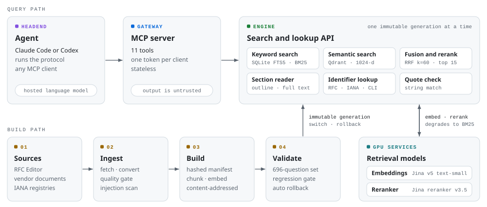

<div align="center">

<picture>
  <source media="(prefers-color-scheme: dark)" srcset="docs/figures/banner-dark.svg">
  <source media="(prefers-color-scheme: light)" srcset="docs/figures/banner-light.svg">
  
</picture>

Retrieval-augmented question answering for network and security engineering.<br>
Answers are built from a local corpus of RFCs and Cisco documentation, with every quotation being string-matched against the source before it is used.

<p>
  <a href="#roadmap"></a>
  <a href="#mcp-tools"></a>
  <a href="#retrieval-pipeline"></a>
  <a href="#verifying"></a>
  <a href="https://orcid.org/0009-0003-8091-4637"></a>
</p>

[Background](#background) · [Architecture](#architecture) · [Retrieval](#retrieval-pipeline) · [Tools](#mcp-tools) · [Protocol](#answer-protocol) · [Corpus](#corpus) · [Evaluation](#evaluation) · [Roadmap](#roadmap) · [Limitations](#limitations)

</div>

> [!NOTE]
> Pre-release. I run Deep32 on my own hardware and nothing in this repository is installable yet. Design notes will go up first, then the code and signed release images. The numbers on this page come from my deployment.

## Background

If you've studied for any Cisco certification (or at the very least attempted to browse their technical paper repo...) you understand the pain involved in trying to find current information. Yes, as an engineer, you should be able to locate your own sources. I think over the past few years, though, it has become more "get thrown to the wolves" than most professions. Which is fine.....up to a point.

With the advent of modern generative AI (things like Claude, ChatGPT, etc...) modern engineers have become very comfortable using these services to find answers (R.I.P. stack overflow, you stingy bastard...), learn new information, or plan/implement/troubleshoot an active production deployment. Unfortunately, even with the flagship models, the results are moderate at best and at worst downright dangerous (if you've never tried arguing with an engineer that uses generative AI instead of reading documentation, I envy you). That being said...Artificial Intelligence (more broadly, Large Language Models and associated algorithms) can be EXTREMELY useful in research+development, in fields much more complex than network engineering and security.

So, I got to thinking. What if you had a local agentic flagship model (something like Opus or Mythos, or even GPT 6.1 Sol) via your terminal of choice (claude code or codex, for example) and hooked it up to a local RAG system? If you don't know what RAG is...don't worry, I didn't either before last year. It stands for, "Retrieval-Augmented Generation" and is based in a local database of documentation, instead of being trained on general user input. I began experimenting with this, and a few months (and many iterations later....), we have Deep32. But, what is it about LLMs that makes networking in particular so difficult to understand for them?

If you've ever read an RFC, you know that they're updated constantly. As are most engineering white papers, configuration guides, technical notes, the list goes on. Networking in particular is a consistently evolving field, and LLMs (simply speaking) have an extremely difficult time catching up. LLMs are (more or less) fluent in understanding the fundamentals of things like routing protocols, but are often wrong on the specifics (the devil is in the details). The answer may originally READ fine and may cite a relevant source, but...eventually you'll notice that a timer or a default is off. Or the command syntax doesn't precisely match the version of Cisco IOS XE you're using. With a field as granular as this, it becomes inherently hard to tell what should or should not be done without actually opening the source documentation. Most of the errors I see fall into four groups:

| Error | Example | What Deep32 does |
|---|---|---|
| Vendor default given as the standard | "BGP hold time is 180 seconds." That is the Cisco default; RFC 4271 suggests 90. | Retrieves RFC text and vendor text as separate sources and compares them |
| Obsolete RFC cited as current | RFC 1771 quoted for BGP-4 after RFC 4271 replaced it | Looks up status, obsoleted-by and errata for every RFC cited |
| Command from the wrong release | Syntax from one software train given for another | Each passage carries its platform and release, and a search can prefer or cap a release |
| Invented quotation | "The RFC states ..." followed by text that is not in the RFC | String-matches every quotation against the source section |

The rest of the design follows from that table. The agent gets no documents up front and is told to answer only from passages it retrieves, or to say that the corpus does not cover the question. Quotation checking is string matching against the stored text, with no model in the loop. Everything that goes into an answer is versioned, from document hashes up to whole index generations, so one build can be compared with the next and rolled back. Retrieval runs entirely on local hardware. The LLM is the only hosted part.

## Architecture

<picture>
  <source media="(prefers-color-scheme: dark)" srcset="docs/figures/architecture-dark.svg">
  <source media="(prefers-color-scheme: light)" srcset="docs/figures/architecture-light.svg">
  
</picture>

There are five components. Four sit in the query path and the fifth, the build pipeline, runs when the corpus changes.

| Component | Role | Built with |
|---|---|---|
| Agent | Runs the [answer protocol](#answer-protocol) and writes the answer. I use Claude Code and Codex. Any MCP client can call the gateway. | Model Context Protocol |
| Gateway | MCP server for the eleven [tools](#mcp-tools). Stateless, with one bearer token per client. Its server instructions tell the client to treat all tool output as untrusted document text. | Python, MCP |
| Engine | Hybrid search, section reader, identifier lookup and quotation check. Serves one index generation at a time. | Python, FastAPI, SQLite FTS5, Qdrant |
| GPU services | Embedding and cross-encoder reranking. If this node is down the engine falls back to BM25 and marks the response as degraded. | Text Embeddings Inference, `jina-embeddings-v5-text-small`, `jina-reranker-v3.5` |
| Build pipeline | Builds and validates [index generations](#index-generations) from the source documents. | Python, git |

In my deployment these run on three machines on a Tailscale network, with HTTPS between services.

## Retrieval pipeline

<picture>
  <source media="(prefers-color-scheme: dark)" srcset="docs/figures/pipeline-dark.svg">
  <source media="(prefers-color-scheme: light)" srcset="docs/figures/pipeline-light.svg">
  
</picture>

| Stage | What happens | Setting |
|---|---|---|
| Plan | A `search_many` call takes several queries at once. Identifiers such as RFC numbers and command names go in as BM25 queries, paraphrases as dense queries. | 1 to 8 queries |
| Keyword | BM25 over SQLite FTS5 | 50 candidates per query |
| Semantic | 1024-dimension vectors, cosine distance, no quantization. Each passage is embedded with its document title and heading path. | 50 candidates per query |
| Fuse | Reciprocal rank fusion | k = 60, top 30 kept |
| Rerank | Cross-encoder, each candidate scored against the query that retrieved it | top 15 |
| Fold | Cisco repeats text across books and releases. Passages with identical text are merged into one hit, and the other locations are listed in `also_in`. | exact text match |
| Deliver | 32 hits in three tiers of 8, 8 and 16, with a shorter text window in each tier. Every hit is centered on its best-matching line and has a reference to the full section. | 2,400 / 800 / 250 characters |

The 32 in the name is this result size, and the strip under the logo is one result drawn to scale.

Hit@1 by stage, on the 696-question set described under [Evaluation](#evaluation):

| BM25 only | Dense only | Fused | Fused + reranked |
|:---:|:---:|:---:|:---:|
| 0.710 | 0.783 | 0.822 | 0.956 |

Every response has a `degraded` field listing any backend it needed and could not use. BM25 has no external dependency and always answers. The dense leg and the reranker sit behind circuit breakers (three failures open the breaker for 30 seconds, then one trial call), so search stays up through a GPU outage at lower quality, and the agent can see that it happened.

## MCP tools

The gateway exposes eleven tools. All of them return source material or metadata. There is no tool that generates text.

| Tool | Returns |
|---|---|
| `search_rag` | One hybrid, BM25 or dense search. Each hit has a citation, its section path, the RFC's status and a text window centered on the best-matching passage. |
| `search_many` | Up to 8 searches fused into one ranked list. Each query keeps its best passage in the result. |
| `get_outline` | A document's section tree |
| `get_section` | Full text of a section, paged, with the neighboring sections |
| `grep_corpus` | Literal or bounded regular-expression search over the source text |
| `find_command` | CLI index entries: syntax, task steps, examples and show output. IOS abbreviations are accepted. |
| `lookup_id` | Resolves an identifier: RFC and section numbers, BCP and STD numbers, IANA registry values, protocol terms, CLI commands, PowerShell cmdlets |
| `lookup_rfc` | RFC Editor metadata: status, obsoletes, obsoleted-by, updates, errata |
| `verify_quote` | Whether a quotation appears in a section: `exact`, `normalized` or `not_found` |
| `list_documents` | The corpus catalog |
| `rag_status` | Health: index generation, corpus fingerprint, counts, backend and breaker state |

## Answer protocol

The agent's instructions are a fixed procedure:

1. Look up every identifier (RFC number, LSA type, path attribute, CLI command) with `lookup_id` or `find_command` before using it.
2. Run one `search_many` call with three to six queries, restricted to one collection where the question allows it.
3. Read the full section with `get_outline` and `get_section`, plus any Restrictions or Defaults section next to it. Search hits are only for locating text.
4. Run `lookup_rfc` on every RFC cited, to catch obsoleted documents and read the errata.
5. Run `verify_quote` on every quotation.
6. Compare the RFC text with the vendor's documented behavior and defaults, and report any difference.
7. If the corpus does not cover the question, say so.

`verify_quote` returns one of three results:

| Result | Meaning | Effect |
|---|---|---|
| `exact` | Character-for-character match | Quotation can be used |
| `normalized` | Matches after collapsing whitespace, RFC page breaks and hyphenation | Quotation can be used |
| `not_found` | No match in that section | Quotation is dropped and the agent goes back to the section |

### Example: BGP keepalive and hold timers

The usual answer to "what are the BGP default timers" is 60 and 180 seconds. These are the tool results for that question from my deployment on 14 November 2026.

| # | Call | Result |
|:---:|---|---|
| 1 | `lookup_rfc 4271` | Draft Standard. Obsoletes RFC 1771. Updated by twelve later RFCs. 16 errata on record, none against section 10. |
| 2 | `verify_quote` in RFC 4271, section 10:<br>"The suggested default value for the HoldTime is 90 seconds." | `normalized`<br>The sentence breaks across lines 5008 and 5009 of the RFC text. |
| 3 | `verify_quote` in RFC 4271, section 10:<br>"The suggested default value for the KeepaliveTime is 1/3 of the HoldTime." | `normalized` |
| 4 | `verify_quote` in Cisco IOS IP Routing: BGP Command Reference, `timers bgp`:<br>"Frequency (in seconds) with which the Cisco IOS software sends keepalive messages to its peer. The default is 60 seconds." | `exact` |
| 5 | `verify_quote`, same section:<br>"Interval (in seconds) after not receiving a keepalive message that the software declares a peer dead. The default is 180 seconds." | `exact` |
| 6 | `verify_quote` in RFC 4271, section 10:<br>"The suggested default value for the HoldTime is 180 seconds." | `not_found` |

RFC 4271 section 10 suggests a hold time of 90 seconds and a keepalive of one third of that, so 30 seconds. Cisco IOS and IOS XE default to 60 and 180. "60 and 180" is therefore correct for Cisco and wrong as a statement about the RFC, and call 6 shows that the 180-second sentence does not appear in section 10 at all.

## Corpus

| Collection | Documents | Contents |
|---|:---:|---|
| IETF RFCs | 365 | RFC text plus RFC Editor status, relations and errata |
| Cisco documentation | 489 | 263 TechNotes, 126 configuration guides, 48 command references, 17 API guides, 15 validated designs, 14 white papers, 3 MIBs, 3 release notes. Covers IOS XE, SD-WAN, Catalyst Center, ISE and Secure Client. |
| PowerShell (opt-in) | 241 | Windows PowerShell 5.1 reference, 7.x differences, Windows networking modules |
| System (opt-in) | rebuilt per release | Deep32's own source, configuration and design notes, so that it can answer questions about itself |

Opt-in collections are searched only when a query names them, which keeps PowerShell help text out of routing results.

Each build also produces structured indexes for the lookup tools:

| Index | Size | Source |
|---|---|---|
| RFC index | 9,842 RFCs with status and relations | RFC Editor |
| Errata | 1,217 records | RFC Editor |
| IANA registries | 2,366 entries | IANA |
| CLI index | about 150,000 command entries with mode, platform and release | Command references and configuration guides |
| Feature history | 2,578 entries | Vendor feature tables |

Every document has a manifest entry with its source URL, SHA-256, platform, release, license terms and a redistribution flag. This repository contains no vendor text. The Cisco documents belong to Cisco.

## Index generations

An index is never modified in place. Each build produces a new generation, and the engine serves one generation at a time.

A generation is a self-contained directory holding a snapshot of the sources, the SQLite store (FTS5 index and section map), the vectors, the structured indexes and a build report.

Document and passage IDs are derived from SHA-256 hashes of the content, so an unchanged passage keeps its ID from one build to the next and its embedding is reused. One corpus update embedded 904 new passages and reused 62,617 existing vectors.

Before a new generation is served, it is run against the labeled question set and compared with the current generation query by query. The gate allows zero net regressions: a build that loses one question without gaining one elsewhere fails.

Switching generations is one setting and a service restart. Old generations stay on disk, so rolling back is the same operation pointed at the previous one. The evaluation that runs after a switch rolls back automatically if it does not pass.

Document conversion runs in a sandbox with no network access. Converted text has to pass a quality gate before it can be built, which includes a scan for instruction-like lines (what a prompt injection planted in a document would look like). Anything the scan flags is reviewed by hand.

## Evaluation

So far I have measured retrieval only. Answer accuracy has not been measured.

The test set is 696 questions on enterprise routing, switching, VPN, SD-WAN, network services and access control. Each question is labeled with the passages that answer it.

| Measure | Result |
|---|:---:|
| Correct passage ranked first (hit@1) | 0.956 |
| Correct passage in the top 8 (hit@8) | 0.991 |
| Median time for one search through the gateway | about 0.57 s |

The hit@1 figure is conservative. Some top-ranked passages have not been judged yet and are counted as misses; depending on how those are judged, the real value is between 0.956 and 0.983. All of these numbers are from October and November 2026 on my deployment. I will re-measure on the released corpus and publish those results with it.

Next is answer-level evaluation: a fixed set of protocol questions, answered once with the verification steps enabled and once with them disabled, and scored against the sources.

## Things that did not work

- Adding a second IOS XE release line made hit@1 drop from 0.824 to 0.754. It turned out that 234 of the 694 questions in the test set at the time had their answer passage repeated verbatim in one of the new books, where it had no label, so correct hits were being scored as misses. Duplicate passages are now folded into one hit (the Fold stage above).
- Larger chunks scored worse. Hit@1 fell from 0.956 to 0.935 and fewer answer passages were delivered intact, so the smaller chunk size stayed.
- A faster reranker lost 10 questions at hit@1 once its new top hits had been judged. I kept the slower one.
- Two HNSW builds from identical vectors can differ on a question or two, which is enough to trip a zero-regression gate. New generations now clone the previous index snapshot and add to it.
- A late-interaction (ColBERT) retriever is implemented but is not part of the served pipeline. Its first run was OOM-killed because the search library packed about 30,700 candidates into a single 31 GiB tensor. Capping the batch size fixed that.
- Check that Tailscale has a direct path between nodes. Relayed through DERP, node-to-node latency was 70 to 157 ms. Direct, it is 1 to 2 ms.

## Hardware

This is what it runs on today. Median search time through the gateway is about 0.57 s.

| Node | Hardware | Runs |
|---|---|---|
| Engine | 2013 dual-socket Xeon server (AVX, no AVX2), as one virtual machine | Search API, SQLite, Qdrant |
| Gateway | Fanless thin client (Pentium Silver, no AVX) | MCP gateway |
| GPU and agent | Desktop PC with one 11 GB NVIDIA card, models under WSL2 | Embeddings, reranker, the agent |

## Release plan

The plan is three disk images covered by one signed manifest. Details may change before release.

| Image | Kind | Contents |
|---|---|---|
| SYSTEM | Bootable installer | Workstation node on OpenBSD: the engine and gateway, plus a desktop with an Ask window and an offline reference library |
| CONTENT | Data | A prebuilt index generation, the corpus blocks that can be redistributed, and the reference library content |
| GPU | Bootable, also importable into WSL2 or Docker | Ubuntu with CUDA: the embedding server, the reranker and the index builder |

- No keys, tokens or logins are shipped on any image. Each install generates its own.
- Every node joins the installer's own Tailscale network. The layout is the same whether the nodes share one machine or sit on several.
- A single install matrix drives the hardware check, the install plan and the test record.
- Claude Code and Codex are supported first. An OpenAI-compatible adapter for locally served models is designed and will follow.

## Roadmap

- [x] Hybrid retrieval engine, gateway and MCP tools, in private use
- [x] Quotation checks and RFC status checks
- [x] Gated index generations with rollback
- [x] Retrieval evaluation on a labeled question set
- [ ] Design document covering the architecture and the verification method
- [ ] Answer-level evaluation with verification on and off
- [ ] Code release
- [ ] Signed release images
- [ ] Archived releases with a DOI

## Limitations

- A verified quotation shows that the text is in the source. It says nothing about whether the reasoning built on it is sound.
- Answers are limited to what the corpus covers.
- Answer accuracy has not been measured (see [Evaluation](#evaluation)).
- The corpus is Cisco documentation and RFCs. Other vendors are not covered.
- The LLM is hosted, so the question and the retrieved passages are sent to the model provider. Everything else stays local.
- A cited answer still needs to be tested in a lab before a change goes into production.

## Verifying

Commits are signed with this OpenPGP key. Tags and release manifests will be signed with it too.

```
B205 B406 5486 27AA BF52  50D8 A078 C5F2 5D02 5DD6
```

```sh
gpg --keyserver hkps://keys.openpgp.org --recv-keys B205B406548627AABF5250D8A078C5F25D025DD6
gpg --fingerprint B205B406548627AABF5250D8A078C5F25D025DD6
git verify-commit HEAD
```

The key is on [keys.openpgp.org](https://keys.openpgp.org/search?q=B205B406548627AABF5250D8A078C5F25D025DD6). Release images will come with a detached signature over the manifest, and the verifier checks the signer's fingerprint as well as the signature.

## Citing

```bibtex
@software{cummings_deep32,
  author = {Cummings, Jeffrey A.},
  title  = {Deep32: Retrieval-augmented question answering for network and security engineering},
  year   = {2026},
  url    = {https://github.com/hellobpdu/deep32},
  note   = {Pre-release}
}
```

A DOI will be added with the first archived release.

## License

No license has been granted yet. The first release will use the PolyForm Noncommercial License 1.0.0 for code and CC BY-NC 4.0 for documentation. Third-party software, models and documents keep their own terms. Both Jina models are licensed CC BY-NC 4.0.

## Author

Jeffrey A. Cummings · [ORCID 0009-0003-8091-4637](https://orcid.org/0009-0003-8091-4637) · [jacummings@acm.org](mailto:jacummings@acm.org) · [@hellobpdu](https://github.com/hellobpdu)

Send security reports by email, encrypted to the key above.

<sub>Personal work. Not affiliated with or endorsed by my employer. Cisco, IOS and Catalyst are trademarks of Cisco Systems, Inc. Other names belong to their owners.</sub>
