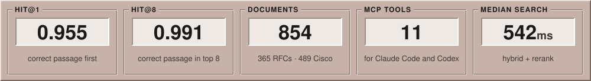
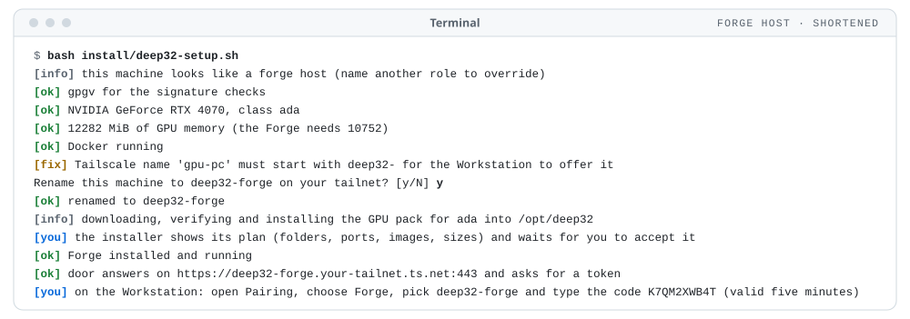
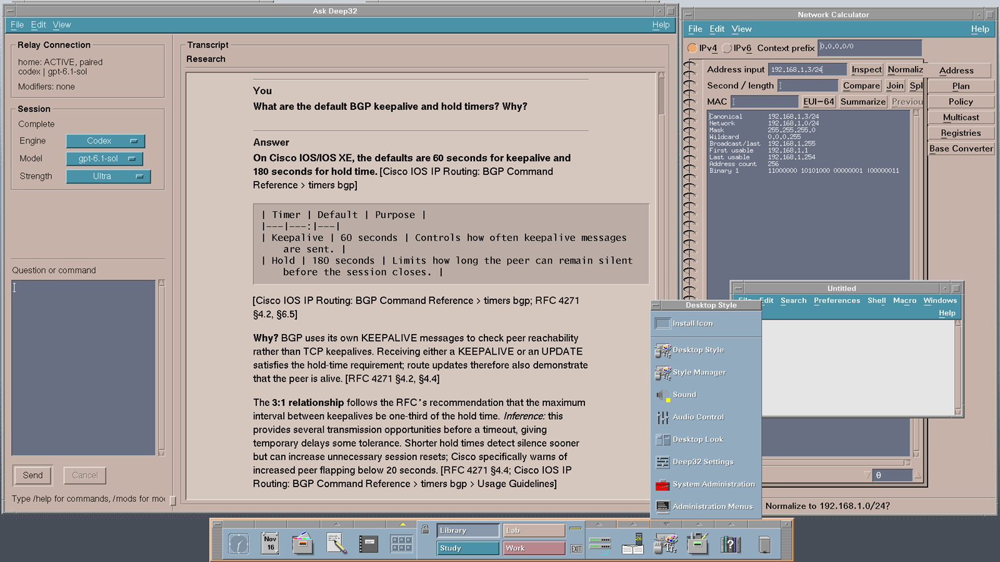
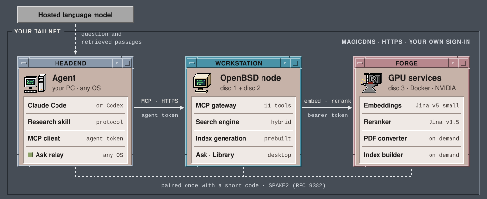
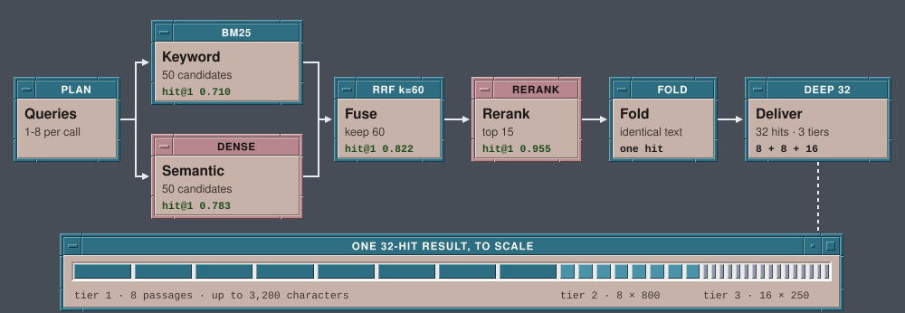
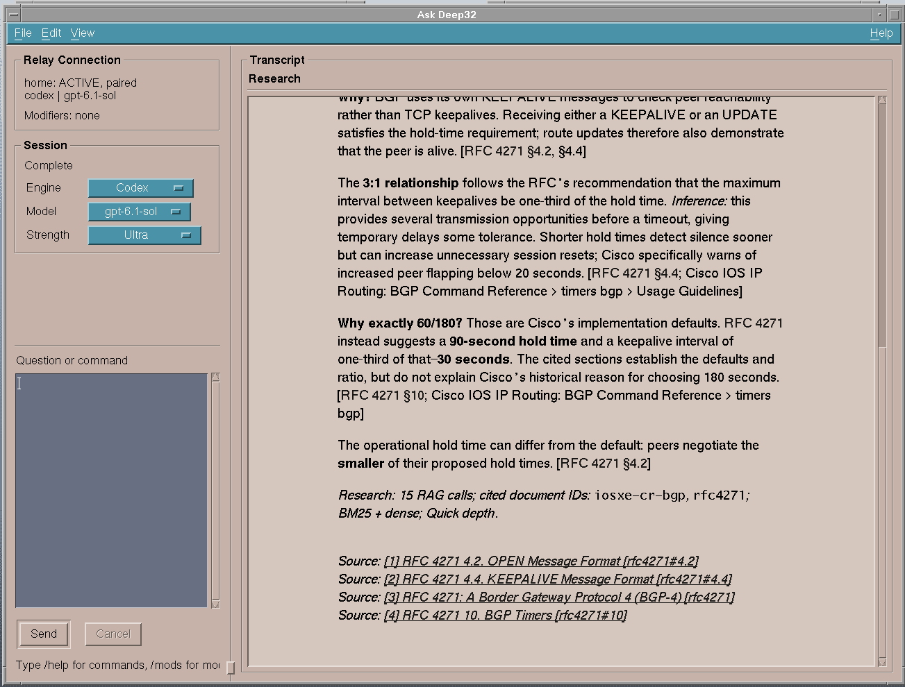
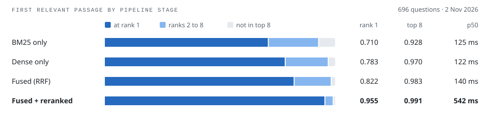
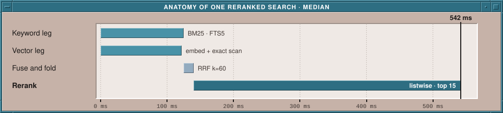
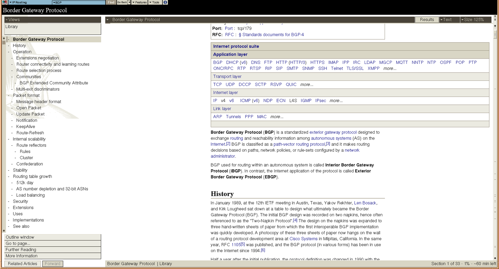
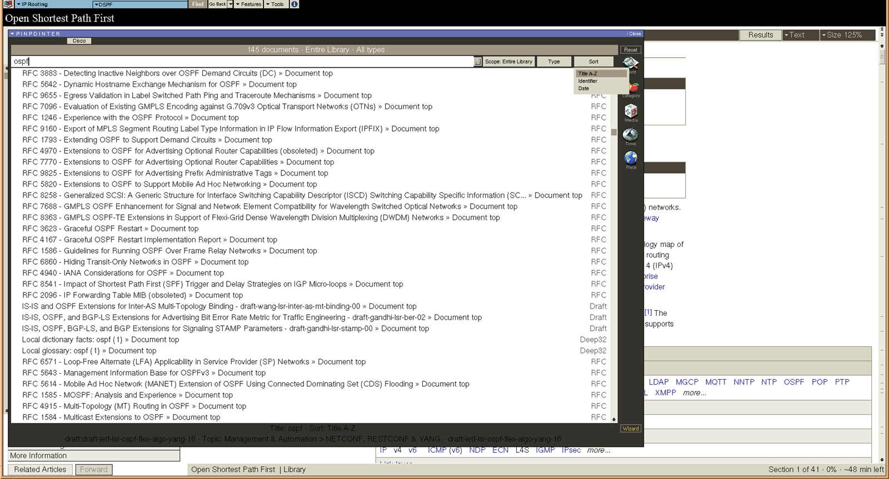

<div align="center">

<picture>
  <source media="(prefers-color-scheme: dark)" srcset="docs/figures/banner-dark.svg">
  <source media="(prefers-color-scheme: light)" srcset="docs/figures/banner-light.svg">
  
</picture>

<p>
  <a href="#11-release-and-verification"></a>
  <a href="#license"></a>
  <a href="#11-release-and-verification"></a>
  <a href="#6-tools-and-answer-protocol"></a>
  <a href="#5-retrieval-pipeline"></a>
  <br>
  <a href="https://doi.org/10.5281/zenodo.24272647"></a>
  <a href="https://orcid.org/0009-0003-8091-4637"></a>
  <a href="https://www.bestpractices.dev/projects/16932"></a>
  <a href="https://scorecard.dev/viewer/?uri=github.com/hellobpdu/deep32"></a>
  <a href="https://github.com/hellobpdu/deep32/actions/workflows/tests.yml"></a>
</p>

[Install](#quick-start) · [Status](#status-of-this-release) · [Introduction](#1-introduction) · [Deployment](#3-deployment) · [Architecture](#4-architecture) · [Retrieval](#5-retrieval-pipeline) · [Evaluation](#8-evaluation) · [Security](#10-security-considerations) · [References](#references)

</div>

```text
Deep32                                                                        J. A. Cummings
Release: 0.1.0-alpha.2                                                         November 2026
Category: Experimental                                             Design document: D32-TR-1
```

## Abstract

Deep32 answers network and security engineering questions from a local corpus of 365 RFCs and 489 Cisco documents.
Two more collections come with it and are searched only when you ask for them: 241 PowerShell documents and 85 about
Deep32 itself.
Claude Code or Codex does the research through eleven MCP tools. The tools search the corpus (BM25 and dense
retrieval, fused and reranked), read whole sections, look up identifiers and RFC status, and string-match quotations
against the stored text. On 696 labeled questions, a correct passage is ranked first for 665 of them (0.955) and is in
the top 8 for 690 (0.991). The corpus, the index and the search engine run on your own machines. The language model is
hosted, so the question, the queries the agent writes and the passages it gets back go to the model provider.

<picture>
  <source media="(prefers-color-scheme: dark)" srcset="docs/figures/glance-dark.svg">
  <source media="(prefers-color-scheme: light)" srcset="docs/figures/glance-light.svg">
  
</picture>

## Status of this release

This is an alpha, and it assumes you're comfortable installing an OS in a VM and running Docker. The numbers on this
page come from my development setup, which runs the same engine, models and corpus. Known issues are in the
[release notes](CHANGELOG.md).

| Part | In 0.1.0-alpha.2 |
|---|---|
| Workstation and content | Tested on a clean install: the guided install, first boot, Tailscale and publishing the gateway |
| Your agent | Claude Code and Codex connect over MCP and answer from the corpus with checked quotations on my development setup. Connect has paired a headend with a clean install of this release's Workstation: gateway authentication and all eleven tools passed |
| Forge | Installs from the signed images on Linux, in WSL 2 and on Docker Desktop. I checked each of its parts on an RTX 2080 Ti; the full run on each kind of host follows the release |
| Ask window | Pairs and keeps its link. A question asked in the Ask window on a Workstation is answered through the relay with Claude Code, with the model and strength you choose |
| `deep32 doctor` and `deep32 selftest` | On the images, not working yet |

## Quick start

```sh
git clone https://github.com/hellobpdu/deep32.git && cd deep32
bash install/deep32-wizard.sh
```

```powershell
# Windows; use an elevated PowerShell on the Forge
git clone https://github.com/hellobpdu/deep32.git; cd deep32
powershell -NoProfile -ExecutionPolicy Bypass -File install\deep32-wizard.ps1
```

Run the setup wizard once on each machine. It works out whether the machine should be the Forge, the Workstation's
host or the headend, checks it, fixes what it safely can with your consent, downloads and verifies the images, and
installs. Its VM guide takes you through the Workstation VM on your hypervisor, and it can send disc 2 to the
Workstation over your tailnet, so you need no optical drive; a USB stick written with the disc 2 image works too. It
stops only for a Tailscale sign-in, the installer's plan and a pairing code. `--demo` shows it without changing
anything, and `install/deep32-setup.sh` is the same install without the screens. To install with an agent, open
Claude Code or Codex in the clone and type `/deep32-install` (Claude Code) or `$deep32-install` (Codex): it walks you
through the wizard on each machine and stops at every step that needs you ([AGENTS.md](AGENTS.md)). The
[project site](https://hellobpdu.github.io/deep32/) has a step-by-step walkthrough, and [INSTALL.md](INSTALL.md) has
every step by hand.

<picture>
  <source media="(prefers-color-scheme: dark)" srcset="docs/figures/setup-dark.svg">
  <source media="(prefers-color-scheme: light)" srcset="docs/figures/setup-light.svg">
  
</picture>
<p align="center"><sub>The setup script on a Forge host. Every line starts with a tag, so a person or an agent can follow it.</sub></p>

<p align="center">
  
</p>
<p align="center"><sub><b>Figure 1.</b> The Workstation on my laptop, in the HP-UX CDE look the release installs. Ask is answering the BGP timer question, with the network calculator, a text editor and the desktop style menu open. Panels that exist only in my private build are blanked.</sub></p>

## 1. Introduction

If you've studied for any Cisco certification (or at the very least attempted to browse their technical paper repo...) you
understand the pain involved in trying to find current information. Yes, as an engineer, you should be able to locate
your own sources. I think over the past few years, though, it has become more "get thrown to the wolves" than most
professions. Which is fine... up to a point.

With the advent of modern generative AI (things like Claude, ChatGPT, etc.) modern engineers have become very
comfortable using these services to find answers (R.I.P. Stack Overflow), learn new information, or
plan/implement/troubleshoot an active production deployment. Unfortunately, even with the flagship models, the results
are moderate at best and at worst downright dangerous (if you've never tried arguing with an engineer that uses
generative AI instead of reading documentation, I envy you). That being said... Artificial Intelligence (more
specifically, Large Language Models and associated algorithms) can be EXTREMELY useful in research and development, in
fields much more complex than network engineering and security.

So, I got to thinking. What if you had an agentic flagship model (something like Opus or Mythos, or even GPT 6.1 Sol)
via your terminal of choice (Claude Code or Codex, for example) and hooked it up to a local RAG system? If you don't
know what RAG is... don't worry, I didn't either before last year. It stands for "Retrieval-Augmented Generation" and
is based on a local database of documentation, instead of relying on whatever the model remembers from its training. I
began experimenting with this, and a few months (and many iterations) later, we have Deep32. But what is it about LLMs
that makes networking in particular so difficult for them?

If you've ever read an RFC, you know that they're constantly being updated and obsoleted by newer ones (as are most
engineering white papers, configuration guides, technical notes... ad nauseam). Networking in particular is a
consistently evolving field, and LLMs (simply speaking) have an extremely difficult time catching up. LLMs are (more or
less) fluent in the fundamentals of things like routing protocols, but are often wrong on the specifics (the devil is in
the details). The answer may READ fine and may cite a relevant source, but... eventually you'll notice that a timer or a
default is off. Maybe the command syntax in an output doesn't precisely match the version of Cisco IOS XE you're using.
With a field as granular as this, it becomes inherently hard to tell what should or should not be done without actually
opening the source documentation. Most of the errors I see fall into four groups:

| Error | Example | What Deep32 does |
|---|---|---|
| Vendor default given as the standard | "BGP hold time is 180 seconds." That is the Cisco default; RFC 4271 suggests 90. | RFC and vendor text come back as separate sources, and the agent compares them |
| Obsolete RFC cited as current | RFC 1771 quoted for BGP-4 after RFC 4271 replaced it | `lookup_rfc` returns status, obsoleted-by and errata for each RFC cited |
| Command from the wrong release | Syntax from one software train given for another | Passages are tagged with platform and release, and a search can prefer or cap a release |
| Invented quotation | "The RFC states ..." followed by text that is not in the RFC | `verify_quote` string-matches the quotation against the source section |

Two of these can be checked mechanically. `lookup_rfc` returns an RFC's status, and `verify_quote` matches a quote
against the stored text with no model involved. The other two depend on the agent. The sources and release tags are
there, but the agent still has to notice the difference (step 6 in [section 6](#6-tools-and-answer-protocol)). It has
nothing loaded at the start, answers only from passages it retrieves, and says so when the corpus doesn't cover the
question. Every document is hashed and every index build is a separate generation, so I can compare one build with the
next and roll back.

## 2. Terminology

<picture>
  <source media="(prefers-color-scheme: dark)" srcset="docs/figures/parts-dark.svg">
  <source media="(prefers-color-scheme: light)" srcset="docs/figures/parts-light.svg">
  
</picture>

- **Workstation**: the machine or VM that holds the index. OpenBSD with the desktop, the Ask window, the search engine
  and the MCP gateway. Installed from disc 1, with its content from disc 2.
- **Forge**: the machine with the NVIDIA card. It runs the embedding and reranking models in Docker, and the PDF
  converter and index builder when you build indexes of your own.
- **GPU pack**: disc 3, which installs a Forge.
- **Headend**: the PC where Claude Code or Codex runs, with the Deep32 research skill installed.
- **Ask relay**: an optional program on the headend that answers the questions typed in the Workstation's Ask window
  with your agent.
- **Content**: disc 2, the corpus with its prebuilt index and the Deep32 Library.
- **Tailnet**: your Tailscale network. All three parts sign in to it with your account.
- **Pairing**: the one-time step that introduces two parts to each other. One side shows a short code and the other
  types it, checked with SPAKE2 [[RFC9382]](#references); the Ask link compares ten words on both consoles instead.
- **Generation**: one complete, immutable build of the index. The engine serves one at a time.

## 3. Deployment

<picture>
  <source media="(prefers-color-scheme: dark)" srcset="docs/figures/topology-dark.svg">
  <source media="(prefers-color-scheme: light)" srcset="docs/figures/topology-light.svg">
  
</picture>
<p align="center"><sub><b>Figure 2.</b> The three parts of an install. They can all run on one machine or on separate ones.</sub></p>

### 3.1 Requirements

| Part | Minimum | Software |
|---|---|---|
| Workstation | 64-bit Intel or AMD with virtualization, 6 threads, 12 GB of memory, 200 GB of disk | A hypervisor, or a spare machine |
| Forge | An NVIDIA card of compute capability 7.5 or newer with at least 10.5 GB of graphics memory (an 11 GB card or larger), 4 threads, 16 GB of memory | NVIDIA driver 580.65.06 or newer, Python 3.12, and Docker with the NVIDIA Container Toolkit (on Windows, Docker Desktop or an Ubuntu 24.04 WSL 2 distro) |
| Both on one machine | 8 threads, 32 GB of memory, the card above | As above |
| Headend | Any PC | Claude Code or Codex |
| Network | Internet access during install | Tailscale (the free plan is enough), with MagicDNS and HTTPS certificates turned on |

The downloads are 21.5 GB for the Workstation (its 1.9 GB system image and the 19.6 GB content image) and about
37.1 GB for the Forge (the 18.6 GB shared core, your card's 3.1 to 3.3 GB embedder and the 15.3 GB ingestion image).

Without a Forge, search is keyword only. Card details and layouts are in [docs/HARDWARE.md](docs/HARDWARE.md).

### 3.2 What an install involves

The [quick start](#quick-start) does all of this for you, one machine at a time. Run it from a clone of this
repository: `deep32-get` checks the images against the release key in `install/`. [INSTALL.md](INSTALL.md) has each
step by hand, with the Windows commands, the VM settings, recovery, and isolated agent profiles for a PC whose Claude
Code or Codex is already set up for other work.

| Step | What you do |
|---|---|
| Tailnet | Create a Tailscale account if you don't have one, and turn on MagicDNS and HTTPS certificates in the admin console |
| Workstation | Download discs 1 and 2, install disc 1 in a VM or on a spare machine, sign it in to your tailnet at first boot and let it import disc 2 |
| Forge | On the GPU machine, sign in to the same tailnet with a name that starts with `deep32-`, then let the setup script download and install the core, your card's embedder and the ingestion image |
| Pairing | Type the Forge's ten-character code on the Workstation. A code lasts five minutes |
| Agent | Publish the Workstation's gateway once, then run Connect on your PC and type the code the Workstation shows |
| Ask window (optional) | Install the relay on your PC and compare ten words on both screens |

To check an install, ask your agent something you already know the answer to, like the BGP hold time in RFC 4271, and
see that it cites the RFC and quotes it. `deep32 doctor` and `deep32 selftest` are on the images but don't work yet in
0.1.0-alpha.2.

## 4. Architecture

<picture>
  <source media="(prefers-color-scheme: dark)" srcset="docs/figures/architecture-dark.svg">
  <source media="(prefers-color-scheme: light)" srcset="docs/figures/architecture-light.svg">
  
</picture>
<p align="center"><sub><b>Figure 3.</b> Query path and build path.</sub></p>

Figure 3 has two paths. On the query path the agent calls the gateway, the gateway calls the engine, and the engine
calls the Forge's models for embeddings and reranking. On the build path, documents are converted and checked, built
into a new index generation and validated before the engine serves it. It's the usual RAG arrangement
[[RAG]](#references), with two searches instead of one. The design document [[D32-TR-1]](#references) specifies each
part and the protocols between them.

| Component | Runs on | Role |
|---|---|---|
| Agent | Headend | Runs the [answer protocol](#6-tools-and-answer-protocol) and writes the answer. Any MCP client can call the gateway. |
| Gateway | Workstation | MCP server for the eleven tools. Stateless. |
| Engine | Workstation | Hybrid search, section reader, identifier lookup, quotation check. Serves one index generation at a time. |
| Forge services | Forge | Query embedding and cross-encoder reranking. Without the Forge, search falls back to BM25 and flags the response as degraded. |
| Build pipeline | Forge | Builds and validates [index generations](#7-corpus-and-index-generations). Each release ships a prebuilt one on disc 2. |

The gateway holds no documents. It checks the token and hands the call to the engine. Its server instructions tell the
agent to treat tool output as document text and not to follow instructions found in it.

The agent reaches Deep32 in two ways. Over plain MCP it calls the gateway's tools while it works, the way Claude Code
and Codex use any MCP server. From the Workstation, you type a question in the Ask window. It goes over the paired
link to a small relay on the headend, the relay starts the agent with the research skill, the agent's searches come
back to the Workstation's gateway, and the answer streams into the window (Figures 1 and 5). The relay runs on
Windows, Linux and macOS. In this release a question asked in the Ask window, or with `d32-ask` in a terminal, is answered
through the relay with Claude Code, with the model and strength you choose, and when the agent's sign-in has lapsed the
relay reports `agent-sign-in-required`. The known issues are in the
[release notes](CHANGELOG.md).

### 4.1 Design decisions

These are the decisions that shaped the system most, with what I ruled out. The [Decision Record](docs/DECISIONS.md)
has all of them, with dates and the measurements behind each.

| Decision | Instead of | Why | Trade-off |
|---|---|---|---|
| A hosted agent working from local retrieval, answering only from retrieved passages | Answering from the model's memory, or a local LLM in the query path | None of the four error classes in section 1 can be caught unless the answer is built from stored text. An early review of the system found no place for a local LLM between the question and the search. | The model provider sees the question and the passages |
| No loss in retrieval quality at any level | Accepting small losses for speed | In research work a better answer is worth a few more seconds. Latency limits stay as tripwires and are relaxed only for a measured gain. | Several measured improvements were turned down because one small topic lost one question |
| A paired, per-question validation gate with zero net regressions, also within each topic | Comparing averages | Averages hide losses. The new and the current generation answer the same questions, and I count wins and losses one by one, with a sign test and a bootstrap interval. | New passages nobody has judged yet look like losses until they're labeled |
| Immutable index generations, one served at a time, with automatic rollback | Updating the index in place | I can compare a change with the previous build and undo it with one setting. | Disk space for old generations |
| Keyword and dense search, merged by rank | One retriever, or normalized scores | BM25 and dense search miss different questions (Figure 4), and their scores aren't on comparable scales. | Two searches per query |
| Cross-encoder reranking on by default | Fused order only | Most misses already had a correct passage in the top 8, so the order was the problem. Reranking took hit@1 from 0.822 to 0.955. | About 400 ms per search. I set the latency budget at an 800 ms median and 1,000 ms p95 to make room for it |
| Quotations checked by string match | Asking a model whether a quote is supported | Same result every time, with no model in the loop. A normalized comparison ignores RFC line breaks and page footers. | Checks wording only ([section 12](#12-limitations)) |
| No secret on any image, and pairing by short code (SPAKE2) | Keys built into the images, or tailnet membership as authorization | Each machine makes its own tokens at install, and a pairing code lasts five minutes with one attempt. | One manual step for each pair of parts |

<details>
<summary><b>Six more decisions</b></summary>

| Decision | Instead of | Why | Trade-off |
|---|---|---|---|
| Rerank the top 15, reading a 1,600-character window around the best-matching lines | The top 10 or top 20, or a shorter input | hit@8 gained 4 questions and lost none (p = 0.002) for 52 ms. The top 20 lost 13 questions, and a shorter input lost 10. | A few questions have no relevant passage in the top 15 at all |
| Text windows and whole-section tools for the agent | Short snippets with each hit | The ranking was already good. The 360-character snippets showed the agent only 21.8% of the correct passages. | More text per search, which is why hits 9 to 32 are trimmed or sent as pointers |
| Exact scan of a flat vector file on the Workstation | Qdrant with an HNSW index | Qdrant doesn't run on OpenBSD without Docker. On the 78,275-vector index an exact scan took 12.7 ms against Qdrant's 19.8 ms, and the C kernel gives bit-identical scores on any amd64 machine. | Cost grows linearly with the corpus |
| GPU services on their own machine, treated as unreliable | Running everything on the GPU machine | The Workstation needs no model of its own, and a GPU machine is the part most likely to be switched off or busy. A circuit breaker ([section 5](#5-retrieval-pipeline)) keeps searches from waiting on it. | Without the Forge, hit@1 drops to BM25's 0.710 |
| One Linux Docker form for the GPU pack | A separate form for each kind of host | One thing to build and test. On Windows it runs in Docker Desktop or in a WSL 2 distro. | This release needs Docker's classic image store |
| The release built and scanned as its own product | Publishing the development tree | Everything shipped is rebuilt from pinned commits through an allowlist and scanned, because built files can carry strings from material that was cut. | A full rebuild and scan for every release |

</details>

<details>
<summary><b>Software versions</b></summary>

| Layer | Software | Detail |
|---|---|---|
| Workstation OS | OpenBSD 8.0 | CDE desktop, signed updates |
| Gateway | Python 3.14, MCP SDK 2.2 | Streamable HTTP at `/mcp`, stateless, JSON responses. Bearer token made at install, compared in constant time. |
| Search API | Python 3.12, FastAPI, uvicorn | REST under `/v2`, bearer token. 2 searches run at once, 16 wait, the rest get `503` with `Retry-After`. |
| Keyword index | SQLite FTS5 | `unicode61` tokenizer, diacritics removed. BM25 over passage text (weight 1.0) and heading path (weight 2.0). |
| Vector search | Exact scan of a flat index | 1024 dimensions, cosine, float32, scanned by a small C kernel ([section 4.1](#41-design-decisions) explains why). |
| Embeddings | Text Embeddings Inference 1.9, `jina-embeddings-v5-text-small` | On the Forge. float32, last-token pooling, model revision pinned |
| Reranker | `jina-reranker-v3.5` | On the Forge. Cross-encoder, model revision pinned |
| PDF converter | MinerU 4.0.7 and PyMuPDF | On the Forge, run on demand for indexes of your own. It uses MuPDF, so it is under AGPL-3.0-or-later; its source is on the ingestion image |
| Network | Tailscale | Your tailnet, HTTPS between parts |

</details>

## 5. Retrieval pipeline

<picture>
  <source media="(prefers-color-scheme: dark)" srcset="docs/figures/pipeline-dark.svg">
  <source media="(prefers-color-scheme: light)" srcset="docs/figures/pipeline-light.svg">
  
</picture>
<p align="center"><sub><b>Figure 4.</b> One search, from queries to the delivered 32-hit result, with hit@1 after each stage.</sub></p>

I run two searches on every query, BM25 and dense, because they miss different questions. BM25
[[BM25]](#references) is keyword matching. Give it `timers bgp` or "RFC 4271" and it finds the exact string, but
describe a problem in your own words and it won't find a passage that uses different ones. Dense search turns text into
vectors and compares meaning, so a loosely worded question still gets to the right section. It's weaker on exact
identifiers and sometimes ranks the exact match low. On my test set, hit@1 is 0.710 with BM25 alone, 0.783 with dense
alone and 0.822 with the two merged.

BM25 scores and cosine similarities are on different scales, so reciprocal rank fusion [[RRF]](#references) ignores the
scores and uses only the ranks. A passage scores 1/(60 + rank) in each list it appears in. The scores are added, and a
passage ranked well by both lists ends up near the top.

The reranker is a second, slower model. It reads the question and a candidate passage together and scores how well
the passage answers it. It's too slow to run over the whole corpus, so it only sees the top 15 of the fused list. It's
the biggest gain in the pipeline, and also most of the search time (Figure 8).

| Stage | What happens | Setting |
|---|---|---|
| Plan | A `search_many` call takes several queries at once: identifiers as BM25 queries, paraphrases as dense queries | 1 to 8 queries |
| Keyword | FTS5 BM25 over passage text and heading path, headings weighted 2x | 50 candidates per query |
| Dense | The query embedded as `Query: {text}`; passages were embedded with their title and heading path | 50 candidates per query |
| Fuse | Weighted reciprocal rank fusion, both legs at weight 1.0 | k = 60, top 30 kept |
| Rerank | Cross-encoder over a 1,600-character window centered on each candidate's best-matching text | top 15 (10 per query in `search_many`) |
| Fold | Identical passages fold into one hit listing its other locations; a passage half-covered by a better hit in the same file is dropped | text compared after normalizing case and punctuation |
| Deliver | 32 hits in three tiers: 8 in full (up to 2,400 characters), 8 trimmed (800), 16 as pointers (250) | hits centered on their best-matching line |

Cisco documentation repeats a lot. The same paragraph shows up in the guide for one release and again in the guide for
the next, and without folding, part of the top 8 would be the same text twice.

The Forge is often a desktop PC with a graphics card, so it's the part most likely to be off or rebooting. The engine
puts a circuit breaker in front of it. After three failed calls in a row it marks the dense leg down and stops waiting
on it, then lets one trial call through every 30 seconds until the Forge answers. Meanwhile BM25 serves alone, and the
response includes a `degraded` field naming the services it couldn't reach.

<details>
<summary><b>Request options and degraded modes</b></summary>

| Option | Values | Effect |
|---|---|---|
| `mode` | `hybrid`, `bm25`, `dense` | Which legs run |
| `rerank` | `auto`, `on`, `off` | Cross-encoder on or off |
| `limit` | 1 to 30 | An exact number of hits in place of the 32-hit result |
| `max_chars` | 200 to 4,000, default 2,400 | Text window per hit |
| `doc_type`, `docs` | a collection, a list of document keys | Restricts the search; also the only way to reach an opt-in collection |
| `release_max` | `17.9` | Skips documents from a newer release on the same major line |
| `prefer_release` | `["17.9"]` | Among identical copies of a passage, shows the copy from this release |
| `include_obsolete` | default true | False drops obsoleted RFCs |

| Failure | Search behavior | `degraded` |
|---|---|---|
| Embedding server or vector index | BM25 answers alone; breaker opens after 3 failures, one trial call every 30 s | `dense` |
| Reranker | Fused order returned without reranking; same breaker | `reranker` |
| Structured indexes | Hits come back without RFC status | `kb` |
| Section index | Hits have the passage's own text and no section reference | `structure` |

</details>

## 6. Tools and answer protocol

The agent gets eleven tools over MCP [[MCP]](#references):

| Tool | Returns |
|---|---|
| `search_rag` | Ranked passages for one query, each with a citation, section path, RFC status and a text window |
| `search_many` | Up to 8 queries fused into one ranked list; each query keeps its best passage |
| `get_outline` | Section tree of a document, to a chosen depth or under one chapter |
| `get_section` | Full text of a section with its neighbors, paged up to 100,000 characters per call |
| `grep_corpus` | Matching lines with document, line number and section; literal by default, bounded regex optional |
| `find_command` | CLI index rows: command, mode, platform, release; IOS abbreviations accepted |
| `lookup_id` | What an identifier is and where it's defined: RFC and section numbers, IANA code points, CLI commands, cmdlets |
| `lookup_rfc` | Status, obsoletes, obsoleted-by, updates and errata |
| `verify_quote` | `exact`, `normalized` or `not_found`, with the location |
| `list_documents` | Catalog: key, type, release, RFC status, size, title |
| `rag_status` | Index generation, corpus fingerprint, counts, backend and breaker state |

Given tools, a model will often still answer from memory, so the research skill has the agent follow this procedure:

1. Look up every identifier (RFC number, LSA type, path attribute, CLI command) before using it.
2. Run one `search_many` call with three to six queries, restricted to one collection where the question allows it.
3. Read the full section, plus any Restrictions or Defaults section next to it. Search hits are only for locating text.
4. Run `lookup_rfc` on every RFC cited, to catch obsoleted documents and read the errata.
5. Run `verify_quote` on every quotation. A `not_found` quotation is dropped and the agent goes back to the section.
6. Compare the RFC text with the vendor's documented behavior and defaults, and report any difference.
7. If the corpus doesn't cover the question, say so.

`normalized` means the text matched once line breaks and page footers were ignored, so a sentence split across a page
break in an RFC still counts.

### 6.1 Example: BGP keepalive and hold timers

The usual answer for the BGP default timers is 60 and 180 seconds. The tools returned the following for that question
on my deployment, 14 November 2026.

| # | Call | Result |
|:---:|---|---|
| 1 | `lookup_rfc 4271` | Draft Standard. Obsoletes RFC 1771. Updated by 12 later RFCs. 16 errata on record, none against section 10. |
| 2 | `verify_quote` in RFC 4271, section 10:<br>"The suggested default value for the HoldTime is 90 seconds." | `normalized`<br>The sentence breaks across lines 5008 and 5009 of the RFC text. |
| 3 | `verify_quote` in RFC 4271, section 10:<br>"The suggested default value for the KeepaliveTime is 1/3 of the HoldTime." | `normalized` |
| 4 | `verify_quote` in Cisco IOS IP Routing: BGP Command Reference, `timers bgp`:<br>"Frequency (in seconds) with which the Cisco IOS software sends keepalive messages to its peer. The default is 60 seconds." | `exact` |
| 5 | `verify_quote`, same section:<br>"Interval (in seconds) after not receiving a keepalive message that the software declares a peer dead. The default is 180 seconds." | `exact` |
| 6 | `verify_quote` in RFC 4271, section 10:<br>"The suggested default value for the HoldTime is 180 seconds." | `not_found` |

60 and 180 seconds are the Cisco IOS and IOS XE defaults. RFC 4271 [[RFC4271]](#references) suggests a 90-second hold
time, with keepalives at a third of that. Call 6 checks the common wrong version of the claim against the RFC, and it
comes back `not_found` because section 10 has no 180-second figure.

<p align="center">
  
</p>
<p align="center"><sub><b>Figure 5.</b> The same question in the Ask window. Cisco and RFC values are given separately and the 3:1 ratio is marked as inference. The cited sections don't say why Cisco chose 180, and the answer says so.</sub></p>

## 7. Corpus and index generations

Configuration guides for one IOS XE release and the next can disagree, so each document is tagged with its platform and
release, and a search can prefer a release or exclude newer ones.

<picture>
  <source media="(prefers-color-scheme: dark)" srcset="docs/figures/corpus-dark.svg">
  <source media="(prefers-color-scheme: light)" srcset="docs/figures/corpus-light.svg">
  
</picture>
<p align="center"><sub><b>Figure 6.</b> Documents by kind. PowerShell and the system collection (Deep32's own source and design notes) are opt-in, searched only when a query names them.</sub></p>

Some questions are really lookups, like whether RFC 1771 is still current or the exact syntax of a command. A ranked
search can return a close but wrong passage for those, so each build also produces lookup tables. There are 9,842 RFCs
with status and relations and 1,217 errata records from the RFC Editor, 2,366 IANA registry entries, about 150,000 CLI
command entries with mode, platform and release, and 2,578 feature-history entries.

I never edit the live index. A corpus change gets a complete new generation built next to the old one, and the engine
only switches to it once it passes the test set. The switch works like `reload in 5` before an ACL change on a remote
router: if the check after the switch fails, the engine goes back to the previous generation by itself.

| Step | What happens | Gate |
|---|---|---|
| Convert | HTML and PDF to plain text, in a sandbox with no network access | |
| Check | Quality checks, plus a scan for instruction-like lines (what a planted prompt injection would look like) | Zero failures; flagged lines reviewed by hand |
| Manifest | Hash, source URL, platform, release, license and redistribution flag for each document | |
| Build | Chunking, FTS5 tables, section index, embeddings, structured indexes | Build report |
| Validate | The labeled question set runs against the new generation and the current one, query by query | Zero net regressions |
| Switch | One setting and a service restart, with a smoke test before and after | Automatic rollback on failure |

A passage whose ID and embedding text haven't changed reuses its vector from the previous generation. One corpus update
embedded 904 new passages and reused 62,617 existing vectors.

<details>
<summary><b>Generation layout, identifiers and a manifest entry</b></summary>

```text
<generation>/
  sources/            corpus snapshot as built: manifest.json, <collection>/*.txt, kb/*.json
  config/             dense.json, retrieval.json, serving.json for this generation
  sqlite/rag.db       documents, passages, sections, FTS5 tables
  kb/kb.sqlite        RFC index, errata, IANA, CLI, glossary, feature history
  dense/              vectors.f32 and points.bin: the flat vector index the Workstation scans
  BUILD_REPORT.json
  VALIDATION.json     gate result
  logs/               retrieval traces
```

| Identifier | Derivation |
|---|---|
| Document ID | `doc_` + SHA-256 of the source file |
| Passage ID | `chk_` + SHA-256 of the document hash, the passage's position and its text |
| Vector point ID | UUIDv5 of the passage ID |

```json
{
  "doc_key": "rfc4271",
  "title": "A Border Gateway Protocol 4 (BGP-4)",
  "doc_type": "rfc",
  "path": "rfc/rfc4271.txt",
  "source_url": "https://www.rfc-editor.org/rfc/rfc4271.txt",
  "sha256": "98b851146abcd56ecbb398dd1a818bcde2dcac6fde3d901c423d988f86eaab76",
  "bytes": 222702,
  "license": "IETF RFC; IETF Trust Legal Provisions (BCP 78): may be copied and distributed in full without modification",
  "redistribute": true
}
```

</details>

This repository contains no vendor text. The documents ship on the content image, and each keeps its publisher's terms.
RFCs fall under the IETF Trust's provisions, and the Cisco documentation is Cisco's copyright.

## 8. Evaluation

So far I've only measured retrieval: whether a correct passage comes back, and at what rank. I haven't measured answer
accuracy yet, and that's next. hit@1 is the share of questions whose top result is a correct passage, and hit@8 the
share with one anywhere in the top 8. The agent reads the top 8 in full, so hit@8 is close to a ceiling on what it can
answer from the first search. It isn't a hard limit, because the agent can open hits 9 to 32 or read whole sections.

<picture>
  <source media="(prefers-color-scheme: dark)" srcset="docs/figures/stages-dark.svg">
  <source media="(prefers-color-scheme: light)" srcset="docs/figures/stages-light.svg">
  
</picture>
<p align="center"><sub><b>Figure 7.</b> First relevant passage by pipeline stage, all 696 answerable questions, through the gateway, 2 November 2026.</sub></p>

| Metric | Fused + reranked | Fused only |
|---|:---:|:---:|
| hit@1 | **0.955** (665) | 0.822 (572) |
| hit@3 | **0.983** | 0.934 |
| hit@8 | **0.991** (690) | 0.983 (684) |
| MRR@10 | **0.970** | 0.882 |
| delivery@8 | **0.909** | 0.904 |

Paired over the 696 questions, reranking wins 102 and loses 9 at hit@1, and at hit@8 it wins 6 and loses none.
delivery@8 is the share of labeled answer spans that arrive intact in the delivered text window.

Afterwards I had each of the 31 misses at rank 1 judged. In 7 the rank-1 passage did answer the question but had no
label, so those are gaps in my labels. In 21 the reranker put another passage above a relevant one, and in 3 fusion
left the relevant passage outside the reranker's top 15. That leaves 24 real misses, 672 of 696 (0.966) with the labels
corrected. I report 0.955 until the label set is frozen again.

`deep32 selftest` will run a public, RFC-only subset of the question set through your install and print hit@1, hit@3,
hit@8 and MRR@10 next to the release's reference values. It ships in 0.1.0-alpha.2 without its signed reference
values, so it can't score a run yet.

<details>
<summary><b>Test set and rank distribution</b></summary>

| Test set | |
|---|---|
| Questions | 726: 696 with an answer in the corpus, 30 without |
| Topics | Enterprise routing, switching, VPN, SD-WAN, network services, access control |
| Relevance labels | 9,209 text spans across 463 documents: 5,175 written with the questions, 2,094 copied to identical passages in sibling documents, 1,940 added by judging retrieved passages |
| How it was built | Questions and first labels were generated per topic by an LLM pipeline (an author and an adversarial verifier). Judged labels are audited blind; the last two audits agreed on 22 of 27 and 15 of 16 items. |
| Relevance rule | A hit counts when it comes from the labeled document and its passage contains the labeled span |
| Repeatability | Three runs over one week returned identical metrics |

| List | Rank 1 | Top 8 | Top 15 | Top 30 | Not in top 30 |
|---|:---:|:---:|:---:|:---:|:---:|
| BM25 | 494 | 646 | 666 | 687 | 9 |
| Dense | 545 | 675 | 688 | 692 | 4 |
| Fused | 572 | 684 | 690 | 693 | 3 |
| Fused + reranked | 665 | 690 | 690 | 693 | 3 |

</details>

## 9. Hardware and performance

I built and tested Deep32 on a 2013 Xeon without AVX2 and one consumer graphics card, which is close to the minimum.
For a Workstation and Forge on one machine I'd recommend 12 or more threads, 32 GB or more, an AVX2 processor and an RTX
card with 11 GB or more of memory. Supported cards and layouts are in [docs/HARDWARE.md](docs/HARDWARE.md).

<picture>
  <source media="(prefers-color-scheme: dark)" srcset="docs/figures/latency-dark.svg">
  <source media="(prefers-color-scheme: light)" srcset="docs/figures/latency-light.svg">
  
</picture>
<p align="center"><sub><b>Figure 8.</b> Where a median reranked search spends its time. Approximate, derived from the medians of separate runs.</sub></p>

Latency on my development setup, measured through the gateway with one client on 2 November 2026. A search leg takes
about 125 ms including the gateway round trip, and the reranker adds about 400 ms.

| Search | p50 | p95 |
|---|:---:|:---:|
| Hybrid + rerank, 8 hits | 521 ms | 656 ms |
| Hybrid + rerank, 30 hits | 542 ms | 682 ms |
| Hybrid, rerank off, 30 hits | 140 ms | 201 ms |
| BM25 only, 30 hits | 125 ms | 185 ms |
| Dense only, 30 hits | 122 ms | 145 ms |
| `search_many`, 3 queries, 8 hits | 778 ms | 1,120 ms |

Check that Tailscale has a direct path between the machines. On my setup, latency between them was 70 to 157 ms
through a DERP relay and 1 to 2 ms direct.

## 10. Security considerations

**Secrets.** Each machine generates its own tokens at first boot, so nothing secret ships on an image, and a headend
gets its own credential when it pairs. The gateway compares bearer tokens in constant time.

**Network.** The parts sign in to your tailnet with your Tailscale account and publish their services over HTTPS
inside the tailnet only. Being on the tailnet isn't enough to use a service, though. Two parts have to pair first: one
shows a short code and the other types it, and SPAKE2 [[RFC9382]](#references) checks it without sending it. A code
lasts five minutes and allows one attempt, and after repeated failures pairing locks for fifteen minutes. The Ask link
pairs by comparing ten words on both consoles, and only while a pairing window is open on the relay.

**The Workstation.** It runs OpenBSD with a firewall that denies by default and allows each service's traffic by
user, system files that can't be changed while it runs, and a raised kernel security level. It is administered at
its console. The one exception is optional maintenance SSH, which is off unless you give the installer an Ed25519
public key. With a key, a separate SSH server accepts that key for root, only from the tailnet address of the machine
the Workstation is paired with, with password login and forwarding turned off. Without one, nothing administrative
can be changed over the network. [INSTALL.md](INSTALL.md#11-what-is-never-stored) lists every credential and where it
is made.

**Prompt injection.** I treat documents as untrusted input. Ingest flags instruction-like lines for review, and the
gateway's server instructions ([section 4](#4-architecture)) tell the agent not to follow instructions found in tool
output. Both are mitigations, and a model can still follow injected text. An Ask session can only search and read
the corpus, whatever it is told. An agent you connect directly keeps its own tools, so for that I'd use a
[separate agent profile](adapters/README.md#3-use-a-separate-profile).

**Supply chain.** Each release has a checksum list with a detached OpenPGP signature. `deep32-get` checks the signer's
fingerprint before it uses any hash in the list, so a mirror can't swap an image without the check failing. The images
include a software bill of materials, and each one's provenance record names the source revision it was built from.
Part of the build is repeated and compared. The content image was made twice from the same staged files, and the two
images were byte-identical. The GPU pack's build makes the core image twice, compares the two byte
for byte and stops if they differ. I compared this release's Workstation image with the build before it, member by
member inside its archives, and the only differences were the fixes I made and the build time that each pack records.
All of these builds ran on my own build hosts. Building every image twice and publishing the byte-for-byte comparison,
and a guide for rebuilding the images yourself, are on the [roadmap](docs/ROADMAP.md#54-builds).

**Hosted model.** The provider sees everything the agent sees: the question, the queries it writes and the passages the
tools return. The corpus files and the index stay on your machines, and a passage leaves only when a search returns it.

**Assurance.** The [assurance case](docs/ASSURANCE-CASE.md) argues claim by claim, with the code as evidence, why the
design meets its security requirements, and the [security review of November 2026](docs/SECURITY-REVIEW-2026-11.md)
records what I checked and found. Fuzz targets built with AddressSanitizer and UndefinedBehaviorSanitizer exercise the
Workstation's C parsers ([tests/fuzz](tests/fuzz/README.md)).

To report a security problem, follow [SECURITY.md](SECURITY.md): a private report on GitHub, or an email encrypted to
the key in [section 11](#11-release-and-verification).

## 11. Release and verification

The release is three discs in eleven image files, all covered by one signed checksum list. It installs without any of
my keys, logins or network settings.

| Image | Size | What it is |
|---|---:|---|
| Disc 1, Workstation | 1.9 GB | Bootable installer: OpenBSD with the engine, the gateway, the Ask window, the Deep32 Library and the desktop |
| Disc 2, content | 19.6 GB | The corpus described in section 7 (RFCs, Cisco documentation and the opt-in collections), a prebuilt index generation built from it, and the encyclopedia content |
| Disc 3, core | 18.6 GB | The Forge's door and reranker, both models' files and the loader, shared by every card |
| Disc 3, embedder (one of seven) | 3.1 to 3.3 GB | The embedding server built for your card's generation |
| Disc 3, ingestion | 15.3 GB | The PDF converter and the index builder |

<table>
  <tr>
    <td width="50%"></td>
    <td width="50%"></td>
  </tr>
  <tr>
    <td><sub><b>Figure 9.</b> The Deep32 Library from the content image, open at Border Gateway Protocol (article text from Wikipedia, CC BY-SA 4.0).</sub></td>
    <td><sub><b>Figure 10.</b> Pinpointer search for "ospf" across the RFCs, Internet-Drafts and the local glossary.</sub></td>
  </tr>
</table>

Start from the [GitHub release page](https://github.com/hellobpdu/deep32/releases/tag/v0.1.0-alpha.2). It carries
the signed checksum list and the signed index of mirrors, which points to the images on the Internet Archive (with a
torrent). `deep32-get` reads that index and works through the mirrors in order. It resumes
an interrupted download and checks the size, hash and signature before it keeps an image.

Release commits, tags and checksum lists are signed with this OpenPGP key (a change made in GitHub's web editor carries
GitHub's own signature instead):

```text
B205 B406 5486 27AA BF52  50D8 A078 C5F2 5D02 5DD6
```

```sh
gpg --keyserver hkps://keys.openpgp.org --recv-keys B205B406548627AABF5250D8A078C5F25D025DD6
git verify-commit HEAD
gpg --verify SHA256SUMS.sig SHA256SUMS
sha256sum -c --ignore-missing SHA256SUMS
```

`--ignore-missing` checks the images you downloaded and skips the ones you didn't.

The key is on [keys.openpgp.org](https://keys.openpgp.org/search?q=B205B406548627AABF5250D8A078C5F25D025DD6).

### 11.1 Roadmap

- [x] Hybrid retrieval engine, gateway and MCP tools
- [x] Quotation checks and RFC status checks
- [x] Gated index generations with rollback
- [x] Retrieval evaluation on a labeled question set
- [x] Source release under Apache-2.0 (the parts that use MuPDF under AGPL-3.0-or-later), archived with a DOI
- [x] Design document [D32-TR-1](docs/tr/README.md): architecture and verification method
- [x] Signed images, one-command setup, pairing by short code and publication on your tailnet (0.1.0-alpha.2)
- [ ] Full Forge acceptance on Linux, WSL 2 and Docker Desktop, with measured storage budgets (a signed revision of 0.1.0-alpha.2)
- [x] Ask answers end to end, from the Ask window on a Workstation through the relay, with a choice of model and strength (0.1.0-alpha.2)
- [ ] Working `deep32 doctor` and `deep32 selftest`, Docker's containerd image store, and Forge pairing on appliance hosts such as Unraid (0.1.0-alpha.3)
- [ ] Everything in Docker on one Linux host, with no VM
- [ ] Answer-level evaluation with verification on and off
- [ ] Bootable GPU installer

[docs/ROADMAP.md](docs/ROADMAP.md) has the plan through November 2027, the project practices I'm working on and what
Deep32 will not do.

## 12. Limitations

- `verify_quote` only proves the quoted words are in the source. The agent can still misread them, and nothing in
  Deep32 checks the reasoning.
- Answers are limited to what the corpus covers: RFCs, Cisco documentation and, when asked for, Microsoft's
  PowerShell documentation. Other network vendors aren't in it.
- Answer accuracy hasn't been measured yet ([section 8](#8-evaluation)).
- The test set was generated with an LLM pipeline, and its labels have gaps: 7 of the 31 recorded misses at rank 1 were
  missing labels.

<details>
<summary><b>Things that did not work</b></summary>

- Adding a second IOS XE release line dropped hit@1 from 0.824 to 0.754. The test set was the cause. 234 of the 694
  questions at the time had their answer passage repeated word for word in one of the new books, where it had no label,
  so correct hits were scored as misses. Duplicates now fold into one hit.
- A chunker revision that took each passage's heading path from the section most of it came from, and dropped trailing
  text from the previous section, cut hit@1 from 0.955 to 0.935 and delivered fewer answer passages intact. It failed
  the validation gate and the previous chunker stayed.
- A shorter input to the reranker was faster (one variant cut the median from 487 to 303 ms) but lost 10 questions at
  hit@1 once its new top hits had been judged. I kept the longer input.
- On the Forge and in my development setup, both of which use Qdrant, a fresh HNSW build from the same vectors doesn't
  return exactly the same lists. In a test on 30,699 vectors a fresh build changed the top 50 for 21 to 24 of 500
  queries, and in the full evaluation that cost 1 or 2 questions at hit@1, enough to fail a zero-regression gate. New
  generations there clone the previous index snapshot and add to it. The Workstation doesn't use HNSW at all.
- I tried a late-interaction retriever [[ColBERT]](#references) as a third search. It cost about 0.8 seconds of CPU per
  query, and most of its match score came from its instruction template, so it carried almost no relevance signal. Its
  first run was also OOM-killed, because the search library packed about 30,700 candidates into one 31 GiB tensor. It
  never showed a measurable gain, and it's off the query path.

</details>

## 13. Questions

<details>
<summary><b>Does my data leave my machines?</b></summary>

The corpus, the index and the search run on your machines. What leaves is what the hosted model sees: your question,
the queries the agent writes and the passages the tools return.

</details>

<details>
<summary><b>Do I need a graphics card?</b></summary>

No. A Workstation by itself answers keyword searches, and on my test set a correct passage comes first for 0.710 of the
questions that way. Meaning search and reranking need a Forge, and a Forge needs an NVIDIA card with 11 GB or more.

</details>

<details>
<summary><b>Can I add my own documents?</b></summary>

Not yet in a supported way. The PDF converter and the index builder ship on the Forge, and a later release adds the
steps for building a generation of your own and switching to it.

</details>

<details>
<summary><b>Why OpenBSD for the Workstation?</b></summary>

The Workstation holds the index and its credentials, and I wanted it small and hard to change: a firewall that denies
by default, pledge and unveil around each service, and system files that can't be modified while it runs. If you'd
rather not run a VM, a layout with everything in Docker on one Linux host is on the roadmap.

</details>

<details>
<summary><b>Which Docker setups work for the Forge?</b></summary>

Docker Engine on Linux, Docker Engine inside an Ubuntu 24.04 WSL 2 distro, and Docker Desktop on Windows. This release
needs Docker's classic image store on all three; [INSTALL.md](INSTALL.md#5-install-the-forge) shows how to check.

</details>

## References

| Key | Reference |
|---|---|
| [BM25] | Robertson, S. and H. Zaragoza, "The Probabilistic Relevance Framework: BM25 and Beyond", *Foundations and Trends in Information Retrieval* 3(4), 2009. |
| [ColBERT] | Khattab, O. and M. Zaharia, "ColBERT: Efficient and Effective Passage Search via Contextualized Late Interaction over BERT", SIGIR 2020. |
| [D32-TR-1] | Cummings, J. A., "Deep32: Design of a Local Retrieval System for Agentic Network Research", Deep32 Technical Report 1, November 2026, <https://hellobpdu.github.io/deep32/tr/d32-tr-1.html> ([PDF](docs/tr/d32-tr-1.pdf), [text](docs/tr/d32-tr-1.txt)). |
| [MCP] | Model Context Protocol, specification, <https://modelcontextprotocol.io/specification>. |
| [RAG] | Lewis, P. et al., "Retrieval-Augmented Generation for Knowledge-Intensive NLP Tasks", NeurIPS 2020. |
| [RFC4271] | Rekhter, Y., Ed., Li, T., Ed., and S. Hares, Ed., "A Border Gateway Protocol 4 (BGP-4)", RFC 4271, DOI 10.17487/RFC4271, January 2006. |
| [RFC9382] | Ladd, W., "SPAKE2, a Password-Authenticated Key Exchange", RFC 9382, DOI 10.17487/RFC9382, September 2023. |
| [RRF] | Cormack, G. V., Clarke, C. L. A., and S. Büttcher, "Reciprocal Rank Fusion Outperforms Condorcet and Individual Rank Learning Methods", SIGIR 2009. |

## Citing

```bibtex
@software{cummings_deep32,
  author = {Cummings, Jeffrey A.},
  title  = {Deep32: Retrieval-augmented question answering for network and security engineering},
  year   = {2026},
  url    = {https://github.com/hellobpdu/deep32},
  version = {0.1.0-alpha.2},
  doi    = {10.5281/zenodo.24371692}
}
```

The entry cites 0.1.0-alpha.2 itself, [10.5281/zenodo.24371692](https://doi.org/10.5281/zenodo.24371692). To cite
Deep32 without a version, use [10.5281/zenodo.24272647](https://doi.org/10.5281/zenodo.24272647), which always
resolves to the latest version.

## Contributing and support

Questions go to [Discussions](https://github.com/hellobpdu/deep32/discussions) and bugs to
[Issues](https://github.com/hellobpdu/deep32/issues). For a security problem, follow [SECURITY.md](SECURITY.md).
[CONTRIBUTING.md](CONTRIBUTING.md) says how to send a change and how to run the tests, and
[GOVERNANCE.md](GOVERNANCE.md) who decides.

If you like Deep32 and want to support it, the Sponsor button at the top of this page links to
[GitHub Sponsors](https://github.com/sponsors/hellobpdu) and my [Ko-fi](https://ko-fi.com/hellobpdu). Everything
donated goes to costs for this project.

## License

Code is licensed under the Apache License 2.0 and documentation under CC BY 4.0. The two parts that use MuPDF, which
is AGPL, are under AGPL-3.0-or-later: the Forge's PDF converter (`src/gpu-pack/containers/converter-agpl/`) and the
Workstation Library's renderer `e26-render` (`src/workstation/library/src/render/`). See
[LICENSING.md](licenses/LICENSING.md), [LICENSE](LICENSE), [NOTICE](NOTICE) and [LICENSE-DOCS](LICENSE-DOCS).
The PDF converter uses MinerU 4.0.7 by the MinerU team, under the MinerU Open Source License: Apache-2.0 with
additional terms. You need a separate commercial license from the MinerU team once you and your affiliates pass 100
million monthly active users or USD 20 million in monthly revenue, and an online service for other people built on
MinerU must say clearly that it uses MinerU ([license text](src/gpu-pack/licenses/MinerU-4.0.7-LICENSE.md),
[third-party notices](notices/THIRD-PARTY-NOTICES.md)).
Third-party software, models and documents keep their own terms, and artwork and sounds keep the terms recorded in the
asset ledger.

If you share Deep32 or a version you changed, the Apache License asks you to pass on the attribution in the NOTICE file
and to mark the files you changed.

The Apache License covers Deep32's code only. Everything on the content image keeps its own license: the Encyclopedia's
Wikipedia articles are CC BY-SA 4.0 (some also GFDL), each Wikimedia Commons picture keeps its author's license, RFCs
follow the IETF Trust's provisions, and the PowerShell documentation is CC BY 4.0. The image's
`THIRD-PARTY-NOTICES.txt` summarizes them, and `LIBRARY-CREDITS.tsv` credits every article and picture.

## Author

Jeffrey A. Cummings · [ORCID 0009-0003-8091-4637](https://orcid.org/0009-0003-8091-4637) · [jacummings@acm.org](mailto:jacummings@acm.org) · [@hellobpdu](https://github.com/hellobpdu)

<sub>Personal work. Not affiliated with or endorsed by my employer. Cisco, IOS and Catalyst are trademarks of Cisco Systems, Inc. Other names belong to their owners and are used only to describe compatibility.</sub>

---

<p align="center"><sub><b>Overview</b> · <a href="INSTALL.md">Installation</a> · <a href="docs/HARDWARE.md">Hardware</a> · <a href="docs/OPTIONAL-FEATURES.md">Optional features</a> · <a href="docs/tr/README.md">Design</a> · <a href="docs/DECISIONS.md">Decision record</a> · <a href="docs/contracts/README.md">Contracts</a> · <a href="adapters/README.md">Agent adapters</a> · <a href="SECURITY.md">Security</a> · <a href="CHANGELOG.md">Release notes</a></sub></p>
