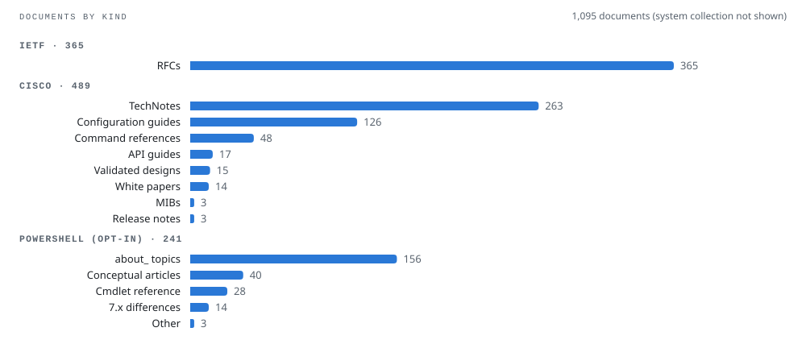

<div align="center">

<picture>
  <source media="(prefers-color-scheme: dark)" srcset="docs/figures/banner-dark.svg">
  <source media="(prefers-color-scheme: light)" srcset="docs/figures/banner-light.svg">
  
</picture>

Retrieval-augmented question answering for network and security engineering.<br>
Answers are built from a local corpus of RFCs and Cisco documentation, and every quotation is string-matched against the source before use.

<p>
  <a href="#getting-deep32"></a>
  <a href="#mcp-tools"></a>
  <a href="#retrieval-pipeline"></a>
  <a href="#verifying"></a>
  <a href="https://orcid.org/0009-0003-8091-4637"></a>
</p>

[Background](#background) · [Architecture](#architecture) · [Retrieval](#retrieval-pipeline) · [Tools](#mcp-tools) · [Protocol](#answer-protocol) · [Corpus](#corpus) · [Evaluation](#evaluation) · [Hardware](#hardware) · [Getting it](#getting-deep32) · [Limitations](#limitations)

</div>

> [!NOTE]
> 0.1.0-alpha.1 is the first public release: the source and the signed Workstation image, with the GPU pack and content images following in the next few days (see [Getting Deep32](#getting-deep32)). The measurements on this page are from my development setup.

## Background

If you've studied for any Cisco certification (or at the very least attempted to browse their technical paper repo...) you understand the pain involved in trying to find current information. Yes, as an engineer, you should be able to locate your own sources. I think over the past few years, though, it has become more "get thrown to the wolves" than most professions. Which is fine.....up to a point.

With the advent of modern generative AI (things like Claude, ChatGPT, etc...) modern engineers have become very comfortable using these services to find answers (R.I.P. Stack Overflow, you stingy bastard...), learn new information, or plan/implement/troubleshoot an active production deployment. Unfortunately, even with the flagship models, the results are moderate at best and at worst downright dangerous (if you've never tried arguing with an engineer that uses generative AI instead of reading documentation, I envy you). That being said...Artificial Intelligence (more specifically, Large Language Models and associated algorithms) can be EXTREMELY useful in research+development, in fields much more complex than network engineering and security.

So, I got to thinking. What if you had an agentic flagship model (something like Opus or Mythos, or even GPT 6.1 Sol) via your terminal of choice (Claude Code or Codex, for example) and hooked it up to a local RAG system? If you don't know what RAG is...don't worry, I didn't either before last year. It stands for, "Retrieval-Augmented Generation" and is based in a local database of documentation, instead of relying on whatever the model remembers from its training. I began experimenting with this, and a few months (and many iterations later....), we have Deep32. But, what is it about LLMs that makes networking in particular so difficult to understand for them?

If you've ever read an RFC, you know that they're constantly being updated and obsoleted by newer ones (as are most engineering white papers, configuration guides, technical notes...ad nauseam). Networking in particular is a consistently evolving field, and LLMs (simply speaking) have an extremely difficult time catching up. LLMs are (more or less) fluent in understanding the fundamentals of things like routing protocols, but are often wrong on the specifics (the devil is in the details). The answer may originally READ fine and may cite a relevant source, but...eventually you'll notice that a timer or a default is off. Maybe the command syntax in an output doesn't precisely match the version of Cisco IOS XE you're using. With a field as granular as this, it becomes inherently hard to tell what should or should not be done without actually opening the source documentation. Most of the errors I see fall into four groups:

| Error | Example | What Deep32 does |
|---|---|---|
| Vendor default given as the standard | "BGP hold time is 180 seconds." That is the Cisco default; RFC 4271 suggests 90. | Retrieves RFC text and vendor text as separate sources and compares them |
| Obsolete RFC cited as current | RFC 1771 quoted for BGP-4 after RFC 4271 replaced it | Looks up status, obsoleted-by and errata for every RFC cited |
| Command from the wrong release | Syntax from one software train given for another | Each passage carries its platform and release, and a search can prefer or cap a release |
| Invented quotation | "The RFC states ..." followed by text that is not in the RFC | String-matches every quotation against the source section |

All four can be checked mechanically. The agent starts with no documents and answers only from passages it retrieves, or states that the corpus does not cover the question. Quotations are string-matched against the stored text; no model is involved in that check. Every input to an answer is versioned, from document hashes up to whole index generations, so one build can be compared with the next and rolled back. Retrieval runs on your own hardware. The LLM is the only hosted component.

## Architecture

<picture>
  <source media="(prefers-color-scheme: dark)" srcset="docs/figures/architecture-dark.svg">
  <source media="(prefers-color-scheme: light)" srcset="docs/figures/architecture-light.svg">
  
</picture>

A RAG system consists of a document store, a search engine (two here, combined; see below) and an LLM that answers only from what the search returns. The rest of the diagram moves data between them.

An install has three parts. The Workstation is the machine you sit at. The Forge is whichever machine has the NVIDIA card. The headend is the PC where your agent (Claude Code or Codex) runs. All three can be the same machine or three different ones, and they find each other over your own Tailscale network.

| Part | Comes from | Runs on | What it does |
|---|---|---|---|
| Workstation | The Workstation image (a bootable OpenBSD 8.0 installer), with the Content image imported after first boot | A machine or VM of its own | The CDE desktop, the Ask window, the Deep32 Encyclopedia and its reader, the search engine and the MCP gateway. It holds the index and does the keyword and vector search itself |
| Forge | The GPU pack, loaded into Docker on Linux or into WSL2 on Windows | Any machine with a supported NVIDIA card | Turns each query into a vector, reranks the candidates, converts PDFs when you add documents, and can rebuild the index from the corpus blocks |
| Headend | Deep32 Connect on Windows, or a single MCP entry on any OS | Wherever Claude Code or Codex already runs | The agent. It calls the gateway's tools itself, and it also answers whatever gets typed into the Ask window |

Five software components run across those parts:

| Component | Role |
|---|---|
| Agent | Runs the [answer protocol](#answer-protocol) and writes the answer. Claude Code and Codex in 1.0; any MCP client can call the gateway. |
| Gateway | MCP server for the eleven [tools](#mcp-tools), on the Workstation. Stateless. Its server instructions tell the client to treat all tool output as untrusted document text. |
| Engine | Hybrid search, section reader, identifier lookup, quotation check, on the Workstation. Serves one index generation at a time. |
| Forge services | Query embedding and cross-encoder reranking. If the Forge can't be reached, search falls back to BM25 and the response is marked degraded. |
| Build pipeline | Builds and validates [index generations](#index-generations). Every release ships a prebuilt one on the Content image; the Forge can build new ones from the corpus blocks. |

The gateway holds no documents. It checks the token, passes the call to the engine and returns the result. Its server instructions state that everything a tool returns is document text and that nothing in it is to be followed as an instruction; a PDF can carry a prompt injection as easily as a web page.

An agent reaches Deep32 in one of two ways. The first is plain MCP: the agent calls the gateway's tools while it works, which is how Claude Code and Codex use Deep32 for their own research. The second is the Ask window on the Workstation. You type a question there, it goes over the paired link to a small relay on the headend, the relay starts the agent with the research skill, the agent's searches come back to the Workstation's gateway, and the answer streams into the Ask window. The relay ships for Windows in 1.0.

Every part joins your tailnet with your own Tailscale sign-in, and no image carries a key or an auth token. Tailnet membership is not sufficient to use a service: each install generates its own tokens, and the parts pair with a short code entered on both sides (SPAKE2, RFC 9382).

Software versions in 1.0:

| Layer | Software | Detail |
|---|---|---|
| Workstation OS | OpenBSD 8.0 | CDE desktop, signed updates |
| Gateway | Python 3.14, MCP SDK 2.2 | Streamable HTTP at `/mcp`, stateless, JSON responses. Bearer token made at install, compared in constant time. |
| Search API | Python 3.12, FastAPI, uvicorn | REST under `/v2`, bearer token. 2 searches run at once, 16 wait, the rest get `503` with `Retry-After`. |
| Keyword index | SQLite FTS5 | `unicode61` tokenizer, diacritics removed. BM25 over passage text (weight 1.0) and heading path (weight 2.0). |
| Vector search | Exact scan of a flat index | 1024 dimensions, cosine, float32. A small C kernel with one fixed order of operations, so every amd64 machine ranks the same way. |
| Embeddings | Text Embeddings Inference 1.9, `jina-embeddings-v5-text-small` | On the Forge. float32, last-token pooling, model revision pinned |
| Reranker | `jina-reranker-v3.5` | On the Forge. Cross-encoder, model revision pinned |
| PDF converter | MinerU 4.0.7 and PyMuPDF | On the Forge, under AGPL-3.0, source included |
| Network | Tailscale | Your own tailnet, HTTPS between parts |

## Retrieval pipeline

<picture>
  <source media="(prefers-color-scheme: dark)" srcset="docs/figures/pipeline-dark.svg">
  <source media="(prefers-color-scheme: light)" srcset="docs/figures/pipeline-light.svg">
  
</picture>

Two searches run because their failure modes are complementary. BM25 is keyword matching: given `timers bgp` or "RFC 4271" it finds the exact string, and given a problem described in other words it misses passages that phrase it differently. Dense search embeds text as vectors and matches on meaning, so a loosely worded question still reaches the right section, but it can rank an exact identifier match low. I run both and merge the results. On my test set, BM25 alone ranks a correct passage first 71% of the time, dense alone 78%, and the merged list 82%.

The merge is reciprocal rank fusion. A passage scores 1/(60 + rank) in each list it appears in, and the scores are summed. BM25 scores and cosine similarities are on different scales and are never compared directly. A passage ranked well by both searches ends up near the top.

The reranker is a second, slower model. It reads the question and one candidate passage together and scores how well the passage answers it. Running it over the whole corpus is too expensive, so it scores only the top 15 of the fused list. It is the largest single improvement in the pipeline (82% to 95.5% at rank 1) and the largest single cost, about 400 ms of a 542 ms search. A faster reranker tested worse (see [Things that did not work](#things-that-did-not-work)).

| Stage | What happens | Setting |
|---|---|---|
| Plan | A `search_many` call takes several queries at once. Identifiers such as RFC numbers and command names go in as BM25 queries, paraphrases as dense queries. | 1 to 8 queries |
| Keyword | FTS5 BM25 over passage text and heading path, with headings weighted 2x | 50 candidates per query |
| Semantic | The query is embedded as `Query: {text}`. Passages were embedded as `Document: {title}`, `Section: {heading path}`, then the text. | 50 candidates per query |
| Fuse | Weighted reciprocal rank fusion, both legs at weight 1.0 | k = 60, top 30 kept |
| Rerank | Cross-encoder, each candidate scored against the query that retrieved it. The reranker sees a 1,600-character window centered on the candidate's best-matching text. | top 15 (top 10 per query in `search_many`) |
| De-duplicate | Passages with identical text fold into one hit, and the other locations are listed in `also_in`. A passage that overlaps a better-ranked hit in the same file by half or more is dropped. | text compared after case and punctuation are normalized |
| Deliver | 32 hits in three tiers | below |

Cisco documentation repeats heavily. The same paragraph appears in the guide for one release and again in the guide for the next; without de-duplication, part of the top 8 is the same text twice. Identical passages are folded into one hit that lists every other location of the text.

The last step sets how much text is returned. An agent can use more than 8 passages, but 32 full passages cost too many tokens per search. The result is delivered in three tiers: the best 8 in full, the next 8 trimmed, and 16 more as short pointers the agent can open. The 32 in the name is this hit count; the strip under the logo is one result drawn to scale.

| Tier | Ranks | Text window | Order |
|:---:|:---:|---|---|
| 1 | 1 to 8 | up to 2,400 characters | reranked |
| 2 | 9 to 16 | up to 800 characters | reranked through rank 15 |
| 3 | 17 to 32 | up to 250 characters | fusion order |

Every hit is centered on its best-matching line. Tier 2 and 3 hits carry a reference for reading the full section.

Request options:

| Option | Values | Effect |
|---|---|---|
| `mode` | `hybrid`, `bm25`, `dense` | Which legs run |
| `rerank` | `auto`, `on`, `off` | Cross-encoder on or off |
| `limit` | 1 to 30 | An exact number of hits in place of the 32-hit result |
| `max_chars` | 200 to 4,000, default 2,400 | Text window per hit |
| `doc_type`, `docs` | a collection, a list of document keys | Restricts the search. Also the only way to reach an opt-in collection. |
| `release_max` | `17.9` | Skips documents from a newer release on the same major line |
| `prefer_release` | `["17.9"]` | Among identical copies of a passage, shows the copy from this release |
| `include_obsolete` | default true | False drops obsoleted RFCs |

The Forge is often a desktop PC with a graphics card, so it is the part most likely to be off, rebooting or busy. The engine treats it the way a routing protocol treats a neighbor. After three consecutive failed calls the dense leg is marked down, searches stop waiting on it, and one trial call is allowed every 30 seconds until it answers. Until then BM25 serves alone, and every response carries a `degraded` field naming each service it needed and could not reach.

| Failure | Search behavior | `degraded` |
|---|---|---|
| Forge's embedding server, or the vector index | BM25 answers alone. After 3 consecutive failures a circuit breaker opens for 30 seconds and the dense leg is skipped without waiting on a timeout, then one trial call. | `dense` |
| Reranker | Fused order is returned without reranking. Same breaker settings. | `reranker` |
| Structured indexes | Hits come back without RFC status | `kb` |
| Section index | Hits carry the passage's own text and no section reference | `structure` |

## MCP tools

MCP (Model Context Protocol) is the standard interface for giving an agent a set of tools. Deep32 provides eleven. None of them writes an answer: they search, fetch sections, look up identifiers and check quotations. The agent writes the answer from what they return.

| Tool | Returns | Arguments worth knowing |
|---|---|---|
| `search_rag` | Ranked passages for one query. Each hit has a citation, section path, RFC status and a text window. | the request options above |
| `search_many` | Up to 8 queries fused into one ranked list. Each query keeps its best passage. | per-query `mode` and `weight` |
| `get_outline` | Section tree of a document | `depth` 1 to 6, `under` for one chapter |
| `get_section` | Full text of a section with its neighbors | paged, up to 100,000 characters per call |
| `grep_corpus` | Matching lines with document, line number and section | literal by default, bounded regex optional, up to 200 matches, 3-second budget |
| `find_command` | CLI index rows: command, kind, mode, location, platform, release | IOS abbreviations accepted. `release` ranks entries at or below it first. |
| `lookup_id` | What an identifier is and where it is defined | RFC and section numbers, BCP and STD numbers, IANA code points, CLI commands, glossary terms, PowerShell cmdlets, API operations |
| `lookup_rfc` | Status, obsoletes, obsoleted-by, updates, errata | optional section text |
| `verify_quote` | `exact`, `normalized` or `not_found`, with the location | quotation of 3 to 4,000 characters |
| `list_documents` | Catalog: key, type, release, RFC status, size, title | optional collection |
| `rag_status` | Index generation, corpus fingerprint, counts, backend and breaker state | |

## Answer protocol

A model with tools will still answer from memory unless it is made to use them, so the agent follows a fixed procedure:

1. Look up every identifier (RFC number, LSA type, path attribute, CLI command) with `lookup_id` or `find_command` before using it.
2. Run one `search_many` call with three to six queries, restricted to one collection where the question allows it.
3. Read the full section with `get_outline` and `get_section`, plus any Restrictions or Defaults section next to it. Search hits are only for locating text.
4. Run `lookup_rfc` on every RFC cited, to catch obsoleted documents and read the errata.
5. Run `verify_quote` on every quotation.
6. Compare the RFC text with the vendor's documented behavior and defaults, and report any difference.
7. If the corpus does not cover the question, say so.

| `verify_quote` result | Meaning | Effect |
|---|---|---|
| `exact` | Character-for-character match | Quotation can be used |
| `normalized` | Matches after collapsing whitespace, RFC page breaks and hyphenation | Quotation can be used |
| `not_found` | No match in that section | Quotation is dropped and the agent goes back to the section |

`normalized` exists because RFCs are plain text with hard line breaks and, in older documents, page footers. A sentence split across two lines with a page break between them is not a misquote.

### Example: BGP keepalive and hold timers

The usual answer for the BGP default timers is 60 and 180 seconds. The tools returned the following for that question (my deployment, 14 November 2026).

| # | Call | Result |
|:---:|---|---|
| 1 | `lookup_rfc 4271` | Draft Standard. Obsoletes RFC 1771. Updated by twelve later RFCs. 16 errata on record, none against section 10. |
| 2 | `verify_quote` in RFC 4271, section 10:<br>"The suggested default value for the HoldTime is 90 seconds." | `normalized`<br>The sentence breaks across lines 5008 and 5009 of the RFC text. |
| 3 | `verify_quote` in RFC 4271, section 10:<br>"The suggested default value for the KeepaliveTime is 1/3 of the HoldTime." | `normalized` |
| 4 | `verify_quote` in Cisco IOS IP Routing: BGP Command Reference, `timers bgp`:<br>"Frequency (in seconds) with which the Cisco IOS software sends keepalive messages to its peer. The default is 60 seconds." | `exact` |
| 5 | `verify_quote`, same section:<br>"Interval (in seconds) after not receiving a keepalive message that the software declares a peer dead. The default is 180 seconds." | `exact` |
| 6 | `verify_quote` in RFC 4271, section 10:<br>"The suggested default value for the HoldTime is 180 seconds." | `not_found` |

"60 and 180" is correct for Cisco IOS and IOS XE and incorrect as a statement about the RFC, which suggests a 90-second hold time with keepalives at one third of it. Call 6 is the check rejecting a sentence that does not exist: section 10 has no 180-second figure.

## Corpus

The configuration guide for one IOS XE release and the guide for the next can disagree, so every document carries its platform and release, and a search can prefer a release or exclude newer ones.

| Collection | Documents | Contents |
|---|:---:|---|
| IETF RFCs | 365 | RFC text plus RFC Editor status, relations and errata |
| Cisco documentation | 489 | IOS XE, SD-WAN, Catalyst Center, ISE and Secure Client |
| PowerShell (opt-in) | 241 | Windows PowerShell 5.1 reference, 7.x differences, Windows networking modules |
| System (opt-in) | rebuilt per release | Deep32's own source, configuration and design notes, so that it can answer questions about itself |

<picture>
  <source media="(prefers-color-scheme: dark)" srcset="docs/figures/corpus-dark.svg">
  <source media="(prefers-color-scheme: light)" srcset="docs/figures/corpus-light.svg">
  
</picture>

Opt-in collections are searched only when a query names them, which keeps PowerShell help text out of routing results. They also get their own FTS5 table, because BM25 statistics computed over one shared table still counted the rows a filter had excluded.

Some questions are lookups: whether RFC 1771 is still current, or the exact syntax of a command. A ranked search answers those with plausible errors, so each build also produces lookup tables:

| Index | Size | Source |
|---|---|---|
| RFC index | 9,842 RFCs with status and relations | RFC Editor |
| Errata | 1,217 records | RFC Editor |
| IANA registries | 2,366 entries | IANA |
| CLI index | about 150,000 command entries with mode, platform and release | Command references and configuration guides |
| Feature history | 2,578 entries | Vendor feature tables |

Every document has a manifest entry. This is the one for RFC 4271:

```json
{
  "doc_key": "rfc4271",
  "title": "A Border Gateway Protocol 4 (BGP-4)",
  "doc_type": "rfc",
  "doc_kind": "rfc",
  "path": "rfc/rfc4271.txt",
  "source_url": "https://www.rfc-editor.org/rfc/rfc4271.txt",
  "page_url": "https://www.rfc-editor.org/rfc/rfc4271.html",
  "platform": null,
  "release": null,
  "release_note": null,
  "sha256": "98b851146abcd56ecbb398dd1a818bcde2dcac6fde3d901c423d988f86eaab76",
  "bytes": 222702,
  "license": "IETF RFC; IETF Trust Legal Provisions (BCP 78): may be copied and distributed in full without modification",
  "terms_url": "https://trustee.ietf.org/license-info",
  "redistribute": true,
  "near_duplicate_of": []
}
```

This repository contains no vendor text. The Cisco documents belong to Cisco.

## Index generations

The index is handled like a production configuration: the running one is never edited in place. Every corpus change builds a complete new index (a "generation") beside the old one, and the engine serves one generation at a time. A new generation must pass the test set before the engine is switched to it, and if the check after the switch fails, the engine reverts to the previous generation on its own. Same principle as `reload in 5` before an ACL change on a remote router.

```
<generation>/
  sources/            corpus snapshot as built: manifest.json, <collection>/*.txt, kb/*.json
  config/             dense.json, retrieval.json, serving.json for this generation
  sqlite/rag.db       documents, passages, sections, FTS5 tables
  kb/kb.sqlite        RFC index, errata, IANA, CLI, glossary, feature history
  dense/              vectors.f32 and points.bin: the flat vector index the Workstation scans
  BUILD_REPORT.json
  VALIDATION.json     gate result
  logs/               retrieval traces
```

On the Workstation the vectors sit beside the generation as one flat file of float32 rows, searched by an exact scan. When the Forge builds or rebuilds an index, it loads them into a Qdrant collection named after the generation.

| Identifier | Derivation |
|---|---|
| Document ID | `doc_` + SHA-256 of the source file |
| Passage ID | `chk_` + SHA-256 of the document hash, the passage's position and its text |
| Vector point ID | UUIDv5 of the passage ID |

A passage whose ID and embedding text are unchanged reuses its vector from the previous generation. One corpus update embedded 904 new passages and reused 62,617 existing vectors.

Ingest steps and their gates:

| Step | What happens | Gate |
|---|---|---|
| Convert | HTML and PDF to plain text, in a sandbox with no network access | |
| Check | Quality checks, plus a scan for instruction-like lines (what a prompt injection planted in a document would look like) | Zero failures. Flagged lines are reviewed by hand. |
| Manifest | Hash, source URL, platform, release, license and redistribution flag for every document | |
| Build | Chunking, FTS5 tables, section index, embeddings, structured indexes | Build report |
| Validate | The labeled question set is run against the new generation and the current one, and compared query by query | Zero net regressions: losing one question without gaining one elsewhere fails |
| Switch | One setting and a service restart, with a smoke test before and after | The evaluation that follows must pass, or the switch rolls back automatically |

Old generations stay on disk, so a rollback is the same switch pointed at the previous one.

## Evaluation

Only retrieval has been measured so far: whether the correct passage is returned, and at what rank. Answer accuracy has not been measured; that evaluation is next. All figures below are from my development setup, which runs the same engine, models and corpus as 1.0.

hit@1 is the share of questions whose top result is a correct passage; hit@8 is the share with a correct passage anywhere in the top 8. The agent reads the full top 8, so hit@8 bounds whether the answer can be correct and hit@1 indicates how much reading it takes.

| Test set | |
|---|---|
| Questions | 726: 696 with an answer in the corpus, 30 without |
| Topics | Enterprise routing, switching, VPN, SD-WAN, network services, access control |
| Relevance labels | 9,209 text spans across 463 documents: 5,175 written with the questions, 2,094 copied to identical passages in sibling documents, 1,940 added by judging retrieved passages |
| How it was built | Questions and first labels were generated per topic by an LLM pipeline (an author and an adversarial verifier). Judged labels are audited blind; the last two audits agreed on 22 of 27 and 15 of 16 items. |
| Relevance rule | A hit counts when it comes from the labeled document and its passage contains the labeled span |
| Repeatability | Three runs over one week returned identical metrics |

<picture>
  <source media="(prefers-color-scheme: dark)" srcset="docs/figures/stages-dark.svg">
  <source media="(prefers-color-scheme: light)" srcset="docs/figures/stages-light.svg">
  
</picture>

All 696 answerable questions, through the gateway, 2 November 2026. Counts in parentheses.

| Metric | Fused + reranked | Fused only |
|---|:---:|:---:|
| hit@1 | 0.955 (665) | 0.822 (572) |
| hit@3 | 0.983 | 0.934 |
| hit@8 | 0.991 (690) | 0.983 (684) |
| MRR@10 | 0.970 | 0.882 |
| delivery@8 | 0.909 | 0.904 |

delivery@8 is the share of labeled answer spans that arrive intact in the delivered text window, out of those present in the retrieved passages. Paired over the 696 questions, reranking wins 102 and loses 9 at hit@1. At hit@8 it wins 6 and loses none.

Rank of the first relevant passage in each list's top 30:

| List | Rank 1 | Top 8 | Top 15 | Top 30 | Not in top 30 |
|---|:---:|:---:|:---:|:---:|:---:|
| BM25 | 494 | 646 | 666 | 687 | 9 |
| Dense | 545 | 675 | 688 | 692 | 4 |
| Fused | 572 | 684 | 690 | 693 | 3 |
| Fused + reranked | 665 | 690 | 690 | 693 | 3 |

BM25 or dense has a relevant passage in its top 30 for 694 of the 696 questions. For 6 questions the fused top 15, which is all the reranker sees, has nothing relevant.

The 31 misses at rank 1 were judged afterward:

| Cause | Questions |
|---|:---:|
| Label gap: the rank-1 passage answers the question but had no label | 7 |
| The reranker put another passage above a relevant one in its pool | 21 |
| A relevant passage was retrieved, but fusion left it outside the reranker's top 15 | 3 |

That leaves 24 real misses: 672 of 696 (0.966) with the labels corrected. I report 0.955 until the label set is frozen again. The generation in service on my setup has the same 31 and the same 6.

Seven of the recorded misses were errors in my answer key; retrieval had returned a correct passage. Every figure on this page carries the same label error, the favorable ones included.

## Things that did not work

Approaches that failed or cost time during development:

- Adding a second IOS XE release line dropped hit@1 from 0.824 to 0.754. The cause was the test set: 234 of the 694 questions (at the time) had their answer passage repeated word for word in one of the new books, where it had no label, so correct hits were being scored as misses. Duplicates now fold into one hit. Before that, about 4% of top-8 slots (231 of 5,808 in one run) were a copy of a passage already in the list.
- Bigger chunks scored worse. Hit@1 went from 0.955 to 0.935 and fewer answer passages were delivered intact, so the small chunks stayed.
- A faster reranker cost 10 questions at hit@1 once its new top hits had been judged. I kept the slow one.
- Two HNSW builds from the same vectors can disagree on a question or two. That is enough to trip a zero-regression gate, so new generations clone the previous index snapshot and add to it.
- There is a late-interaction (ColBERT) retriever in the code that isn't part of the served pipeline. Its first run was OOM-killed because the search library packed about 30,700 candidates into one 31 GiB tensor. Capping the batch size fixed that.
- Check that Tailscale has a direct path between your nodes. Relayed through DERP, node-to-node latency was 70 to 157 ms. Direct, it is 1 to 2 ms.

## Hardware

I built and tested Deep32 on a 2013 Xeon without AVX2 and one consumer graphics card, which is close to the minimum. Supported graphics cards and single- and multi-machine layouts are in [docs/HARDWARE.md](docs/HARDWARE.md).

| Layout | Minimum | Recommended |
|---|---|---|
| Workstation alone (keyword search only) | 64-bit Intel or AMD with virtualisation; 6 threads and 12 GB on the host; 60 GB free | As below |
| Workstation and Forge on one machine | 8 threads and 32 GB; an NVIDIA card of compute capability 7.5 or newer with 6 GB; 160 GB free | 12 or more threads, 32 GB or more, an AVX2 processor and an RTX 20 series or newer card |
| Forge alone | 4 threads and 16 GB on the host; a card as above; 100 GB free | As above |
| Headend | Any PC that runs Claude Code or Codex | Windows, for the Ask window's relay in 1.0 |

The Forge also needs an NVIDIA driver of 580.65.06 or newer, Docker and the NVIDIA Container Toolkit (on Windows, WSL2 handles that side). The Workstation has no model of its own, so without a Forge it searches on keywords only.

Latency on my development setup (same engine and models as 1.0, on the Xeon and an 11 GB card), measured through the gateway with one client on 2 November 2026. Each search leg takes about 125 ms including the gateway round trip. The reranker accounts for about 400 ms of every reranked search.

| Search | p50 | p95 | Searches |
|---|:---:|:---:|:---:|
| Hybrid + rerank, 8 hits | 521 ms | 656 ms | 696 |
| Hybrid + rerank, 30 hits | 542 ms | 682 ms | 696 |
| Hybrid, rerank off, 30 hits | 140 ms | 201 ms | 696 |
| BM25 only, 30 hits | 125 ms | 185 ms | 696 |
| Dense only, 30 hits | 122 ms | 145 ms | 696 |
| `search_many`, 3 queries, 8 hits | 778 ms | 1,120 ms | 70 |

## Getting Deep32

0.1.0-alpha.1 is an alpha. The Workstation image is on the release page now. The GPU pack and the content image are still being assembled and will be added to the same release in the next few days; until then the Workstation installs but cannot search.

The release installs without any of my keys, logins or network settings. It is three images, covered by one signed checksum list.

| Image | Kind | Contents |
|---|---|---|
| Workstation | Bootable installer | OpenBSD with the engine, the gateway, the Ask window, the Deep32 Encyclopedia and the desktop |
| Content | Data | A prebuilt index generation, the corpus blocks that can be redistributed, and the encyclopedia content |
| GPU pack | Data, mounted on the host | The GPU services as containers, plus the two ways to start them: Docker on Linux, or WSL2 on Windows |

The larger images exceed GitHub's size limit for a release file and are split into parts. `deep32-get` (on the release page, `.sh` for Linux and `.ps1` for Windows) downloads the parts for the requested image, resumes an interrupted download, checks every hash and the signature, and joins the parts:

```sh
./deep32-get.sh disc1             # Workstation image, verified, ready to write to a USB stick
./deep32-get.sh disc3 --install   # GPU pack: verify, mount and start the containers (Linux, as root)
```

```powershell
.\deep32-get.ps1 disc3 --install  # GPU pack through WSL2 on Windows
```

- No keys, tokens or logins are shipped on any image. Each install generates its own.
- The guided Workstation install needs a disk of 160 GB or more in this alpha. A smaller layout is planned for the beta.
- The research skills for Claude Code and Codex are in `adapters/`, and [INSTALL.md](INSTALL.md) shows how to connect an agent to the gateway by hand. The Ask window needs the relay, which comes with the one-step headend installer (Deep32 Connect) in a later release.
- The GPU pack needs an NVIDIA driver of at least 580.65.06, Docker and the NVIDIA Container Toolkit. If one is missing, the installer names it and stops before changing anything. A bootable GPU installer that sets these up is planned for a later release.
- Every node joins the installer's own Tailscale network. The layout is the same whether the nodes share one machine or sit on several.
- Claude Code and Codex are supported first. An OpenAI-compatible adapter for locally served models is designed for a later release.

## Roadmap

- [x] Hybrid retrieval engine, gateway and MCP tools, in private use
- [x] Quotation checks and RFC status checks
- [x] Gated index generations with rollback
- [x] Retrieval evaluation on a labeled question set
- [ ] Design document covering the architecture and the verification method
- [ ] Answer-level evaluation with verification on and off
- [ ] Code release
- [x] Signed release images (0.1.0-alpha.1: Workstation; GPU pack and content images to follow)
- [ ] Bootable GPU installer
- [ ] Archived releases with a DOI

## Limitations

- A verified quotation shows that the text is in the source. It says nothing about whether the reasoning built on it is sound.
- Answers are limited to what the corpus covers, and the corpus is Cisco documentation plus RFCs. Other vendors aren't in it.
- Answer accuracy has not been measured (see [Evaluation](#evaluation)).
- The test set was generated with an LLM pipeline, and its labels have gaps: 7 of the 31 recorded misses at rank 1 turned out to be missing labels.
- The LLM is hosted, so the question and the retrieved passages go to the model provider. Everything else stays local.
- A cited answer still needs to be tested in a lab before a change goes into production.

## Verifying

Commits are signed with this OpenPGP key. Tags and release manifests will be signed with it too.

```
B205 B406 5486 27AA BF52  50D8 A078 C5F2 5D02 5DD6
```

```sh
gpg --keyserver hkps://keys.openpgp.org --recv-keys B205B406548627AABF5250D8A078C5F25D025DD6
gpg --fingerprint B205B406548627AABF5250D8A078C5F25D025DD6
git verify-commit HEAD
```

The key is on [keys.openpgp.org](https://keys.openpgp.org/search?q=B205B406548627AABF5250D8A078C5F25D025DD6). Every release has a detached signature over its checksum list. `deep32-get` checks the signer's fingerprint as well as the signature before it trusts any hash. The manual equivalent:

```sh
gpg --verify SHA256SUMS.sig SHA256SUMS
sha256sum -c SHA256SUMS
```

## Citing

```bibtex
@software{cummings_deep32,
  author = {Cummings, Jeffrey A.},
  title  = {Deep32: Retrieval-augmented question answering for network and security engineering},
  year   = {2026},
  url    = {https://github.com/hellobpdu/deep32},
  note   = {Version 0.1.0-alpha.1}
}
```

A DOI will be added with the first archived release.

## License

Code is licensed under AGPL-3.0-or-later and documentation under CC-BY-4.0. See [LICENSING.md](LICENSING.md), [LICENSE](LICENSE) and [LICENSE-DOCS](LICENSE-DOCS) for the grants and full licence texts. Third-party software, models and documents keep their own terms. Both Jina models are licensed CC BY-NC 4.0. Artwork and sounds keep the terms recorded in the asset ledger.

The names are the trademarks of their owners, used only to describe compatibility, and Deep32 is not affiliated with or endorsed by them.

## Author

Jeffrey A. Cummings · [ORCID 0009-0003-8091-4637](https://orcid.org/0009-0003-8091-4637) · [jacummings@acm.org](mailto:jacummings@acm.org) · [@hellobpdu](https://github.com/hellobpdu)

Send security reports by email, encrypted to the key above.

<sub>Personal work. Not affiliated with or endorsed by my employer. Cisco, IOS and Catalyst are trademarks of Cisco Systems, Inc. Other names belong to their owners.</sub>
