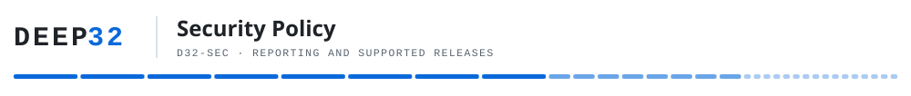

<div align="center">

<picture>
  <source media="(prefers-color-scheme: dark)" srcset="docs/figures/head-security-dark.svg">
  <source media="(prefers-color-scheme: light)" srcset="docs/figures/head-security-light.svg">
  
</picture>
<br>

</div>

How to report a security problem in Deep32, and which release gets the fix.

<sub>Applies to 0.1.0-alpha.1 · [1 Supported releases](#1-supported-releases) · [2 Reporting](#2-reporting-a-vulnerability) · [3 Scope](#3-scope) · [4 Security design](#4-security-design)</sub>

## 1. Supported releases

| Release | Status | Fixes |
|---|---|---|
| 0.1.0-alpha.1 | Source current; images withdrawn | Fixes go into 0.1.0-alpha.2 |

## 2. Reporting a vulnerability

Please report privately, by email to [jacummings@acm.org](mailto:jacummings@acm.org), encrypted to the release key:

```text
B205 B406 5486 27AA BF52  50D8 A078 C5F2 5D02 5DD6
```

Include the release, the part affected (Workstation, Forge, headend, release tools), what you did and what happened,
with any tokens removed. Please do not open a public issue for a vulnerability.

I'll confirm I got the report and keep you posted while I work on a fix. Unless you'd rather not, I'll credit you in
the release notes.

## 3. Scope

In scope: everything in this repository and the signed images built from it, including the gateway, the engine,
pairing and publication, the installers, `deep32-get` and the release signatures.

Out of scope: Tailscale, Docker, NVIDIA's drivers and container toolkit, the language model providers, and the
documents in the corpus. Report problems in those to their owners. A document that tries to instruct the agent is
expected, since Deep32 treats retrieved text as untrusted. A way around that is in scope.

## 4. Security design

[Security considerations](README.md#10-security-considerations) in the README describes the design, and the
[network contract](docs/contracts/C8-network.md) specifies ports, tokens and pairing in detail.

---

<p align="center"><sub><a href="README.md">Overview</a> · <a href="INSTALL.md">Installation</a> · <a href="docs/HARDWARE.md">Hardware</a> · <a href="docs/OPTIONAL-FEATURES.md">Optional features</a> · <a href="docs/contracts/README.md">Contracts</a> · <a href="adapters/README.md">Agent adapters</a> · <b>Security</b> · <a href="CHANGELOG.md">Release notes</a></sub></p>
