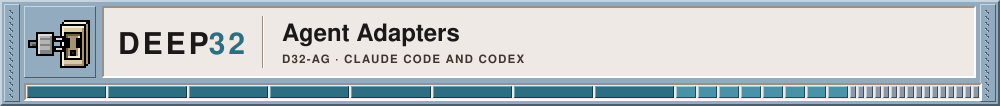

<div align="center">

<picture>
  <source media="(prefers-color-scheme: dark)" srcset="../docs/figures/head-adapters-dark.svg">
  <source media="(prefers-color-scheme: light)" srcset="../docs/figures/head-adapters-light.svg">
  
</picture>
<br>

</div>

How to connect Claude Code or Codex to your Workstation, install the research skill, and set up the optional Ask
relay. This page is for the PC where your agent runs, which the rest of the documentation calls the headend.

<sub>Applies to 0.1.0-alpha.3 · [1 Before you start](#1-before-you-start) · [2 Connect](#2-connect-an-agent) · [3 Separate profile](#3-use-a-separate-profile) · [4 Skills only](#4-install-the-skills-only) · [5 Ask relay](#5-the-ask-relay) · [6 First session](#6-first-session) · [7 Troubleshooting](#7-troubleshooting) · [8 Files](#8-what-connect-changes) · [9 Removal](#9-remove-a-headend)</sub>

## 1. Before you start

There are three ways to use Deep32 from an agent. Most people want the first.

| Path | What you get | Section |
|---|---|---|
| Connect | The research skill, a paired credential of the agent's own, and a launcher that starts the agent with it | [2](#2-connect-an-agent) |
| Skills only | The research skill and, optionally, an MCP entry you manage yourself | [4](#4-install-the-skills-only) |
| Ask relay | Questions typed in the Workstation's Ask window, answered by the agent on this PC | [5](#5-the-ask-relay) |

You need:

- Claude Code or Codex installed and signed in;
- Python 3.11 or newer for Connect (3.10 or newer for the skills-only setup), and OpenSSL on `PATH`;
- Tailscale on this PC, signed in to the same tailnet as the Workstation;
- the Workstation's published gateway address, which ends in `/mcp`. The Workstation shows it when you turn on
  publication.

Set `DEEP32_CONNECT_PYTHON` (Connect) or `DEEP32_PYTHON` (setup) to choose a particular Python. Neither variable holds
a secret.

## 2. Connect an agent

<picture>
  <source media="(prefers-color-scheme: dark)" srcset="../docs/figures/part-headend-dark.svg">
  <source media="(prefers-color-scheme: light)" srcset="../docs/figures/part-headend-light.svg">
  
</picture>

**Procedure 1. Connect Claude Code, Codex or both**

1. On the Workstation, open **Pairing** and choose **Headend**. It shows a ten-character code that lasts five minutes.
2. On this PC, from the Deep32 source folder, run Connect with your agent and the Workstation's address:

   ```sh
   bash adapters/connect.sh --agent claude --workstation 'https://<workstation>.<tailnet>.ts.net/mcp'
   ```

   ```powershell
   powershell -NoProfile -ExecutionPolicy Bypass -File adapters\connect.ps1 -Agent claude -Workstation 'https://<workstation>.<tailnet>.ts.net/mcp'
   ```

3. Type the code at Connect's prompt, `Workstation one-time code for claude (hidden, 10 characters):`. The code stays
   hidden; the prompt shows one dot for each character, Backspace removes the last one and Ctrl+U clears the line.
   There is no way to pass the code or a token as an argument.
4. Start the agent with the `Launch:` command Connect prints. The launcher reads the agent's credential and hands it
   to the agent process only.

**Verify.** Run the same command with `--check` (`-Check` in PowerShell). It changes nothing, starts no pairing, and
checks the agent's sign-in, the address, authentication and the eleven tools.

Use `--agent codex` for Codex, or `--agent both` to connect both. With `both`, Connect pairs twice, once per agent:
open a new headend pairing on the Workstation for each and type each code in turn. Each agent gets its own
credential and can be revoked on its own. If the second pairing fails, the first stays in place, and running the
same command again picks up where it stopped.

`--name NAME` sets the MCP server name for a single agent. Connect refuses a name that conflicts with an existing
entry.

> [!NOTE]
> Connect pairs over the Workstation's pairing port and then checks the gateway over HTTPS. It doesn't change any
> Tailscale setting and can't open a pairing window on the Workstation; that is always done at the Workstation.

## 3. Use a separate profile

If Claude Code or Codex on this PC is already set up for other work, connect Deep32 to a separate, empty profile
instead. Connect then reads and writes only that folder and leaves your existing agent configuration alone.

**Procedure 2. Connect a separate profile**

1. Create a new, empty folder for one agent:

   ```sh
   profile="$PWD/deep32-codex-profile"
   mkdir -- "$profile"
   ```

   ```powershell
   $AgentProfile = Join-Path $PWD 'deep32-codex-profile'
   New-Item -ItemType Directory -Path $AgentProfile
   ```

2. Run Connect with `--profile-dir` (`-ProfileDir`):

   ```sh
   bash adapters/connect.sh --agent codex --workstation 'https://<workstation>.<tailnet>.ts.net/mcp' --profile-dir "$profile"
   ```

   ```powershell
   powershell -NoProfile -ExecutionPolicy Bypass -File adapters\connect.ps1 -Agent codex -Workstation 'https://<workstation>.<tailnet>.ts.net/mcp' -ProfileDir $AgentProfile
   ```

3. Sign the agent in to the new profile by adding `login` (Codex) or `auth login` (Claude Code) to the printed
   launcher command, then start the agent with the launcher alone:

   ```sh
   '<printed-launcher-path>' login
   '<printed-launcher-path>'
   ```

**Verify.** Run the Connect command from step 2 again with `--check`.

Use one agent per profile folder. `--agent both` is refused with `--profile-dir`. Start a new connection in an empty
folder with no hidden files or links. Use the resulting profile when running `--check`. If a connection into a profile was interrupted, revoke the headend it
paired (section [9](#9-remove-a-headend)), delete that folder and start with a new empty one. Don't copy account
files from another profile.

## 4. Install the skills only

The setup scripts copy the research skill into an agent's home and add a short marked block to its `AGENTS.md` or
`CLAUDE.md`. They don't pair, store a credential or contact the Workstation.

```sh
bash adapters/codex/setup.sh
bash adapters/claude-code/setup.sh
```

```powershell
powershell -NoProfile -ExecutionPolicy Bypass -File adapters\codex\setup.ps1
powershell -NoProfile -ExecutionPolicy Bypass -File adapters\claude-code\setup.ps1
```

| Agent | Default home | Override | Installs |
|---|---|---|---|
| Codex | `CODEX_HOME` or `~/.codex` | `--codex-home` / `-CodexHome` | Six skills: `deep32`, `deep32-configure`, `deep32-describe`, `deep32-design`, `deep32-troubleshoot`, `deep32-verify` |
| Claude Code | `CLAUDE_CONFIG_DIR` or `~/.claude` | `--claude-home` / `-ClaudeHome` | The `deep32` skill |

Setup checks every target before writing anything and keeps unrelated files as they are. Running it again with
nothing changed changes nothing. Before it replaces files it installed earlier, it backs them up under
`.deep32-backups`. It refuses, and tells you why, when it finds a local edit, an extra file in a skill folder it
owns, a damaged marker block, a link, or an existing MCP entry that differs.

**An MCP entry you manage yourself.** Add `--workstation-url` (`-WorkstationUrl`) with the gateway address, and setup
writes a `deep32` entry that reads its token from the `DEEP32_MCP_TOKEN` environment variable. Codex gets a `deep32`
table in `config.toml`; Claude Code gets `deep32.mcp.json`, used with the `claude --mcp-config` argument setup prints.
You then supply the token yourself and keep it out of files, arguments and chat. Connect does all of this for you,
with a credential of the agent's own, so use this only if you have a reason to.

## 5. The Ask relay

<picture>
  <source media="(prefers-color-scheme: dark)" srcset="../docs/figures/part-relay-dark.svg">
  <source media="(prefers-color-scheme: light)" srcset="../docs/figures/part-relay-light.svg">
  
</picture>

The relay lets you ask from the Workstation's Ask window and have the agent on this PC answer. It runs on Windows,
Linux and macOS as a per-user service: a logon task on Windows, a `systemd --user` unit on Linux, a LaunchAgent on
macOS.

> [!IMPORTANT]
> The PC's Tailscale machine name must start with `deep32-`, for example `deep32-relay`, and it must be in the same
> tailnet as the Workstation; the Workstation only offers such machines for pairing. Rename it with
> `sudo tailscale set --hostname deep32-relay` or on the admin console's Machines page.
>
> On Linux, also let your user manage Tailscale Serve once before installing: `sudo tailscale set --operator=$USER`.
> Without it the relay can't publish its port on your tailnet, and the installer tells you so.

> [!NOTE]
> Ask has no password of its own in this release. Anyone with an account in the Workstation's `_d32users` group,
> which includes the desktop user the installer creates, can open Ask and ask on the plan of the agent signed in on
> this PC. I protect the link itself: D32U/1 inside TLS 1.3, with each side pinning the other's certificate at pairing
> after you confirm the ten words, inside your Tailscale network on TCP port 7452. A per-window Ask password is planned
> for a later release.

**Procedure 3. Install and pair the relay**

1. Install the relay for your agent on your tailnet. It prints the relay's install ID. Replace `<id>` with that value
   in the commands below when supplying `--relay-id`.

   ```sh
   bash adapters/connect.sh --relay install --agent claude --relay-transport tailnet --tailscale-binary "$(command -v tailscale)"
   ```

   ```powershell
   powershell -NoProfile -ExecutionPolicy Bypass -File adapters\connect.ps1 -Relay install -Agent claude -RelayTransport tailnet -TailscaleBinary "C:\Program Files\Tailscale\tailscale.exe"
   ```

2. Sign the relay's own agent profile in. The relay runs the agent in a separate profile with none of your settings,
   so it needs its own sign-in. After you sign in, the relay checks the agent again on its own:

   ```sh
   bash adapters/connect.sh --relay login --relay-id '<id>' --agent claude
   ```

3. On Linux, let the relay run while you're logged out (once): `sudo loginctl enable-linger $USER`. Without it, the
   relay's `systemd --user` service stops when your last session ends.
4. Publish the Workstation gateway first as described in INSTALL section 8. If replacing a paired relay, run
   `/usr/local/d32/sbin/d32-chatctl unpair work` on the Workstation first. On Linux, stop the relay service before
   opening pairing on this PC.

   ```sh
   systemctl --user stop 'deep32-relay-<id>'
   bash adapters/connect.sh --relay pair --relay-id '<id>' --agent claude
   ```

   While pairing is open, run `/usr/local/d32/sbin/d32-pairdesk -relay` as root on the Workstation's text console
   (Ctrl+Alt+F1) and pick this PC. The Workstation points its Ask link at the relay, then each screen shows ten words.
   Type the Workstation's words here and this PC's words on the Workstation. On this PC the words appear as you type
   them, one at a time (`word 3 of 10:`), and each is checked when you press Space or Enter. A typing slip gets
   `that is not word 3 - type it again`; a different pairing word means the two screens disagree, so pairing stops and
   nothing is stored. The word comparison runs only on the text console, not in a desktop terminal window. After pairing, start the Linux service
   again with `systemctl --user start 'deep32-relay-<id>'`. Keep publication on while using Ask.

**Verify.** `bash adapters/connect.sh --relay status --relay-id '<id>' --agent claude` reports the relay ready. Then ask
the Workstation a question you already know the answer to. A successful turn streams into the Ask window, and its
research line lists the searches the agent made. If the turn ends with `agent-start-failed`, use your agent directly
through Connect. See the known issues in CHANGELOG.md.

**What the agent follows.** Ask's agent follows the deep32 research skill that Connect installs for the same agent,
including its exam blueprint map, under the relay's own rules: only the eleven Deep32 tools, no files, commands
or web access, and no other agents. The relay gives the agent the whole skill in the order an answer needs it: the
rules every default answer follows first, the deeper retrieval rules next, and the blueprint last. Claude Code gets
it with each question; Codex gets its own skill once, as the conversation's base instructions. An answer starts with
the same method as a Connect session. The skill comes with the relay, so a relay installed from an older clone keeps
the skill of that clone: to get the current one, remove the relay and install it again from an updated clone with the
same install ID.

**One question at a time.** The relay answers one question at a time. A second question waits in a queue of two
for up to 30 seconds and is then turned away, so ask again when the first answer is done. An answer has no time
limit of its own: it runs until the agent is done, within the relay session's one hour, and a researched question
at xhigh or max can take several minutes. If an answer seems stuck, press **Cancel** in the Ask window; the relay
ends the agent and takes the next question. A conversation keeps its agent session for up to 15 minutes between
questions, so a follow-up keeps its context, with the earlier questions and answers marked as such. While another
conversation is waiting for the relay, an idle one closes after a minute. `/new` starts another conversation. The
relay accepts at most 30 questions an hour.

**Checks under an answer.** `adapters/relay/deep32_relay/answer_check.py` checks a finished answer against the tool
calls of its turn, by script, with no model: each quotation against its `verify_quote` result, each cited RFC against
a status lookup, a "not in the corpus" against an outline read, a degraded search against the answer's opening lines,
and the numbers, releases and commands of the answer against the text the tools returned. What it can't confirm it
lists as "to check"; it never changes or holds back an answer. With the setting `DEEP32_RELAY_CHECKS=footer` the relay
adds that list under each answer, after a line `---` and `Checks (by script, no model):`. It is off by default. On
the 12 answers graded in my November pilot it flagged 8 of the 19 unsupported claims, with 23 false alarms, and it
can't see a wrong recommendation or inference, so treat a clean list as "nothing found by string matching" and a flag
as something to look at. To check a saved answer and the turn's tool calls (one JSON object per call, with `tool`,
`arguments`, `result` and `is_error`) from a clone:

```sh
python3 -I -B adapters/relay/deep32_relay/answer_check.py --events events.jsonl --answer answer.md
```

**Settings.** The relay reads these from its environment when the service starts. Each is optional, and a value that
isn't valid stops the service with `invalid-relay-setting`.

| Setting | Values | What it does |
|---|---|---|
| `DEEP32_RELAY_IDLE_SECONDS` | 60 to 900, default 900 | How long a conversation may sit idle before the relay closes it |
| `DEEP32_RELAY_CHECKS` | `footer` or `off`, default `off` | `footer` adds the script's checks under each answer |
| `DEEP32_RELAY_MODEL`, `DEEP32_RELAY_EFFORT` | a full model ID; an effort level | What a conversation that names no model or strength runs. The relay refuses a turn whose agent reports another model |
| `DEEP32_RELAY_ANSWER_RECORD` | `on` or `off`, default `off` | `on` writes one small file per answer to `logs/answers/` in the relay's folder: the agent, model and effort, the hash of the instructions it got, the index generation, the IDs each tool returned, and the check's counts. It holds no question, answer, passage, query or quotation, and keeps the newest 200 |

On Linux, put them in a drop-in file, `~/.config/systemd/user/deep32-relay-<id>.service.d/override.conf`, with a line
`[Service]` and one `Environment=NAME=value` line per setting, then run `systemctl --user daemon-reload` and
`systemctl --user restart deep32-relay-<id>.service`. On Windows, `setx NAME value` stores one for your user; sign out
and in to restart the relay with it. On macOS, `launchctl setenv NAME value` sets one until you log out, then
`launchctl kickstart -k gui/$(id -u)/org.deep32.distribution.deep32-relay-<id>` restarts the relay. Don't edit the
service's own unit file, task or plist: the relay compares them with its install record and refuses to start when
they differ. Restart only when no question is running.

**Model and strength.** You can choose the model and the strength for each Ask conversation. When you install a Claude
Code relay, its startup check records the model names Claude Code offers that profile (default, opus, fable, sonnet and
haiku with Claude Code 2.1.326) and the effort levels all of them support (low, medium, high, xhigh and max). The relay
offers those lists to the Workstation with `default` first. The Ask window shows them in its Model and Strength menus,
and in a terminal `d32-ask --model opus --effort high` picks them. A conversation that names nothing gets `default`
for both, which is the pair the relay checked at install. The relay turns away any other model or effort, and before
each answer it checks that the agent started with the model you chose. The names are Claude Code's own short names for
the account the relay signed in with, so `opus` runs the newest Opus that account can use, and `sonnet`, `haiku` and
`fable` work the same way. Any other model the account lists under a short name appears too. The list is taken when
the relay is installed, so to pick up a new model, remove the relay and install it again with the same install ID. A
Codex relay still offers its one checked model and effort: the model Codex used when the relay was installed.
`--relay status` lists what the relay offers and the model and effort of the last finished conversation.

To remove the relay, run `bash adapters/connect.sh --relay remove --relay-id '<id>' --agent claude --tailscale-binary "$(command -v tailscale)"`.
It takes off the service, the Tailscale route and the files it installed, and lists anything it couldn't remove. A
later install with the same ID keeps the relay profile's sign-in.

**The box.** An agent started by the relay can use the eleven Deep32 tools and nothing else: no commands, no file
access outside an empty folder for that session, no web, no other MCP servers, and none of your own agent settings,
skills or MCP entries. Before every question the relay checks how the agent started: its version, its permission mode,
its sign-in and its single Deep32 server. When the question goes in, it checks the agent's exact tool list, and it
stops the agent before any tool call if anything differs. `--relay selftest --live` goes further and tries each
escape, confirming it fails. That test uses your model allowance, so it only runs when you ask for it.

The relay listens only on this PC's loopback address. The Workstation reaches it through a Tailscale forward the
installer sets up and removes.

## 6. First session

Start the agent with its launcher and check the connection end to end:

1. When the agent asks, approve only the eleven Deep32 tools: `rag_status`, `search_rag`, `search_many`,
   `get_section`, `get_outline`, `lookup_id`, `lookup_rfc`, `find_command`, `grep_corpus`, `list_documents`,
   `verify_quote`. Don't approve another server or a wildcard.
2. Run the skill's check: `/deep32 first-session check` in Claude Code, `$deep32 first-session check` in Codex. A
   profile set up by Connect uses its scoped skill name, such as `deep32_1a2b3c4d`.
3. The check calls `rag_status`, finds a public document, reads a section and verifies a quotation from it.

`rag_status` should report keyword search, embeddings and reranking as healthy. If embeddings or reranking show as
degraded, the Forge isn't reachable, and searches fall back to keyword matching until it is.

## 7. Troubleshooting

| Symptom | Likely cause | What to do |
|---|---|---|
| `401` from the gateway | The headend's credential was revoked, or the agent wasn't started with its launcher | Start the agent with the printed launcher; if it still fails, revoke and pair again |
| Name not found | Tailscale signed out, or the wrong address | Check `tailscale status` on this PC and the address the Workstation shows |
| Timeout | Publication or the gateway is off on the Workstation | Check publication on the Workstation, then run Connect with `--check` |
| `dense` or `reranker` in `degraded` | The Forge is off or unreachable | Start the Forge or fix its link; keyword search still works |
| `agent-credential-mode-unsupported` | The installed Claude Code can't pass the credential the safe way | Update Claude Code; Connect never falls back to writing the token into a file |

Never paste a token into chat, and never print the environment of an agent started by the launcher.

## 8. What Connect changes

| Item | Where |
|---|---|
| Connector state and launchers | `deep32-connect/` in the agent's home |
| MCP server name | `deep32_alpha_<id8>` |
| Token variable | `DEEP32_ALPHA_<ID8>_MCP_TOKEN`, referenced by name only |
| Credential | Windows: encrypted with DPAPI for the current user, in a folder only you can read. Linux: a mode 0600 file in a mode 0700 folder. |
| Codex | `config.toml` (a server table with `bearer_token_env_var`), `AGENTS.md`, six scoped skills |
| Claude Code | `.claude.json` (an `Authorization: Bearer ${…}` header that names the variable), `CLAUDE.md`, `settings.json` permission rules, the scoped skill |

Connect parses TOML and JSON before it merges, keeps comments and unrelated entries, and refuses duplicate keys,
duplicate server tables, links and conflicting entries before any pairing starts. If a file it needs to change was
edited since it last wrote it, Connect lists it and waits for you to agree to the merge. It keeps a
`.deep32-backup-*` copy next to each file it replaces. Each file is replaced in one step and earlier replacements are
rolled back if a later write fails, but a crash between files can leave the set half done: run Connect again to
finish. Close other programs that write the agent's settings while it runs.

Keep the Deep32 source folder where it was when you ran Connect. The launchers run from it.

## 9. Remove a headend

1. Close every agent session that uses it.
2. On the Workstation, open **Pairing**, find the headend by the install ID Connect printed, and revoke it.
3. For a separate profile, delete that profile folder, which holds its credential, sign-in and skills.

Deleting files on this PC doesn't revoke the credential on the Workstation; step 2 does. Other agents and headends
keep working.

To remove an Ask relay instead, see section [5](#5-the-ask-relay).

---

<p align="center"><sub><a href="../README.md">Overview</a> · <a href="../INSTALL.md">Installation</a> · <a href="../docs/HARDWARE.md">Hardware</a> · <a href="../docs/OPTIONAL-FEATURES.md">Optional features</a> · <a href="../docs/tr/README.md">Design</a> · <a href="../docs/DECISIONS.md">Decision record</a> · <a href="../docs/contracts/README.md">Contracts</a> · <b>Agent adapters</b> · <a href="../.github/SECURITY.md">Security</a> · <a href="../CHANGELOG.md">Release notes</a></sub></p>
