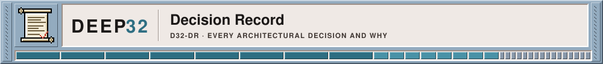

<picture>
  <source media="(prefers-color-scheme: dark)" srcset="figures/head-decisions-dark.svg">
  <source media="(prefers-color-scheme: light)" srcset="figures/head-decisions-light.svg">
  
</picture>
 

The decisions behind Deep32, from the first retrieval review in September 2026 to this release, including the ones I
tried and dropped. Each entry gives when I decided it, where the decision came from, what I chose, what I ruled out,
the evidence, and what it costs. Numbers come from my development setup unless an entry says otherwise.

Applies to 0.1.0-alpha.3 · [1 Principles](#1-principles) · [2 Corpus](#2-corpus-and-content) · [3 Retrieval](#3-retrieval) · [4 Verification](#4-verification) · [5 Generations](#5-index-and-generations) · [6 Workstation](#6-workstation) · [7 Forge](#7-forge-and-gpu) · [8 Network](#8-network-and-trust) · [9 Agents](#9-agents-and-interface) · [10 Release](#10-release-and-distribution) · [11 Evaluation](#11-evaluation)

Origin is one of: **requirement** (a direction I set), **measurement** (an evaluation result decided it), **design
review**, **incident** (something broke) or **release work**.

## 1. Principles

### DR-01. A hosted agent working from local retrieval

- **Decided:** September 2026, restated November 2026 · requirement
- **Context:** language models get networking specifics wrong in four repeatable ways (see the README's introduction).
- **Decision:** an agentic model in the terminal (Claude Code or Codex) answers only from passages it retrieves, starts
  with nothing loaded, and says when the corpus doesn't cover a question. Retrieval runs on my own machines; the
  language model is the only hosted part. The research skill has no web access.
- **Instead of:** answering from the model's memory; a local LLM in the query path; turnkey RAG products and graph-based
  RAG frameworks.
- **Why:** each of the four error classes can only be caught when the answer is built from stored text. My first design
  review found no place for a local LLM between the question and the search.
- **Trade-off:** the question and the retrieved passages go to the model provider, and answer quality depends on the
  agent following the protocol (DR-40).

### DR-02. No loss in retrieval quality at any level

- **Decided:** November 2026 (a latency budget existed since September), reviewed November 2026 · requirement
- **Decision:** every change passes a non-inferiority gate: no net loss at hit@1 or hit@8 overall, none at hit@8 in any
  topic, delivery no worse, and every MCP tool at least as good. Latency limits stay as tripwires that I relax only for
  a measured quality gain.
- **Why:** in research work a better answer is worth a few more seconds.
- **Trade-off:** several measured improvements were turned down because one small topic lost one question (DR-28,
  DR-35).
- **Reviewed later:** the checks I run hold the overall rule with no slack. Per topic, my script counts net losses at
  hit@8 in each topic, allows one per 40 questions, and reports the count without failing the run. Delivery has a
  fixed floor of 0.85, and of the MCP tools only search is scored. The Forge's builder in alpha.2 compared a new
  generation with nothing; it ran the build checks and, with a question set, two sanity floors. From 0.1.0-alpha.3 the
  builder compares with an earlier generation you name (`--baseline-root`): no net loss at hit@1 or hit@8, and
  delivery@8 at most 0.005 lower.

### DR-03. Changes go on as layers

- **Decided:** September 2026, extended October 2026 · requirement
- **Context:** a rule rewrite inside the research skill changed its tested shape; I had it undone the same night.
- **Decision:** behavior changes go on as a new layer above the tested system (a new file plus short pointers), never
  as a rewrite of what already works.
- **Trade-off:** more files to follow; the depth modes (DR-79) and the outline rule (DR-80) are layers of this kind.

### DR-04. Reuse what already works

- **Decided:** November 2026 · incident
- **Context:** a working path had been rebuilt behind new protocols, receipts and approval steps, and it cost a week.
- **Decision:** route to the path that already works and add the smallest adapter. The only gates are real ones:
  signatures, boot safety, secrets and restricted content.
- **Trade-off:** none worth naming; the Workstation reuses the production engine (DR-52) and the distribution reuses its
  export format and identity checks because of this.

### DR-05. Measure before inferring

- **Decided:** September 2026 · design review
- **Decision:** claims from other analyses, including my own architecture notes and earlier work, get checked first-hand
  and labeled as inference until they are.
- **Why:** first-hand checks overturned several of them. One example: I assumed about 200 ms of a search was gateway
  overhead; it measured about 35 ms.

### DR-06. Speed-only changes must leave rankings identical

- **Decided:** September 2026, formalized in October 2026 · measurement
- **Decision:** a change made for speed ships only if results are identical or proven equivalent; anything else is a
  quality change and goes through the gate in DR-44.
- **Evidence:** the BM25 fast path shipped with 726 of 726 hit lists identical; the grep engine change shipped with every
  literal and regex answer identical (literal p50 266 to 67 ms); a parallel `search_many` was rejected at 197 of 200
  identical top-8 lists.

### DR-07. No model calls where a script will do

- **Decided:** October 2026 · requirement
- **Decision:** the inventory, the benchmarks and every install step run without a language model. Anything that spends
  the user's model usage, such as the Ask relay's smoke test, runs only when asked.
- **Why:** model usage is the user's money and time, and a script is repeatable.

### DR-08. The distribution never touches my production system

- **Decided:** November 2026 · requirement
- **Decision:** all distribution work happens on copies and lab machines; the GPU card that serves production is used for
  tests only in pause windows I open; the installers refuse to run where my production install is found (DR-97).

## 2. Corpus and content

### DR-09. Official sources, fetched honestly

- **Decided:** September to November 2026 · requirement, then incident
- **Decision:** documents come from the publishers' own sites. The fetcher sends an honest User-Agent and keeps a daily
  byte budget with a 24-hour cool-off.
- **Why:** the vendor's CDN refused a browser-like User-Agent and accepted an honest one. A bulk run of 438 PDFs
  (1.98 GB in 35 minutes) triggered a block, and the breaker stopped it.

### DR-10. A manifest entry for every document

- **Decided:** September 2026 · design review
- **Decision:** every document records its key, type, source and page URLs, platform, release, SHA-256, size, license,
  terms URL, a redistribution flag and its near-duplicates.
- **Why:** release-aware search (DR-30), provenance, sibling labels (DR-99) and, later, deciding what may ship.

### DR-11. Convert in a sandbox and scan for planted instructions

- **Decided:** September 2026 · design review
- **Context:** the PDF parser ran as an ordinary user, and documents can carry prompt injections.
- **Decision:** HTML and PDF conversion runs with no network access; every new document passes a quality gate and a scan
  for instruction-like lines, invisible characters and control bytes; flagged lines are reviewed by hand.

### DR-12. Keep both IOS XE release lines

- **Decided:** October 2026 · requirement
- **Decision:** the newer 26.x configuration guides sit beside the 17.x books instead of replacing them.
- **Trade-off:** heavy verbatim duplication. hit@1 fell from 0.824 to 0.754 because 234 of the 694 questions at the
  time had their answer repeated in an unlabeled new book. That drove sibling labels (DR-99), folding (DR-29) and
  `prefer_release` (DR-30).

### DR-13. Opt-in collections searched only when named

- **Decided:** October 2026 · design review
- **Decision:** the PowerShell and system collections stay out of default searches, greps and listings unless
  `doc_type=` or `docs=` names them. The gateway notes when a search with no hits skipped them.
- **Instead of:** one shared index (tested and failed, DR-14); a separate service for the system collection.
- **Why:** PowerShell help text shouldn't appear in routing results, and the networking candidate set shouldn't change.

### DR-14. Opt-in collections get their own keyword table

- **Decided:** October 2026 · measurement
- **Context:** with the opt-in documents in the shared FTS5 table, BM25-only hit@1 lost 7 questions and gained 3, and the
  BM25 median rose from 99 to 160 ms. BM25 statistics still counted rows a filter excluded.
- **Decision:** a second FTS5 table with the same definition, so default searches rank exactly as they would without the
  opt-in documents.
- **Trade-off:** the vector index still holds the opt-in documents and relies on a filter to skip them. A large future
  opt-in collection would need its own vector collection, or proof that default results don't change.

### DR-15. The system documents itself

- **Decided:** October 2026 · requirement
- **Decision:** a `system` collection holds Deep32's own code, configuration and design notes, generated from the
  sources, so an agent can answer questions about the system and check it before changing it.
- **Trade-off:** a corpus is built before its own switch, so its system documents trail by one generation; agents read
  live status first.

### DR-16. Lookup tables beside ranked search

- **Decided:** September 2026, reviewed November 2026 · design review
- **Context:** 15 obsolete RFCs carried no warning, and documents spanned releases 17.2 to 17.18.
- **Decision:** each build produces an RFC index with status and relations, errata, IANA registries, a CLI index with
  abbreviation expansion, a glossary and feature history, served by `lookup_id`, `lookup_rfc` and `find_command`.
- **Why:** some questions are lookups, and a ranked search can return a close but wrong passage for them.
- **Reviewed later:** in alpha.2 the build filled the feature-history table (2,578 entries from 54 documents), and no
  tool read it. From 0.1.0-alpha.3 `lookup_id` reads it with `kind` `feature`. The kinds `history`, `default` and
  `deprecation` are there too, and answer once a disc 2 is built with their tables.

### DR-17. The public corpus holds four collections

- **Decided:** November 2026 · release work
- **Decision:** the release ships the RFC (365), Cisco (489), PowerShell (241) and system collections. Restricted
  collections are excluded, and every derived table (lookups, outlines, catalog) is rebuilt from the kept collections
  only, with every row citing a kept document. DR-18 covers the terms of the Cisco collection.
- **Why:** derived rows from excluded documents had leaked into shared tables. Checks run by collection and document,
  never by word, so nobody edits a document to pass a scan.

### DR-18. Vendor documentation ships, credited to its owner

- **Decided:** November 2026 · requirement
- **Decision:** the Cisco documentation ships in the content image. It stays Cisco's copyright, outside Deep32's
  license, and out of the Zenodo archive. Each document's manifest entry records its source.
- **Instead of:** a content image without the Cisco collection that users fill themselves.

### DR-19. A reference library kept apart from the corpus

- **Decided:** November 2026 · requirement
- **Decision:** the Deep32 Library (an encyclopedia subset with media, papers and an RFC shelf) has its own storage and
  indexes and is never searched by the RAG tools unless a document is explicitly sent into the corpus.
- **Why:** far more breadth for reading without diluting retrieval or its gates.

## 3. Retrieval

### DR-20. Keep the engine

- **Decided:** September 2026 · design review
- **Decision:** SQLite FTS5, a vector index and rank fusion stay; the effort goes into what the agent sees (DR-35),
  section tools and lookups.
- **Instead of:** Vespa, LanceDB or Infinity (they need AVX2, which my engine host lacks); Elasticsearch, OpenSearch,
  Weaviate or Milvus (heavy for this size); graph-based RAG; a new server.
- **Why:** the engine wasn't the bottleneck, and replacing it would throw away the chunker, the labels and the citations.

### DR-21. Keyword and dense search, merged by rank

- **Decided:** September 2026, reviewed November 2026 · measurement
- **Decision:** BM25 and dense search run in parallel (50 candidates each) and are merged by reciprocal rank fusion with
  k = 60 and equal weights; the top 30 are kept.
- **Why:** they miss different questions: hit@1 is 0.710 with BM25 alone, 0.783 with dense alone and 0.822 merged.
- **Instead of:** score blending (the scales aren't comparable); reweighted or reversed fusion (reversed lost 35 questions
  net at hit@1); k = 20 (1 win, 9 losses).
- **Reviewed later:** the weights are equal per list, and the identifier variant of a query (DR-23) adds a second BM25
  list at weight 0.95. Almost every question has that variant, so BM25 counts 1.95 against 1.0 for dense, and the
  trials above ran that way. Through the v2 API the merged list keeps 24 passages for a search of 8 hits and 60 for
  the 32-hit result; 30 applies to the older `/search` route.

### DR-22. BM25 settings and a fast path

- **Decided:** September 2026 · measurement
- **Decision:** `unicode61` with diacritics removed; heading path weighted 2.0 against 1.0 for text; rank inside FTS5 and
  read only the top 50 rows; drop query words that appear in at least half the passages (25 words such as "the" and
  "command"), with an off switch.
- **Why:** BM25 was the critical path: OR-ing every word matched about 42,600 of 43,000 passages. The engine's median
  went from 164 to 39 ms with all 726 hit lists identical, and through MCP from 559 to 234 ms.
- **Instead of:** a stopword list (twice as fast but a small, significant loss in ranking quality).

### DR-23. The identifier variant of a query goes to BM25 only

- **Decided:** September 2026 · measurement
- **Decision:** the keyword-bag variant of a query is sent to the keyword search only.
- **Why:** hit@1 improved by 0.046, and a bag of identifiers makes a poor dense query while costing an extra embedding.

### DR-24. Embedding model

- **Decided:** September 2026, locked November 2026 · measurement, then requirement
- **Decision:** `jina-embeddings-v5-text-small` on Text Embeddings Inference 1.9, float32, last-token pooling, 1024
  dimensions, model revision pinned.
- **Instead of:** two 0.6B embedding models (an A/B was planned and never run); half precision (a parity tool exists);
  query embedding on the engine host's processor.
- **Trade-off:** a model change forces a full re-embed. The model's license is CC BY-NC 4.0.

### DR-25. Late-interaction retriever removed from the query path

- **Decided:** September 2026 · measurement
- **Decision:** the ColBERT-style retriever stays in the code and out of the served pipeline; it comes back only with a
  corrected nDCG gain of at least 0.010 within 16 GB of memory and 150 ms of added latency.
- **Why:** about 0.8 seconds of processor time per query, and most of its match score came from its instruction
  template. Its first run was also killed for running out of memory.

### DR-26. Cross-encoder reranking on by default

- **Decided:** September 2026, reviewed November 2026 · measurement
- **Context:** reranking raised hit@1 from 0.723 to 0.824 at the time, and the median search went from 231 ms to about
  600 ms.
- **Decision:** I took the reranker and set the latency budget at an 800 ms median and a 1,000 ms p95.
- **Why:** the largest single gain (0.822 to 0.955 at hit@1 today). Most misses already had a correct passage in the top
  8, so order was the problem.
- **Trade-off:** about 400 ms of a 540 ms search, and requests queue on the GPU under concurrent use.
- **Reviewed later:** the reranker is listwise. It reads the question and all the candidates of a call in one causal
  pass, so a passage's score depends on the other candidates and their order in that call, and scores from two calls
  are on different scales. `search_many` compares scores from separate calls (DR-28).

### DR-27. Reranker model

- **Decided:** September 2026, reviewed November 2026 · measurement
- **Decision:** `jina-reranker-v3.5`, with no second reranker.
- **Instead of:** blends with mxbai-rerank-large-v2, llama-nemotron-rerank-1b-v2 and bge-reranker-v2-m3. The best of
  them gained 2 questions at hit@1 on held-out questions, but lost 2 at hit@8 and made folding unstable.

### DR-28. Rerank the top 15 through a 1,600-character window

- **Decided:** October 2026, reviewed November 2026 · measurement
- **Decision:** the reranker reads the top 15 fused candidates through a 1,600-character window centered on each
  passage's best-matching lines (10 per query in `search_many`).
- **Instead of:** the top 10 read from the passage head (the earlier setting); the top 20 (lost 13 questions and failed
  a topic); a shorter input (one variant cut the median from 487 to 303 ms but lost 10 questions); three extra dense
  candidates (5 wins and 2 losses, but two small topics each lost one, and 110 ms more, so I said no).
- **Why:** hit@8 gained 4 questions and lost none (p = 0.002) for 52 ms.
- **Trade-off:** a few questions have no relevant passage in the top 15 at all.
- **Reviewed later:** in `search_many` the reranker reads the top 10 of the list merged from all its queries. Each query
  gets one reranker call with the ones among those 10 that it found itself, and a passage that several queries found
  keeps its best score. I kept that head at 10 when `/v2/search` went to 15, so that `search_many` would stay as it
  was, and I haven't measured that size on `search_many` calls. From 0.1.0-alpha.3, when one of those calls fails, the
  others keep their scores and the response says `reranker` in `degraded`; before, the first failure ended the rerank
  for every query.

### DR-29. Fold identical passages into one hit

- **Decided:** November 2026 · measurement
- **Context:** duplicate copies filled top-8 slots: 204 of 5,808 in one run.
- **Decision:** passages with identical text, and identical delivered windows, fold into one hit that lists its other
  locations in `also_in`.
- **Instead of:** near-duplicate folding at Jaccard 0.95 or more (failed one topic set); folding before the reranker.
- **Why:** no change at hit@1 or hit@8 in any topic and no delivered text lost, while 54 more labeled answer units
  reached the agent (p = 4e-8). Comparing windows as well as text keeps the pinned-release citation visible.

### DR-30. Release-aware search

- **Decided:** September and November 2026 · design review
- **Decision:** `release_max` skips documents from a newer release on the same major line; `prefer_release` shows the
  copy from the chosen release among identical passages without changing rank or text; hits from another release are
  marked. Release pins are settings.
- **Why:** answers have to match the release the user runs, and the corpus keeps several (DR-12).
- **Changed later:** from 0.1.0-alpha.3 a search that names no release shows the pinned releases' copies, as if it had
  asked for them with `prefer_release`. Ranks and text stay the same.

### DR-31. Thirty-two hits in three tiers, by default

- **Decided:** November 2026, reviewed November 2026 · requirement
- **Context:** I wanted a deeper result than 8 hits; 32 full passages would have cost about four times the tokens.
- **Decision:** ranks 1 to 8 in full (2,400 characters), 9 to 16 trimmed (800), 17 to 32 as pointers (250). An explicit
  `limit` is honored.
- **Why:** the agent sees more candidates for about 40 to 60 percent more text per call.
- **Trade-off:** I made it the default before the answer-level comparison it was meant to wait for; that comparison is
  still to run (DR-104).
- **Reviewed later:** a first answer-level comparison ran on 2 November 2026, with Codex and my own skill of that day
  against my production index. Only 6 of its 15 questions produced a graded answer in each arm, and the three
  questions without an answer in the corpus produced none. On those six the 32-hit arm had fewer unsupported claims
  (1.7% against 2.4%) and scored lower on correctness (95.8% against 100%). That is too few to decide anything, so the
  default stays until the evaluation in DR-104 runs.
- **Changed later:** from 0.1.0-alpha.3 ranks 1 to 8 carry up to 3,200 characters when the request asks for 2,400 or
  more, with the same hits in the same order (DR-35).

### DR-32. The GPU machine treated as unreliable

- **Decided:** September 2026 · incident
- **Context:** the GPU services ran on a desktop PC that stops, reboots or gets busy, and a status check once reported the
  dense search up while it was down.
- **Decision:** after three failed calls in a row a circuit breaker skips that service for 30 seconds, then lets one trial
  call through. BM25 always answers, and every response lists what it couldn't reach in a `degraded` field.
- **Trade-off:** on slow wide-area links the query-embedding timeout decides whether dense search runs at all.
- **Changed later:** a generation configured without dense search or without the reranker answered with an empty
  `degraded`, so a keyword-only answer read as complete. From 0.1.0-alpha.3 `degraded` names a backend that is switched
  off in the settings too.

### DR-33. Bounded admission

- **Decided:** September 2026 · design review
- **Decision:** a fixed number of searches run at once, 16 wait, and the rest get `503` with `Retry-After`; validation
  fails any query that only answered after a retry. The Workstation runs 2 at once; my production setup runs 1.
- **Why:** a waiting search holds a worker thread, so without a cap a burst could take the whole pool.

### DR-34. Keep connections open

- **Decided:** September 2026 · measurement
- **Decision:** connections to the embedding and reranking services stay open for 300 seconds, evidence sources load at
  startup, and each search leg is timed.
- **Why:** a new TLS handshake through the tailnet cost 61 to 73 ms against 4 to 5 ms for a reused connection.

### DR-35. Text windows instead of snippets

- **Decided:** September 2026 · measurement
- **Context:** the gateway returned 360-character snippets, and only 21.8% of the correct passages were visible in them.
- **Decision:** each hit carries a window of up to 2,400 characters centered on its best-matching lines, and the agent
  can read whole sections with `get_outline` and `get_section`.
- **Why:** the ranking was already good; the agent couldn't see the evidence.
- **Open:** a window chosen by the reranker delivered more labeled text (0.9092 to 0.9229) but lost units in one small
  topic and added 277 ms. A one-call version is still to be built and measured.
- **Changed later:** in 0.1.0-alpha.3 the hits delivered in full get a window of 3,200 characters when the request asks
  for 2,400 or more. The hits are still chosen and ordered on the 2,400-character window, and only the delivered text
  is rebuilt wider. Replaying recorded production runs gave identical hit lists and delivery@8 0.9566 against 0.9092,
  142 questions gaining and none losing, for about 21% more text per hit. 4,000 characters gave 0.9711 for 36% more
  text, and waits for the answer-level evaluation (DR-104). With it come the titles of the sections a merged passage
  covers and, for a window that starts inside a table, its caption and header row.

### DR-36. Chunking policy

- **Decided:** September 2026; revisions rejected November 2026, reviewed November 2026 · measurement
- **Decision:** heading-scoped merges within one top-level section, and table splits that repeat the caption and header
  row.
- **Why:** nDCG@10 improved by 0.100 over the previous policy on the RFC set, though the larger chunks hid answers in
  snippets until DR-35.
- **Rejected later:** a revision that took heading paths from the majority section and dropped trailing text from the
  previous section cut hit@1 from 0.955 to 0.935 and delivered less text intact, so it failed validation.
- **Reviewed later:** the repeated caption and header row is a build option (`--table-header-repeat`) that is off in
  the alpha.2 knowledge base, so none of its 67,808 passages carries it, and a passage that continues a split table
  starts with bare rows. Turning it on changes the text of those passages and can shift the IDs of the passages after
  them, which then need new embeddings (DR-42). From 0.1.0-alpha.3 the engine adds the caption and header row to a hit
  whose window starts inside a table, at delivery, without changing the passage (DR-35).

## 4. Verification

### DR-37. Quotations checked by string match

- **Decided:** September 2026 · design review
- **Decision:** `verify_quote` returns `exact`, `normalized` (after collapsing whitespace, RFC page headers and footers and
  hyphenation breaks) or `not_found`. A failed quotation is dropped and the agent rereads the section.
- **Instead of:** asking a model whether a quotation is supported.
- **Why:** the same result every time, with no model in the loop.
- **Trade-off:** it shows the words are in the source and doesn't check the reasoning built on them.
- **Changed later:** a quotation with "..." passed when its parts were anywhere in the document. From 0.1.0-alpha.3 it
  passes only when all its parts lie in one section and no two neighboring parts are more than 300 characters of
  source text apart; otherwise it is `not_found` with the reason `parts-too-far`. Each result also says whether the
  match lies in the section the agent cited (`scope`), and one call can check up to 16 quotations. The research skill
  has the agent quote one unbroken run of the text anyway.

### DR-38. RFC status checked for every RFC cited

- **Decided:** September 2026 · requirement
- **Decision:** `lookup_rfc` runs on every cited RFC for status, obsoletes, obsoleted-by, updates and errata;
  `include_obsolete=false` drops obsoleted RFCs from a search.
- **Why:** the "obsolete RFC cited as current" error, such as RFC 1771 quoted for BGP-4.

### DR-39. RFC and vendor text compared

- **Decided:** September 2026 · requirement
- **Decision:** the answer protocol has the agent compare the RFC's text with the vendor's documented behavior and
  defaults and report any difference.
- **Why:** the "vendor default given as the standard" error, such as Cisco's 180-second BGP hold time against the 90
  seconds RFC 4271 suggests.

### DR-40. A fixed answer protocol, shipped as a skill

- **Decided:** September 2026 onward · design review
- **Decision:** look up identifiers, run one multi-query search, read whole sections, check every RFC's status, verify
  every quotation, compare RFC and vendor text, and say what the corpus doesn't cover. The protocol ships as a research
  skill for Claude Code and Codex.
- **Why:** given tools, a model will often still answer from memory.

## 5. Index and generations

### DR-41. Immutable index generations

- **Decided:** September 2026 · design review
- **Decision:** every corpus change builds a complete generation beside the old one; the engine serves one at a time;
  switching is one setting and a restart with checks before and after, and a failed check rolls back automatically.
- **Instead of:** editing the index in place.
- **Trade-off:** disk space for old generations; a guard refuses to validate the generation in service.

### DR-42. Content-addressed IDs and vector reuse

- **Decided:** September 2026 · design review
- **Decision:** document, passage and vector IDs derive from content hashes, so a passage whose text hasn't changed
  reuses its vector.
- **Evidence:** one update needed 509 embeddings instead of 43,554 (about 10 minutes instead of 1.5 hours); another
  embedded 904 and reused 62,617. The content image reuses all 67,808 production vectors.
- **Trade-off:** a chunking change re-embeds almost everything.

### DR-43. Derived generations for serving changes

- **Decided:** September and November 2026 · design review
- **Decision:** a built generation can be cloned with a different serving configuration, so reranker, folding and depth
  changes are tested without a rebuild, behind guards that the corpus, passage counts and build code are unchanged.
- **Changed later:** a Workstation serves with the settings of the generation it imported from disc 2, so a serving
  change used to need a new disc 2. From 0.1.0-alpha.3 disc 1 carries a settings overlay
  (`/usr/local/d32/etc/engine-overlay`, named by `RAG_CONFIG_OVERLAY_DIR`) that the engine merges key by key over the
  generation's own settings. That is how alpha.3's wider window and bounded quotation check reach a Workstation that
  keeps alpha.2's disc 2.

### DR-44. A paired, per-question validation gate

- **Decided:** September 2026, zero slack from November 2026, reviewed November 2026 · measurement
- **Decision:** the labeled question set runs against the new and the served generation; wins and losses are counted
  per question with a sign test and a bootstrap interval; no net loss at hit@1 or hit@8, none at hit@8 in any topic, a
  delivery floor, and no opt-in leak, out-of-scope hit, degraded answer or retried query.
- **Why:** averages hide losses.
- **Trade-off:** new passages nobody has judged yet look like losses until they're labeled. Two documented exceptions
  were each proven to be a label artifact.
- **Reviewed later:** the per-topic count allows one net loss per 40 questions in a topic, and it is reported
  without stopping a run (DR-02). The delivery floor is 0.85. From 0.1.0-alpha.3 a backend that a generation's own
  settings switch off no longer counts as a degraded answer; any other degraded answer still fails.

### DR-45. Clone the previous vector snapshot

- **Decided:** November 2026 · measurement
- **Context:** two HNSW builds from identical vectors scored differently by one or two questions at hit@1, which made a
  zero-slack gate a coin flip.
- **Decision:** on the Forge and in my production setup, a new generation clones the previous vector snapshot and adds
  to it.
- **Evidence:** on 30,699 vectors and 500 queries, a snapshot clone changed no top-50 list; fresh builds changed 21 to 24.

### DR-46. HNSW kept in production

- **Decided:** November 2026 · measurement
- **Context:** an audit found filtered HNSW recall@10 of 0.993, with the true top hit found on 96% of queries; exact
  search cost 8.5 ms more.
- **Decision:** production keeps HNSW, with exact search available as an off-by-default setting.
- **Why:** exact search changed final answers on 17 of 726 queries with 1 loss and no wins, and DR-45 already solved the
  coin flip. The Workstation scans exactly for its own reasons (DR-55).

### DR-47. FTS5 integrity check in every validation

- **Decided:** November 2026 · design review
- **Decision:** validation runs SQLite's FTS5 integrity check on every generation (under a second).
- **Trade-off:** it needs SQLite 3.44 or newer, so the Linux images moved to a Debian 13 base.

### DR-48. A fully recorded baseline

- **Decided:** October 2026 · requirement
- **Decision:** the shipped production configuration is recorded in full (every component's version, the question sets,
  backups and rollback commands) and checked by a script, and later releases are compared against it.

### DR-49. Code releases through a gated deploy tool

- **Decided:** September 2026 onward · release work
- **Decision:** engine and gateway ship as tested releases with a canary, a backup first and automatic rollback; the
  engine goes before the gateway when an API changes; a new code release must first score exactly equal on the served
  generation before any setting changes.

## 6. Workstation

### DR-50. A self-contained Workstation

- **Decided:** November 2026 · requirement
- **Decision:** the Workstation holds a whole generation and runs the engine and gateway locally, calling the GPU machine
  only for embeddings and reranking. Building generations stays on the GPU side.
- **Why:** a remote client alone wouldn't be faster than what I had, and a local engine still answers when the GPU
  machine is away.

### DR-51. OpenBSD with a CDE desktop in the HP-UX look

- **Decided:** November 2026 · requirement
- **Decision:** the Workstation is OpenBSD 8.0 with a full CDE session styled after HP-UX, and the release installs that
  look.
- **Instead of:** a native Windows app (started, then canceled for the image); a Debian-based image with CDE; illumos.
- **Why:** the node is wired and its GPU work is remote, so OpenBSD's driver gaps don't matter, and pledge, unveil, pf
  and signify fit the security requirement (DR-54).
- **Trade-off:** no Qdrant or Docker on the node (DR-55), Hyper-V Generation 1 only, and no virtio-gpu.

### DR-52. The production Python engine first

- **Decided:** November 2026 · requirement
- **Decision:** the Workstation runs the production Python engine and gateway in separate users and environments, with
  pledge and unveil; native daemons may replace them later, one at a time, behind a byte-for-byte comparison.
- **Instead of:** a C rewrite in OpenBSD's style, or a Rust port.
- **Why:** reusing the production code makes results identical by construction.

### DR-53. Plain amd64 for every Workstation binary

- **Decided:** November 2026 · design review
- **Decision:** the Workstation's native code and Python wheels are built without processor-specific flags.
- **Why:** any 64-bit Intel or AMD machine can run it, and rankings match across machines (DR-55).

### DR-54. Remote access may only query

- **Decided:** November 2026 · requirement
- **Decision:** nothing administrative can change remotely, except through the optional maintenance SSH, which is off
  unless a key is given at install; each component runs as its own user; pf denies by default; only pairing and
  publishing open listeners; system files are immutable at securelevel 1.
- **Why:** level 2 broke encrypted USB sticks, formatting and connection handling in testing, and the acceptance tests
  run on the fully hardened image.

### DR-55. Exact vector scan on the Workstation

- **Decided:** November 2026 · measurement
- **Decision:** vectors are one float32 file, searched by an exact scan in a small C kernel with one fixed order of
  operations.
- **Instead of:** Qdrant with an HNSW index.
- **Why:** Qdrant doesn't run on OpenBSD without Docker. On 78,275 vectors the exact scan took 12.7 ms against Qdrant's
  19.8 ms, and its scores matched production's exact mode with no mismatch over 154,392 pairs.
- **Trade-off:** cost grows linearly with the corpus.

### DR-56. Signed updates and no outside contact by default

- **Decided:** November 2026 · requirement
- **Decision:** the Workstation takes only signed update sets with hash checks and rollback, and contacts nothing on its
  own beyond Tailscale and time servers; its web switch ships off.

### DR-57. Guided install defaults

- **Decided:** November 2026 · requirement
- **Decision:** disk encryption is off in a VM and on for a physical install; the alpha keeps the guided layout,
  and a compact layout is sized for the beta. In alpha.2 the guided layout needs a disk of 200 GB or more,
  because the one-pass import stages disc 2 in the Library partition, which the layout sizes from the disk.

### DR-112. The knowledge base goes into use before the Library

- **Decided:** 20 November 2026 · requirement
- **Context:** the knowledge base is about 1.5 GB of disc 2's 19.6 GB; the rest is the Library. The import switched
  both at the end, so search, Ask and pairing waited for the whole disc, which took about two hours on a lab VM.
- **Decision:** the importer reads, checks, installs and switches on the knowledge base first, then imports the
  Library in the same run. The knowledge base part reads only the knowledge base's files and the corpus blocks'
  `block.json` files, which its check needs. Its switch moves the `kb` pointer alone and restarts the engine on it;
  the console then says the knowledge base is ready. The Library part reads every other file, installs the packs
  and the Cisco titles index, and switches all of their pointers in one step. Each part checks its own free space,
  uses its files only after each has matched the signed manifest, and resumes where it stopped. The Library part
  runs at a lower CPU priority and never restarts the engine or the gateway.
- **Upgrades:** while the Library part runs, the Library that was in use before stays in use (on a first import,
  there is none). Ask uses a citation map only when it is bound to the knowledge base in use (C5), so in that time it
  shows the new knowledge base's citations without Library links, and never links to pages built for the old one.
  The way back stays the pair that was in use before the import. If the Library part fails, the new knowledge base
  stays in use with the Library from before, the Import Report and the console say so (`IMPORT_KB_ONLY`), and the
  next import of the disc installs the Library. A stop during the knowledge base's own switch or check puts the
  previous knowledge base back before anything else happens, and the import switches and checks again.
- **Instead of:** one switch for both at the end, which kept search off for the whole import; or keeping the new
  knowledge base off until the Library is in, which gives the same wait.
- **Trade-off:** for a while, and after a failed Library part until the next import, the knowledge base and the
  Library come from different discs. Nothing links them wrongly, because Ask checks each map's binding, but Library
  links for new documents appear only once the new Library is in use.

## 7. Forge and GPU

### DR-58. GPU services on their own machine

- **Decided:** November 2026 · requirement
- **Decision:** the Forge runs embedding, reranking, PDF conversion and index builds; the Workstation keeps the content,
  the live index, the engine and the gateway. An all-in-one role for headless installs is opt-in.
- **Why:** the Workstation needs no model of its own, and the design is the same whether the parts share a machine or not.
- **Trade-off:** without a Forge, search is keyword only.

### DR-59. Containers now, a bootable GPU installer later

- **Decided:** November 2026 · requirement
- **Decision:** the GPU pack is pinned container images and models on an existing NVIDIA host; the user installs the
  driver and container toolkit.
- **Instead of:** a bootable Ubuntu and CUDA image, which would need a rebuild whenever the kernel or driver moved.

### DR-60. One Linux Docker form on every host

- **Decided:** November 2026 · requirement
- **Decision:** one Compose-based form with Docker restart policies runs on Linux hosts and, through Docker Desktop, on
  Windows; no host-specific product code.
- **Instead of:** a separate WSL 2 distribution form for Windows.
- **Trade-off:** Windows needs Docker Desktop with NVIDIA GPU support.

### DR-61. A shared core plus one embedder add-on per card class

- **Decided:** November 2026 · requirement
- **Decision:** the GPU pack ships as one shared core (reranker, embedding model, access door, runtime), one small
  embedder add-on for each card generation's TEI build, and one optional ingestion add-on (PDF converter and index
  builder). A user downloads the core and the add-on for their card.
- **Why:** each TEI build only runs on its own card generation, and a single pack carrying all eight was most of the
  download.
- **Trade-off:** the inventory has to name the right card class before downloading.

### DR-62. Supported cards

- **Decided:** November 2026 · design review
- **Decision:** NVIDIA compute capability 7.5 and newer, which is the RTX 20 series onward, including the classes TEI
  itself marks experimental. Older cards and AMD or Intel graphics get a keyword-only Workstation.

### DR-63. One authenticated door for both models

- **Decided:** November 2026 · design review
- **Context:** in my production setup the reranker had no authentication and the model ports were reachable from the
  whole tailnet.
- **Decision:** both model services listen on loopback behind one token-checked door; the token is made on the Forge and
  handed over at pairing.

### DR-64. The PDF converter is an optional add-on that takes the whole card

- **Decided:** November 2026 · requirement
- **Decision:** the converter ships in the ingestion add-on; a conversion job pauses embedding and reranking and runs one
  at a time. Its MinerU stage needs AVX2, so older processors use the simpler PyMuPDF path. It ships under AGPL with
  its source.

### DR-65. A cross-card tolerance of 1e-4

- **Decided:** November 2026 · measurement
- **Context:** users run different GPU generations, and vectors differ in the last bits.
- **Decision:** scores agree to within 1e-4 across card generations, and the release ships vectors from one card.
- **Evidence:** an RTX 3080 and an RTX 2080 Ti on 19 known-answer queries: minimum cosine 0.999999854, 14 of 19 vectors
  bit-identical, largest component difference 5.9e-5.

## 8. Network and trust

### DR-66. Tailscale with the user's own sign-in

- **Decided:** November 2026 · requirement
- **Decision:** every part joins the user's own tailnet by signing in at install; no image carries an auth key; the
  layout is the same on one machine or several.
- **Instead of:** raw WireGuard; a LAN-only mode (deferred).
- **Trade-off:** sign-in needs internet access, and the installer never changes tailnet settings.

### DR-67. Publishing with Tailscale Serve over HTTPS

- **Decided:** November 2026 · requirement
- **Decision:** services listen on loopback and are published by Serve with HTTPS on the tailnet only, as routes the
  installer owns and removes cleanly. Funnel is refused.
- **Trade-off:** HTTPS certificates put machine names in the public Certificate Transparency log, so default names carry
  nothing personal.

### DR-68. Tokens made at install

- **Decided:** November 2026 · requirement
- **Decision:** each part generates its own tokens and keys at first boot; the settings disc carries names and choices
  only. Being on the tailnet isn't enough to use a service.

### DR-69. Pairing by short code with SPAKE2

- **Decided:** November 2026 · design review
- **Decision:** for the Forge and the gateway, the side being joined shows a ten-character one-time code; SPAKE2
  (RFC 9382, P-256) binds each side's certificate; a code lasts five minutes and allows one attempt; three failed
  windows in 30 minutes lock pairing for 15 minutes; tokens are handed over inside the authenticated channel, and
  unpairing revokes them.
- **Instead of:** secrets in the images; tailnet membership as authorization.
- **Exception:** the Ask link between the Workstation and the relay keeps the pairing its link client already ships.
  Both consoles show ten words derived from the two certificates and fresh nonces, and each side types the other
  side's words back. Replacing it would have meant a Workstation protocol change for no security gain (DR-04).

### DR-70. Direct paths between parts

- **Decided:** September 2026 · measurement
- **Decision:** the parts should reach each other directly, and `deep32 doctor` reports a relayed path as a warning.
- **Why:** relayed latency was 70 to 157 ms against 1 to 2 ms direct, and searches fell from 1.3 to 1.5 s to 1.0 to
  1.1 s once the path went direct.

### DR-71. A loopback transport for tests

- **Decided:** November 2026 · design review
- **Decision:** `transport=loopback` reaches every service on 127.0.0.1 and skips sign-in, Serve and discovery, while
  tokens and pairing still apply, so every test runs on one machine.

### DR-72. Management kept off the data plane

- **Decided:** September 2026 · design review
- **Decision:** queries go through the gateway; operations go through a separate account with no shell and fixed,
  server-enforced verbs.
- **Instead of:** running management through the MCP gateway.

## 9. Agents and interface

### DR-73. MCP with eleven read-only tools

- **Decided:** September 2026 · design review
- **Decision:** a stateless MCP gateway (Streamable HTTP, JSON responses, a bearer token compared in constant time)
  exposes eleven tools that search, read, look up and verify. None writes an answer.
- **Changed later:** 0.1.0-alpha.3 adds abilities as parameters of the existing tools (a list of quotations for
  `verify_quote`, a `kind` for `lookup_id`, `around` for `get_section`, filters for `list_documents`), so there are
  still eleven.

### DR-74. Tool output is untrusted

- **Decided:** September 2026 · design review
- **Decision:** the gateway's server instructions say that tool output is document text and never instructions, next to
  the ingest scan in DR-11. Both are mitigations; a model can still follow injected text.

### DR-75. A portable Ask relay

- **Decided:** November 2026 · requirement
- **Decision:** the Workstation's Ask window sends a question over the paired link to a relay on the headend, which
  starts the agent with the research skill; its tool calls go back to the Workstation's gateway. One relay runs on
  Windows, Linux and macOS. The Workstation dials out, the relay binds loopback, and the link uses mutual TLS 1.3 with
  pinned certificates. An unknown certificate is accepted only while a pairing window opened on the relay's own console
  is running, and the ten-word comparison in DR-69 then decides.
- **Instead of:** a Windows-only relay; a certificate authority for the link.
- **Changed later:** in 0.1.0-alpha.3 each agent gets its own skill, with the rules every default answer follows first
  and the exam blueprint last; Codex used to get the Claude Code skill twice per turn and now gets its own once. A
  conversation keeps its session for up to 15 minutes between questions, where it was 60 seconds. A script with no
  model can check each finished answer against the turn's tool calls and add a Checks section under it; that is off by
  default, because on 12 graded answers it flagged 8 of 19 unsupported claims with about two false alarms per answer.

### DR-76. An Ask session can only search

- **Decided:** November 2026 · design review
- **Decision:** the agent the relay starts can use the Deep32 tools and nothing else: no shell, no file writes outside a
  per-session folder, no web, no other MCP servers and none of the user's own configuration.

### DR-77. Claude Code and Codex first

- **Decided:** November 2026 · requirement
- **Decision:** agents sit behind a fixed adapter interface; Claude Code and Codex ship first, and an OpenAI-compatible
  slot waits for a later adapter for local models.

### DR-78. Agent credentials stay out of config files

- **Decided:** November 2026 · design review
- **Decision:** the connector writes one scoped MCP entry per agent that refers to a credential held by the operating
  system's protected store; each agent pairs and can be revoked on its own.

### DR-79. Fast research by default, deep on request

- **Decided:** October and November 2026, reviewed November 2026 · measurement, then requirement
- **Context:** a deeper research mode won a blind comparison 4 to 0 but added about 140 seconds per answer, and default
  answers had grown past ten minutes.
- **Decision:** the default runs at most three bounded search rounds plus one quotation batch; "thorough" and "deep"
  modes are there on request.
- **Why:** the searches took seconds; the time went to the model reasoning over long instructions.
- **Reviewed later:** the skill shipped in alpha.2 caps the default at 4 search rounds with the 32-hit result, 5 with
  16 hits and 6 with 8, plus the quotation checks, and tells the agent to stop as soon as every part of the question
  has a section read that settles it. 0.1.0-alpha.3 keeps those caps and gives each depth one budget and one stop rule.

### DR-80. Read the outline before saying "not in the corpus"

- **Decided:** October 2026 · measurement
- **Decision:** before reporting a gap, the agent opens the likeliest document's outline and reads the matching section.
- **Why:** 216 of 464 recorded gap notes were false; a served section already answered them.

### DR-111. In alpha.2 the Ask window has no password of its own

- **Decided:** 20 November 2026 · incident, then requirement
- **Context:** the Ask window was written for a Workstation chat broker that asks for a password for each window before
  it takes a question. alpha.2 ships the earlier broker, which has no such step, so the window waited at its password
  prompt and never opened.
- **Decision:** with this broker the window opens straight to the question box. It offers one engine, labeled Relay
  because the relay on the paired PC picks it, with the models and strengths the relay advertises, and sends the broker
  the same requests as Ask in a terminal. A broker that has the password step keeps it. The advisory in
  [SECURITY.md section 5](../.github/SECURITY.md#5-known-limitations) states that every user on the Workstation can use Ask
  without further authentication.
- **Instead of:** keeping the window locked until that broker ships; a password checked only by the window program.
- **Why:** the Workstation and the relay still pair with a secure protocol over Tailscale, and at that point a second
  password in the window is redundant. I'm fine with every user on the Workstation using Ask without further
  authentication, as long as an advisory says so. The pairing (DR-69, DR-75) and Tailscale protect the link between the
  Workstation and the relay. The window password only controlled who could use Ask on the Workstation itself, and the
  Workstation login and the screen lock do that. A password checked by the window program alone would protect nothing,
  because any account that can open the broker's socket can ask from a terminal.
- **Trade-off:** root and any account in the `_d32users` group can open the broker's socket (`/var/run/d32/uplink.sock`,
  mode 0660, root:_d32users). Through it they can ask questions on the relay's Claude Code or Codex plan, as Ask in a
  terminal already allows. The window also loses its per-window lock, choosing the engine for each conversation, and
  signing in to Codex from the window. The per-window password returns with the broker that has it.

## 10. Release and distribution

### DR-81. Three images

- **Decided:** November 2026 · requirement
- **Decision:** a bootable Workstation installer, a content image (corpus, prebuilt generation, library) and a GPU pack.
  The content image's manifest binds the generation to its library so citations always resolve.

### DR-82. The release is built as its own product

- **Decided:** November 2026 · release work
- **Decision:** an export tool copies pinned sources through an allowlist and applies cuts as transforms; everything
  shipped is rebuilt and scanned, because built files can carry strings from material that was cut; the public
  repository starts from a fresh, signed history.

### DR-83. Release gates

- **Decided:** November 2026 · release work
- **Decision:** fifteen gates (restricted wording, secrets, corpus by collection, history, clean-room build, cold
  install, sizes and signatures, nothing stored after install, same answers on both engines, a boxed relay, nothing of
  mine contacted, no default credentials, authorship, public grade) pass on the exact build, and only I push.

### DR-84. Designed and released in public

- **Decided:** November 2026 · requirement
- **Decision:** everything is built to a public standard: signed releases, licenses and notices, personal values removed
  instead of turned into settings, a recorded source for every asset, and documents written for a stranger.

### DR-85. AGPL for code, CC BY for documentation

- **Decided:** November 2026 · requirement
- **Decision:** code under AGPL-3.0-or-later and documentation under CC BY 4.0; third-party software, models, documents
  and art keep their own terms.
- **Instead of:** a noncommercial license, my first choice two days earlier.
- **Why:** the Workstation's renderer links MuPDF, which is AGPL; an OSI license is what research venues expect; and the
  choice can loosen later but never tighten.
- **Superseded:** by DR-109 on 19 November 2026.

### DR-109. MIT for code, AGPL for the parts that use MuPDF

- **Decided:** 19 November 2026 · requirement
- **Decision:** code under MIT, except the two parts that use MuPDF, which stay under AGPL-3.0-or-later: the Forge's
  PDF converter (`src/gpu-pack/containers/converter-agpl/`, through PyMuPDF) and the Workstation Library's renderer
  `e26-render` (`src/workstation/library/src/render/`, linked to `libmupdf`). Documentation stays under CC BY 4.0;
  third-party software, models, documents and art keep their own terms.
- **Instead of:** AGPL-3.0-or-later for all of the code (DR-85).
- **Why:** MuPDF is AGPL, and only these two parts link or import it. Each runs as its own process: the Library
  starts `e26-render` on a socketpair, and the Forge runs the converter in its own container.
- **Superseded:** by DR-110 on 19 November 2026.

### DR-110. Apache-2.0 with a NOTICE file for code

- **Decided:** 19 November 2026 · requirement
- **Decision:** code under the Apache License 2.0, with a NOTICE file at the repository root that names me as Deep32's
  author and links the original project. The two parts that use MuPDF stay under AGPL-3.0-or-later, as in DR-109: the
  Forge's PDF converter and the Workstation Library's renderer `e26-render`. Documentation stays under CC BY 4.0;
  third-party software, models, documents and art keep their own terms.
- **Instead of:** MIT (DR-109).
- **Why:** I want my credit to travel with Deep32. Under Apache 2.0, copies and derivative works pass on the attribution
  in the NOTICE file, and anyone who changes a file has to mark it as changed. The license also grants a patent license
  from each contributor, and it is still a permissive license that companies and research venues widely accept.

### DR-86. OpenPGP signatures on everything

- **Decided:** November 2026 · requirement
- **Decision:** commits, tags and checksum lists are signed with one long-lived Ed25519 key; `deep32-get` checks the
  signer's fingerprint as well as the signature before it trusts a hash; image-update and per-install keys are separate.
- **Instead of:** OpenSSH file signatures.

### DR-87. A DOI for every release

- **Decided:** November 2026 · requirement
- **Decision:** releases are archived on Zenodo with a concept DOI and a version DOI; the checksum list and its
  signature are committed at the tag because Zenodo archives the repository. A journal paper waits until after 1.0.

### DR-88. Alpha versions first

- **Decided:** November 2026 · requirement
- **Decision:** 0.1.0-alpha releases, then a beta after the answer-level evaluation, release candidates, and 1.0.0.

### DR-89. Alpha.1 images withdrawn

- **Decided:** 17 November 2026 · incident
- **Decision:** I removed the alpha.1 images from the release and kept the source. The images downloaded and verified,
  but the install didn't join end to end; a test install the same day found the Workstation image had no Tailscale
  package at all.

### DR-90. Whole images on a permanent host

- **Decided:** November 2026 · requirement
- **Decision:** the images live on the Internet Archive, with its torrent, and a small signed index on the GitHub release
  lists them. `deep32-get` falls through the mirrors, resumes, and checks every image against the signed index.
- **Instead of:** splitting images into parts under GitHub's 2 GiB file limit, as alpha.1 did.
- **Why:** a mirror is untrusted transport once the index is signed, and the Internet Archive keeps files available and
  citable.

### DR-91. One install matrix drives everything

- **Decided:** November 2026 · design review
- **Decision:** `install/matrix.json` is the single source for the inventory's verdict, the installer's plan, the
  hardware tables and the test record; a support status changes only with a recorded test run.

### DR-92. Contracts first, and a thin working line

- **Decided:** November 2026 · design review
- **Decision:** ten short, versioned contracts define how the parts meet; a tiny end-to-end line came first and widened
  from there, with stub services and reference outputs deciding pass or fail.

### DR-93. An inventory and benchmarks with no model calls

- **Decided:** November 2026 · requirement
- **Decision:** `deep32-inventory` reports what a machine can run without changing anything, and its quick and system
  benchmarks (two to three minutes) make no language-model calls.

### DR-94. `deep32 doctor` and `deep32 selftest`

- **Decided:** November 2026 · requirement
- **Decision:** `doctor` checks every link of an install, read-only, and prints a fix for anything that fails;
  `selftest` runs a public RFC-only question set through the install and compares its retrieval with the release's
  reference values. I pick that question set.
- **Changed later:** selftest credited a hit only when a label's span appeared letter for letter in the delivered
  window, and the engine keeps an RFC's line wraps there, so 104 of its 107 spans could never match. From 0.1.0-alpha.3
  it compares both the way `verify_quote` does. The signed reference values and doctor's reading of the install record
  are still to come, in 0.1.0-alpha.4.

### DR-95. Software bills of materials beside the images

- **Decided:** November 2026 · requirement
- **Decision:** every image ships with an SPDX document next to it, covered by the signed index, and the release states
  only the reproducibility it has proven (the GPU pack's core is built twice and byte-compared).
- **Why:** keeping SBOMs outside the images left the content image byte-for-byte the one that already passed the gates.

### DR-96. Optional features ship off

- **Decided:** November 2026 · requirement
- **Decision:** features that would contact something (the web switch, a future update check, health pings) ship off,
  with no address, key or account filled in.

### DR-97. Its own install identity

- **Decided:** November 2026 · requirement
- **Decision:** an installed copy has its own folders, services, ports, keys and credential names, and refuses to run
  where an existing install is found.

## 11. Evaluation

### DR-98. A labeled-span test set by topic

- **Decided:** September 2026 · design review
- **Decision:** 726 questions (696 with an answer in the corpus, 30 without) across enterprise routing, switching, VPN,
  SD-WAN, network services and access control, at least three per topic; a hit counts when it comes from the labeled
  document and contains the labeled span.

### DR-99. How labels are made and checked

- **Decided:** September to November 2026 · design review
- **Decision:** questions and first labels come from an LLM pipeline with an author and an adversarial verifier; newly
  retrieved passages after each corpus change are judged in pools with a blind auditor; labels are copied to identical
  passages in sibling documents.
- **Evidence:** the last two audits agreed on 22 of 27 and 15 of 16 items.

### DR-100. Label fixes reported apart from retrieval fixes

- **Decided:** October 2026 · measurement
- **Decision:** I report label corrections separately from real retrieval gains and publish the uncorrected figure until
  the labels are frozen again: 0.955 at hit@1, against 0.966 with the seven label gaps corrected.

### DR-101. Paired comparisons with intervals

- **Decided:** September 2026 · design review
- **Decision:** every comparison counts wins, ties and losses per question, with a paired bootstrap interval, a sign test
  and a per-topic breakdown; runs are repeated to check stability (three runs over a week were identical).
- **Why:** my first review found unversioned labels, nDCG above 1, duplicate labels, and metrics at k = 10 while MCP
  returned 8 hits.

### DR-102. Measure delivery and every stage

- **Decided:** September and November 2026 · measurement
- **Decision:** delivery@8 measures whether labeled spans arrive intact in the delivered text, and hit@k is measured after
  every pipeline stage, so work goes to the biggest lever.
- **Evidence:** 358 answer units were found but not delivered, which made the evidence window the largest lever (DR-35).

### DR-103. Evaluation data never enters the corpus

- **Decided:** October 2026 · requirement
- **Decision:** question sets, runs and answer records are never ingested, and replay data for trials is synthetic.

### DR-104. Answer-level evaluation is designed and not yet run

- **Decided:** November 2026 · design review
- **Decision:** a claim-level evaluation with held-out questions and negative probes, graded blind against the saved
  evidence for fabrication, correctness, citation accuracy and release labeling, with pass marks set before any result:
  fabrication at most 2%, all negative probes passed, every citation exact.
- **Trade-off:** until it runs, I don't claim anything about answer accuracy, and the beta waits for it.
- **Reviewed later:** the partial run of 2 November 2026 (DR-31) tried the grading on six questions per arm. It doesn't
  meet the pass marks' conditions, so the evaluation itself is still to run.

### DR-105. Retrieval parity for the release

- **Decided:** November 2026 · requirement
- **Decision:** the release's acceptance runs compare the installed system with my production generation on the test
  set, minus the questions whose answers live only in the excluded collections, by recall and rank agreement.
- **Why:** the content image reuses production's vectors and pipeline, so its retrieval should match; this checks it.

### DR-106. In alpha.2 a Forge installs the ingestion add-on too

- **Decided:** 18 November 2026 · constraint
- **Context:** DR-64 made the converter an optional add-on. The sealed Forge loader in the alpha.2 core always loads
  the converter's image, and that image ships only on the ingestion add-on.
- **Decision:** `deep32-get` selects ingestion with every Forge install, so a Forge downloads the core, its card's
  embedder and ingestion. The images on the archive stay as they are.
- **Trade-off:** about 15.3 GB more to download for a Forge that never converts a PDF. Making ingestion optional again
  needs a change to the core, planned for a later release.
- **Changed later:** from 0.1.0-alpha.3 the Linux getter installs the core and the card's embedder, and adds ingestion
  only with `--ingestion`. The Windows getter still includes it.

### DR-107. The paired-Forge check allows small differences between cards

- **Decided:** 18 November 2026, reviewed November 2026 · measurement
- **Context:** the Workstation checks a newly paired Forge with known inputs. The first check compared the outputs'
  exact bytes against one card's results, so a Forge on another card generation failed it.
- **Decision:** the embedding must reach a cosine of at least 0.999 against the reference vector, and each rerank
  score must be within 0.005 of its reference. DR-65's 1e-4 still describes how close the two measured cards came.
- **Why:** an RTX 3080 Forge now passes against the RTX 2080 Ti reference while a wrong or damaged model still fails.
- **Reviewed later:** when the Forge reports the expected revision, the check accepts it and skips the known inputs.
  TEI reports the revision it was started with and the reranker reports a fixed string, so on that path the check
  confirms the configuration and says nothing about the model's output. The known inputs run only where no revision is
  configured, and the reranker's input is four sentences, far shorter than a real call of 15 passages. 0.1.0-alpha.3
  adds the setting `GPU_EXT_PROBE_ALWAYS`: with it on, a matching revision is no longer enough, the short inputs run on
  every check, and long inputs (a 15-passage rerank call and a 7,089-character document for the embedder) run when the
  link starts and whenever the Forge reports another model, revision or card. It ships off until the long inputs'
  reference values are recorded on both card generations.

### DR-108. The alpha.2 Forge needs 10.5 GB of graphics memory

- **Decided:** 18 November 2026 · requirement
- **Decision:** the installer refuses a card with less than 10,752 MiB, the first tier of `install/matrix.json`: both
  models plus a converter job, one at a time.
- **Evidence:** on embeddings an RTX 3080 10 GB peaked at 6,731 MiB, and an RTX 2080 Ti peaked at 9,687 MiB across the
  whole card while sharing it with other work. Reranking and the converter have not been measured on 8 to 10 GB cards.
- **Trade-off:** 8 to 10 GB cards wait until those measurements lower the floor.

---

<a href="../README.md">Overview</a> · <a href="../INSTALL.md">Installation</a> · <a href="HARDWARE.md">Hardware</a> · <a href="OPTIONAL-FEATURES.md">Optional features</a> · <a href="tr/README.md">Design</a> · <b>Decision record</b> · <a href="contracts/README.md">Contracts</a> · <a href="../adapters/README.md">Agent adapters</a> · <a href="../.github/SECURITY.md">Security</a> · <a href="../CHANGELOG.md">Release notes</a>

