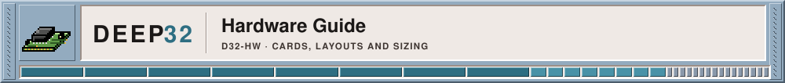

<picture>
  <source media="(prefers-color-scheme: dark)" srcset="figures/head-hardware-dark.svg">
  <source media="(prefers-color-scheme: light)" srcset="figures/head-hardware-light.svg">
  
</picture>
 

What each part of Deep32 needs, and how to size a machine that runs more than one part. The figures come from
`install/matrix.json`, the file both the inventory program and the installer read, so `deep32-inventory` tells you
which rows your machine meets.

Applies to 0.1.0-alpha.2 · [1 Summary](#1-summary) · [2 Processor](#2-processor) · [3 Threads and memory](#3-threads-and-memory) · [4 Disk](#4-disk) · [5 Graphics card](#5-graphics-card) · [6 Hosts](#6-hosts) · [7 Network](#7-network)

## 1. Summary

| Layout | Minimum | Recommended |
|---|---|---|
| Workstation alone (keyword search only) | 64-bit Intel or AMD with virtualization and SLAT · 6 threads · 12 GB · 200 GB | As below |
| Workstation and Forge on one machine | 8 threads · 32 GB · NVIDIA compute capability 7.5+ with 10.5 GB of graphics memory · 200 GB plus the Forge | 12+ threads · 32 GB+ · AVX2 · RTX 20 series or newer with 11 GB+ · SSD |
| Forge alone | 4 threads · 16 GB · the card above | As above |
| Headend | Any PC that runs Claude Code or Codex | Same as minimum |

The Workstation has no model of its own. Meaning search and reranking need a Forge, on the same machine or another;
without one, search works on keywords only.

## 2. Processor

| Processor | Workstation | Forge | Notes |
|---|:---:|:---:|---|
| Intel Core 4th generation on, Xeon E5 v3 on, AMD Ryzen and EPYC (AVX2) | Yes | Yes | The safe class for everything |
| Intel 12th generation on, with fast and efficient cores | Yes | Yes | VMs are sized by the fast cores only |
| Intel Core 2nd and 3rd generation, Xeon E5 v1 and v2 (AVX, no AVX2) | Yes | Expected | My development system's class. The PDF converter's MinerU stage needs AVX2 |
| Other 64-bit Intel or AMD without AVX | Expected | No | The Workstation's programs target the plain 64-bit baseline |
| Low-power chips (Atom, Celeron, Pentium Silver class) | No | No | Too slow for the engine, gateway, desktop and Library in one VM |
| ARM (Apple Silicon, Snapdragon and others) | No | No | Headend only |

A machine that hosts a VM needs virtualization (Intel VT-x or AMD-V) with second-level address translation (Intel EPT
or AMD RVI) switched on in the firmware.

## 3. Threads and memory

Two threads and 4 GB always stay with the host. Threads are counted on the fast cores only.

| Host | What fits | Workstation VM | Forge |
|---|---|---|---|
| Under 8 threads or under 32 GB | The Workstation alone, or a headend | 4 threads · 8 GB | None |
| 8 to 11 threads, 32 GB or more | Both, tight | 4 threads · 8 to 12 GB | 2 to 4 threads · 12 to 16 GB |
| 12 to 15 threads, 32 GB or more | Both, comfortable | 4 to 6 threads · 12 to 16 GB | 4 threads · 16 GB |
| 16 or more threads, 64 GB or more | Both with room | 8 threads · 16 GB | 6 to 8 threads · 16 to 32 GB |

## 4. Disk

| Part | Download | Installed |
|---|---|---|
| Workstation | 21.5 GB: the Workstation image (1.9 GB) and the content image (19.6 GB) | 200 GB guided layout: two system update slots, the Library content and swap. The disc 2 import copies the Library into the Library partition before it installs it, and the layout sizes that partition from the disk |
| Forge | About 37.1 GB: the shared core (18.6 GB), your card's embedder (3.1 to 3.3 GB) and ingestion (15.3 GB) | A declared budget of about 244 to 247 GB, and about 281 to 284 GB free at the start, when the data folder and Docker's storage share one disk; [Installation 5](../INSTALL.md#5-install-the-forge) has the other layouts |

The Forge installer joins the three images into one verified copy before it loads them, so leave room for the
downloads, that copy and the installed services at the same time. The installer checks the free space against the
signed storage budget before it writes anything, and again after it has written the joined copy.

Solid-state storage is strongly recommended for both.

Before a real run, measure the free space on each filesystem the Forge writes to, as the
[per-filesystem storage receipt](PRE-RUN.md#measure-each-backing-filesystem-pr-05) describes. The
[pre-run stop gates](PRE-RUN.md) list the checks a real host still needs before first use.

## 5. Graphics card

The Forge's embedding server is Text Embeddings Inference (TEI) 1.9, built once per card generation. The inventory
reads your card and the installer loads the matching build only.

| Card class | Capability | TEI build | Forge |
|---|:---:|---|---|
| RTX 20 series, Titan RTX, Quadro RTX, T4 | 7.5 | `turing-1.9` | Yes: my development card |
| GTX 16 series, Quadro T series | 7.5 | `turing-1.9` | Expected |
| RTX 30 series, RTX A series | 8.6 | `86-1.9` | Yes |
| A10, A40, A16, A2 | 8.6 | `86-1.9` | Expected |
| A100, A30 | 8.0 | `1.9` | Expected |
| RTX 40 series | 8.9 | `89-1.9` | Yes |
| L4, L40 | 8.9 | `89-1.9` | Expected |
| H100, H200 | 9.0 | `hopper-1.9` | Expected |
| B200, GB200 | 10.0 | `100-1.9` | Expected |
| RTX 50 series | 12.0 | `120-1.9` | Expected |
| Volta, GTX 10 series and older; AMD or Intel graphics | | | No: use a keyword-only Workstation |

**Driver.** NVIDIA 580.65.06 or newer. On Windows the host driver serves Docker Desktop; do not install a Linux graphics
driver inside its WSL 2 backend.

**Docker's image store.** The alpha.2 Forge images load only into Docker's classic image store (`overlay2`), and
Docker Engine 29 and Docker Desktop default to the containerd store. [INSTALL.md](../INSTALL.md#5-install-the-forge)
shows how to switch and what switching hides. Supporting the containerd store is planned.

**Host software.** `deep32-get` needs Python 3.10 or newer, and the Forge installer needs Python 3.12 or newer
(Ubuntu 24.04 ships it). The Forge also needs Docker Engine with the Compose v2
plugin (`docker compose`), the NVIDIA Container Toolkit, and `gpgv` from GnuPG for the signature checks. Install them
from your distribution's packages or the vendors' instructions; `deep32-inventory` lists any that are missing. On
Windows, Docker Desktop provides Compose and the GPU runtime, and Git for Windows provides `gpgv`.

For the Forge's Docker form, Windows uses Docker Desktop's Linux engine with the WSL 2 backend. If the PC already
runs Docker in another WSL distribution, keep integration for an existing production distribution disabled in Docker
Desktop's settings, so the two never share an engine, and leave the PC's own Tailscale setup as it is. The
portable Windows Forge lifecycle is supplied in source; its full run on a Windows host comes after this release.

On an appliance OS that doesn't let you add system packages, put a standalone Python and the Compose plugin in a
folder of your own, and point `PATH` at the Python and `DOCKER_CONFIG` at a folder whose `cli-plugins` holds Compose.
That runs the installer and the models. Pairing is different: the 0.1.0-alpha.2 pairing helper runs on the host's own
`/usr/bin/python3`, which must be Python 3.10+ with `ssl`; `sh install/forge-host-python.sh` checks it.

| GPU host | Install and models | Pairing | Notes |
| --- | --- | --- | --- |
| Ubuntu, Debian, Fedora and other distributions with Python 3.10+ | Yes | Yes | Tested on Ubuntu 24.04 (headend) |
| Unraid 7.4 (tested with an RTX 3080) | Yes | **No** | Its `/usr/bin/python3` can't load `ssl`, and `/usr` is rebuilt at every boot |
| Ubuntu 24.04 on WSL 2 (Windows) | Yes | Yes | Docker Engine inside the distro with systemd on; parts checked on an RTX 2080 Ti, full run after release |
| Windows with Docker Desktop | Yes | Yes | WSL 2 backend; parts checked on an RTX 2080 Ti, full run after release |
| macOS | No GPU form | — | Not supported |

0.1.0-alpha.3 runs the pairing helper with the installer's own Python, which removes the Unraid limit.

**Card memory.**

The 0.1.0-alpha.2 installer needs at least 10.5 GB (10,752 MiB) of graphics memory, which in practice means an 11 GB
card or larger: an RTX 2080 Ti, RTX 3060 12 GB, RTX 3080 12 GB or Ti, RTX 3090, RTX 4070 or larger, and the data-center
cards above. `deep32-setup` checks this before it downloads anything.

| Card memory | What runs |
|---|---|
| 11 GB or more | Both models; the PDF converter one job at a time, pausing the models while it runs and restoring them after |
| 8 to 10 GB | Not installable in alpha.2. Both models fit for search (an RTX 3080 10 GB peaked at 6.6 GB on embeddings); the floor drops once reranking and the converter are measured on these cards |
| 6 GB | Not installable; embeddings only, later |

A locally served language model would need a card of its own; the Forge's card is sized for embeddings and reranking.

## 6. Hosts

| Host | Workstation | Forge | Tested for alpha.2 |
|---|---|---|---|
| Windows 11 Pro, Enterprise or Education | Hyper-V | Docker Desktop with WSL 2 and NVIDIA GPU support, or Docker Engine in an Ubuntu 24.04 WSL 2 distro | Workstation not yet; Forge parts checked, full run after release |
| Linux | KVM | Docker with the NVIDIA Container Toolkit | Yes: a KVM Workstation (Proxmox), an Ubuntu 24.04 headend; the Forge's parts checked, full run after release |
| Windows 11 Home, VirtualBox, VMware, ESXi | VirtualBox, VMware Workstation or ESXi, with the setup wizard's VM guide; on Windows without Hyper-V the wizard writes the raw-image kit | Not supported in this release | Workstation not boot-tested yet on these |
| macOS | Headend only | Headend only | Not yet |

Notes for the Workstation, which runs OpenBSD 8.0:

- On Hyper-V the Workstation VM is Generation 1; OpenBSD does not support Generation 2.
- On KVM use BIOS firmware, IDE disks, VGA display and an e1000 network adapter, as `deep32-get --prepare-vm`
  generates. Give the Workstation a standard VGA display. OpenBSD has a virtio-gpu driver (viogpu(4), since 7.4), but the Workstation desktop has not been tested on it.
- For a physical install, the tested laptop is the Dell Latitude 5430. Other machines run the Workstation as a VM.

## 7. Network

Parts on one machine or one network should reach each other directly. Through Tailscale's relays every search slows
by tens of milliseconds: on my setup node-to-node latency was 70 to 157 ms relayed and 1 to 2 ms direct. Tailscale needs
outbound UDP for direct paths; with UDP blocked it falls back to relays over HTTPS. `tailscale status` shows which path
each link uses.

---

<a href="../README.md">Overview</a> · <a href="../INSTALL.md">Installation</a> · <b>Hardware</b> · <a href="OPTIONAL-FEATURES.md">Optional features</a> · <a href="tr/README.md">Design</a> · <a href="DECISIONS.md">Decision record</a> · <a href="contracts/README.md">Contracts</a> · <a href="../adapters/README.md">Agent adapters</a> · <a href="../SECURITY.md">Security</a> · <a href="../CHANGELOG.md">Release notes</a>

