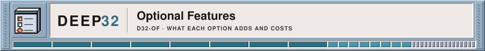

<picture>
  <source media="(prefers-color-scheme: dark)" srcset="figures/head-features-dark.svg">
  <source media="(prefers-color-scheme: light)" srcset="figures/head-features-light.svg">
  
</picture>
 

Every optional feature ships switched off, with no address, key, account or webhook filled in and nothing of mine
preset. This page lists each one, what it contacts when you switch it on, and what a fresh install contacts with all
of them off.

Applies to 0.1.0-alpha.2 · [1 Defaults](#1-defaults) · [2 Features](#2-features) · [3 Commands that reach out](#3-commands-that-reach-out) · [4 Network egress](#4-network-egress)

## 1. Defaults

A feature contacts something only after you set it up and switch it on yourself. The installer never switches one on
for you, and turning a feature off also closes the connections it had open.

## 2. Features

| Feature | Default | What it contacts when on |
|---|---|---|
| [Web switch](#21-web-switch) | Off | Any web address you open in the Workstation's web browser, and the name servers needed to find it |
| Update check | Not in this release | |
| Health pings and phone notifications | Not in this release | |

### 2.1 Web switch

The Workstation's packet filter gives its web browser no route to the internet. The web switch opens one, for the web
browser only; nothing else on the Workstation gains internet access.

| Action | How |
|---|---|
| Turn on | The **Web switch** control on the desktop, or `doas /usr/local/d32/sbin/deep32ctl web direct` from a terminal on the Workstation |
| Turn off | The same control, or `doas /usr/local/d32/sbin/deep32ctl web off`. This closes open connections |
| Check | `doas /usr/local/d32/sbin/deep32ctl web status` prints `OFF` or `DIRECT` |

The switch refuses to change when it is not run from a terminal on the Workstation itself.

## 3. Commands that reach out

Run these commands explicitly. The table lists the service or local resources each one uses.

| Command | What it contacts or uses |
|---|---|
| `bash install/deep32-inventory.sh report --net` | One HEAD request each to github.com, huggingface.co, archive.ubuntu.com, NVIDIA's CUDA package site and login.tailscale.com; asks the GitHub CLI whether it is signed in |
| `bash install/deep32-inventory.sh bench quick` | Nothing outside the machine; about 2 minutes of full processor and disk load |
| `deep32-get` | The release index on GitHub and the image mirrors it lists |
| `deep32 selftest` | The public question set uses your own gateway only. See CHANGELOG.md for this release's limitation. |

## 4. Network egress

With every feature off, a running install contacts the hosts below. The list comes from the Workstation's firewall rules
and what each service needs; I haven't yet captured it with a packet trace.

- **Tailscale's coordination servers**, for sign-in and key exchange, and its relays when no direct path exists.
- **Time servers.**
- **Let's Encrypt**, from the Workstation's Tailscale client, to fetch and renew the HTTPS certificate for the published
  gateway, once you publish it.
- **The model provider** of your agent, from the headend: the question and the retrieved passages.

During installation it also contacts GitHub and the image mirrors. Nothing of mine is contacted: no address, host name,
tailnet, webhook or health-check service.

---

<a href="../README.md">Overview</a> · <a href="../INSTALL.md">Installation</a> · <a href="HARDWARE.md">Hardware</a> · <b>Optional features</b> · <a href="tr/README.md">Design</a> · <a href="DECISIONS.md">Decision record</a> · <a href="contracts/README.md">Contracts</a> · <a href="../adapters/README.md">Agent adapters</a> · <a href="../.github/SECURITY.md">Security</a> · <a href="../CHANGELOG.md">Release notes</a>

